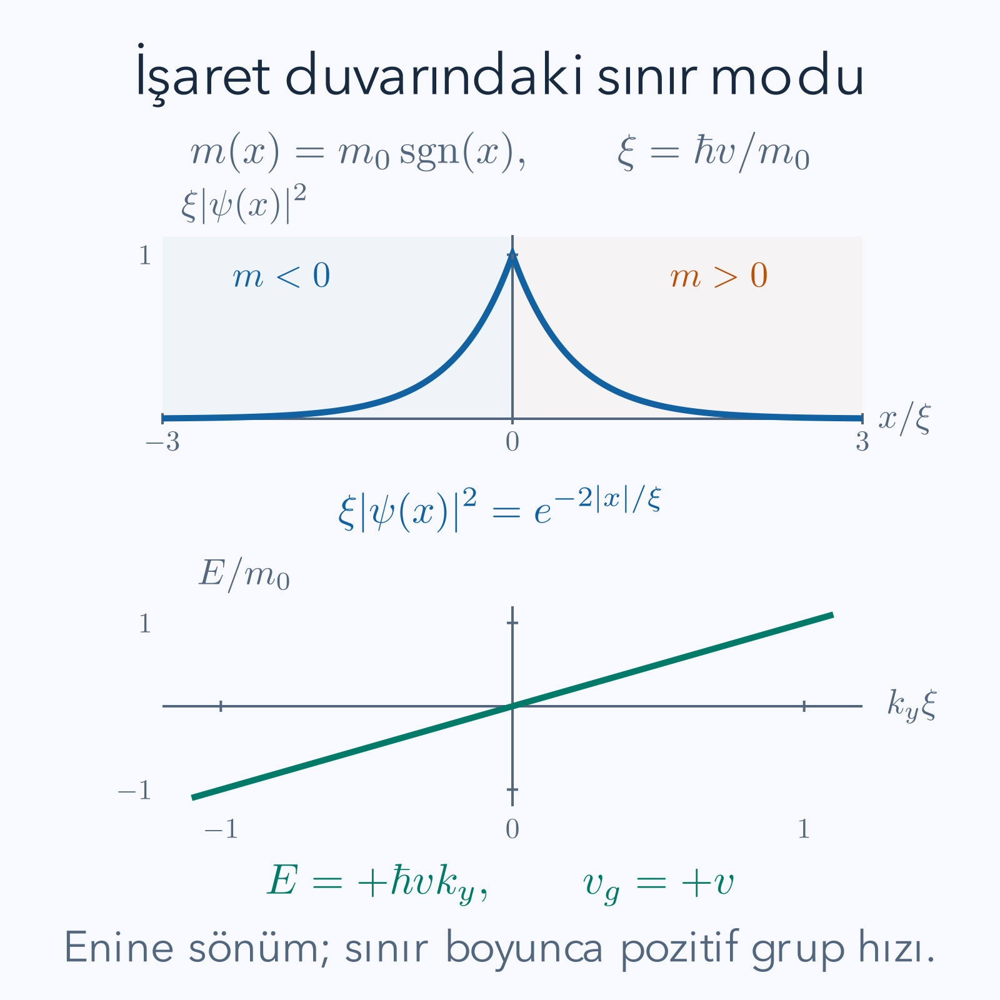

Bir katının iç bölgesi elektrik akımını taşımaya elverişli düşük enerjili durumlar sunmazken sınırında hareket edebilen durumlar bulunabilir. Bu tek başına topoloji değildir; sıradan bir yüzeyde de iletken bir tabaka oluşturabiliriz. Topolojik yalıtkan fikri daha belirli bir ilişki kurar: iç bölgedeki dolu kuantum durumlarının yapısı ve korunmuş simetriler, farklı bir bölgeyle sınırda belirli düşük enerjili durumların ortaya çıkmasını gerektirir. Bu bağı soyut bir adla bırakmak yerine, işaret değiştiren bir katsayının bağladığı dalga fonksiyonunu hesaplayacağız.

Ön bilgilerimiz [enerji bantları](/blog/kristaller-ve-enerji-bantlari/), [Berry fazı ve topolojik bantlar](/blog/berry-fazi-ve-topolojik-bantlar/) ile [SSH modeli](/blog/ssh-modeli-ve-uc-durumlari/). [Kısmi diferansiyel denklemler](/blog/kismi-diferansiyel-denklemler/) uzay türevli denklemlerin anlamını destekler. Matrisler, dalga fonksiyonları ve norm koşulu burada yeniden görünür olacak. Tek bir iki bileşenli Dirac modelinin bütün bir malzemenin topolojik sınıfını tek başına vermediğini özellikle takip edeceğiz.

## 1. İç bölge, sınır ve doluluk

İki boyutlu bir örnek düşünelim. İç bölge, kenardan çok uzakta, hemen hemen öteleme simetrisi olan kısımdır. Sınır bir boyutlu çizgi boyunca uzanır. Üç boyutlu bir malzemede sınır bunun yerine iki boyutlu yüzeydir. Bu geometrik ayrım önemlidir; aşağıda çözdüğümüz çizgisel sınır modunu doğrudan bütün üç boyutlu yüzeylerin nicel hesabı saymayacağız.

İç bölgenin enerji bantlarında bir aralık bulunduğunu ve kimyasal potansiyelin bu aralıkta olduğunu varsayalım. Sıcaklık yeterince düşükken dolu banttan boş banda geçmek enerji gerektirir. Bu yüzden ideal iç bölge düşük enerjili elektrik taşınımına katkı sunmaz. Sınırda aralığın içinden geçen bir enerji dalı varsa kimyasal potansiyel bu dalı kesebilir ve sınır boyunca taşınım mümkün olur. Aralık içinde tek bir yerelleşmiş seviye bulmakla sürekli bir iletim kanalı bulmak aynı şey değildir; sınır boyunca dalga sayısına bağlı bir dal ararız.

Gerçek örnekte kusurlar iç bölgeye ek taşıyıcı katabilir, kimyasal potansiyel aralığın dışında olabilir veya yüzey kirlenebilir. Böyle durumlarda ölçülen iletkenliğin ne kadarının topolojik sınıra ait olduğu ayrıca ayrıştırılır. Matematiksel iç bölge aralığı varsayımı deneyde otomatik gerçekleşmez. Buradaki hedef, ideal mekanizmayı ve onun hangi koşullarda korunacağını açıkça görmek.

## 2. Berry bilgisi neden enerji grafiğinden fazlasıdır?

Dolu bir bant için her dalga vektöründe normalize hücre içi özvektör $|u(\mathbf k)\rangle$ bulunur. Enerji, bu vektörün yönünün bütün momentum uzayında nasıl değiştiğini tek başına söylemez. Berry bağlantısı $\mathcal A_j=i\langle u|\partial_{k_j}u\rangle$, onun eğriliği ise iki boyutta

$$
\Omega=\partial_{k_x}\mathcal A_y-\partial_{k_y}\mathcal A_x
$$

olarak tanımlanır. Kapalı Brillouin bölgesinde izole dolu bantların eğriliği uygun biçimde toplandığında Chern sayısı

$$
C=\frac1{2\pi}\int_{\rm BZ}\Omega(\mathbf k)\,d^2k
$$

elde edilir. Bu tamsayılılığın tam ispatını burada yeniden kurmuyoruz; önceki Berry yazısındaki kapalı bölge ve ayar yamaları koşullarını kullanıyoruz. Dolu ve boş bantların ayrılması esastır. Aralık kapandığında aynı bant alt uzayını sürekli izleme koşulu bozulabilir.

İki tarafın Chern sayısı farklıysa ideal sınırda sağ ve sol hareket eden dalların net sayısı bu farkla ilişkilidir. İşaret, kenarın yönüne ve kullanılan Berry konvansiyonuna bağlıdır. Birazdan belirli bir Dirac Hamiltonyeni için işareti doğrudan hesaplayacağız. Böylece soyut sınıflama ile yerel dalga fonksiyonu arasında bir köprü kuracağız; bu yerel hesabı küresel tamsayı hesabının yerine geçirmeyeceğiz.

## 3. Sınır için iki bileşenli Dirac modeli

Sınır $y$ yönünde düz, değişim $x$ yönünde olsun. $y$ boyunca öteleme simetrisi olduğu için dalga fonksiyonunu $e^{ik_yy}\psi(x)$ yazabiliriz. $k_y$ ters uzunluk biriminde dalga sayısıdır. İki bileşenli etkin Hamiltonyenimiz

$$
H=-i\hbar v\sigma_x\partial_x+\hbar vk_y\sigma_y+m(x)\sigma_z
$$

olsun. Burada $v$ pozitif bir hız, $m(x)$ enerji biriminde bir katsayıdır. $m$ doğrudan kilogram cinsinden parçacık kütlesi değildir. Relativistik benzetmede dinlenim enerjisinin rolünü oynar. $\hbar v$ enerji çarpı uzunluk birimindedir; türev veya dalga sayısıyla çarpınca bütün terimler enerji olur.

Pauli matrisleri

$$
\sigma_x=\begin{pmatrix}0&1\\1&0\end{pmatrix},\quad
\sigma_y=\begin{pmatrix}0&-i\\i&0\end{pmatrix},\quad
\sigma_z=\begin{pmatrix}1&0\\0&-1\end{pmatrix}
$$

iki etkin orbital bileşenine etki eder. Bunlar zorunlu olarak elektronun gerçek spin bileşenleri değildir. İleride zaman tersinmesiyle eşleşen iki kanal eklerken bu alt uzay ile gerçek spin veya Kramers eşini ayrı tutacağız. Her iki bileşenli matrise “spin” deyip aynı fiziksel nesneyi kastetmek kavramları karıştırabilir.

Sabit $m$ için tam düzlem dalgasında türev yerine $ik_x$ gelir. Hamiltonyenin karesi, farklı Pauli matrislerinin antikomütasyonu sayesinde

$$
H(\mathbf k)^2=\left[(\hbar v)^2(k_x^2+k_y^2)+m^2\right]I
$$

olur. Enerjiler bu ifadenin karekökünün artı ve eksi işaretleridir. Momentum sıfırda iki bant arasındaki fark $2|m|$'dir. Dolayısıyla işaret değişse bile uzak iki bölgede enerji aralığı aynı büyüklükte açık kalabilir.

## 4. Önce sınırda sıfır enerjili çözümü bulalım

İlk adımda $k_y=0$ ve $E=0$ alalım. Denklem

$$
[-i\hbar v\sigma_x\partial_x+m(x)\sigma_z]\psi(x)=0
$$

olsun. Soldan $\sigma_x$ ile çarpalım. $\sigma_x^2=I$ ve açık matris çarpımından $\sigma_x\sigma_z=-i\sigma_y$ gelir. Bu yüzden

$$
\begin{aligned}
-i\hbar v\partial_x\psi-im(x)\sigma_y\psi&=0,\\
\hbar v\partial_x\psi+m(x)\sigma_y\psi&=0,\\
\partial_x\psi&=-\frac{m(x)}{\hbar v}\sigma_y\psi.
\end{aligned}
$$

İkinci satıra geçerken ortak $-i$ çarpanını böldük. İşaretin bu aşamada yanlış seçilmesi, normalize edilebilir modu yanlış hareket yönüne yerleştirir. Bu nedenle Pauli çarpımını açık tutmak önemlidir.

$\sigma_y$'nin özdeğeri $s=\pm1$ olan sabit normalize vektörüne $\chi_s$ diyelim. $\psi_s(x)=f_s(x)\chi_s$ yazarsak matris denklemi tek skaler denkleme iner:

$$
\frac{df_s}{dx}=-\frac{s\,m(x)}{\hbar v}f_s,
\qquad
f_s(x)=N\exp\left[-\frac s{\hbar v}\int_0^x m(u)\,du\right].
$$

Çözümü elde etmek için sıfır olmayan $f_s$ ile bölüp $d\ln f_s/dx$ ifadesini integre ettik. $N$ daha sonra normu sağlayacak sabittir. Sıfır çözüm elbette denklemi sağlar ama fiziksel normalize durum değildir. Şimdi hangi $s$ seçiminin iki sonsuz yönde de sönüm verdiğini kontrol etmeliyiz.

## 5. İşaret değiştiren katsayı ve normalizasyon

Keskin fakat ideal bir duvar için $m_0$ pozitif enerji olmak üzere

$$
m(x)=m_0\operatorname{sgn}(x)
$$

alalım. Yani sol taraf eksi, sağ taraf artı katsayıya sahiptir. İntegrali parçalı yapalım. Sağda $\int_0^x m_0du=m_0x$ olur. Solda sınırların ters olması nedeniyle $\int_0^x(-m_0)du=-m_0x=m_0|x|$ çıkar. İki tarafta birlikte integral $m_0|x|$'tir.

Dolayısıyla $s=+1$ seçimi

$$
\psi_0(x)=N e^{-|x|/\xi}\chi_+,
\qquad
\xi=\frac{\hbar v}{m_0},
\qquad
\chi_+=\frac1{\sqrt2}\begin{pmatrix}1\\i\end{pmatrix}
$$

verir. $\sigma_y\chi_+=\chi_+$ ilişkisi doğrudan matrisle çarpılarak denetlenir. Eksi özdeğerli vektör için üstel iki yanda büyürdü ve norm ıraksardı. Normlanabilirlik, işaret seçimini fiziksel olarak belirledi.

$\chi_+$'nın normu bir olduğundan

$$
1=|N|^2\int_{-\infty}^{\infty}e^{-2|x|/\xi}dx
=|N|^2\,2\int_0^\infty e^{-2x/\xi}dx
=|N|^2\xi
$$

olur. Son integral $\xi/2$'dir. Pozitif $N=1/\sqrt\xi$ seçebiliriz. Bu, yalnız enine yöndeki normalizasyondur; sonsuz $y$ düzlem dalgası normalize edilebilir değildir. $y$ doğrultusunu uzunluğu $L_y$ olan periyodik kutuya koyarsak ayrıca $1/\sqrt{L_y}$ çarpanı gerekir. Boyut kontrolünde toplam dalga fonksiyonu ters uzunluk birimi taşır ve alan integrali boyutsuz olasılık verir.

## 6. Sıfır modunu hareketli bir sınır dalına çevirmek

Şimdi aynı enine dalga fonksiyonunu koruyup sıfır olmayan $k_y$ ekleyelim. Sıfır modunu tanımlayan ilk ve üçüncü terimler birbirini zaten götürür. Kalan terim

$$
\begin{aligned}
H\psi_0&=\hbar vk_y\sigma_y\psi_0\\
&=+\hbar vk_y\psi_0
\end{aligned}
$$

olur. Böylece sınır enerjisi ve grup hızı

$$
E_{\rm edge}(k_y)=+\hbar vk_y,
\qquad
u_y=\frac1\hbar\frac{dE_{\rm edge}}{dk_y}=+v
$$

bulunur. Eğimin boyutu enerji çarpı uzunluk olduğundan $\hbar$ ile bölmek hız verir. Her negatif enerjiyi sola hareket olarak yorumlamayız: hareket yönünü enerjinin işareti değil türevin işareti belirler. Bu dalda negatif ve pozitif $k_y$ değerlerinin her ikisinde grup hızı pozitiftir.

Duvarın yönünü ters çevirip solda artı, sağda eksi $m$ alırsak bu kez $s=-1$ normalize edilebilir olur. Aynı türetim $E=-\hbar vk_y$ ve hız $-v$ verir. Böyle bir tek yönlü dalı kiral sınır modu diye adlandırıyoruz. SSH'deki “kiral simetri” ile burada “kiral hareket” aynı tanım değildir; biri bir antikomütasyon koşulu, öbürü hareket yönü hakkındadır.

*Sol panelde yoğunluk $e^{-2|x|/\xi}$ ile, sağ panelde enerji $E=\hbar vk_y$ ile çizildi. Bu işaretler solda negatif, sağda pozitif katsayılı duvar ve yazıdaki Pauli konvansiyonu içindir.*

## 7. Örnek 1: Yerelleşme uzunluğu ve kuyruk olasılığı

Etkin hız $v=5\times10^5\,\mathrm{m/s}$, katsayı büyüklüğü $m_0=0.05\,\mathrm{eV}$ olsun. Bu hız saniyede $5\times10^{14}$ nanometredir. $\hbar=6.582119569\times10^{-16}\,\mathrm{eV\,s}$ ile

$$
\hbar v=(6.582119569\times10^{-16})(5\times10^{14})
\,\mathrm{eV\,nm}=0.32910597845\,\mathrm{eV\,nm}
$$

elde edilir. Enerjiye bölünce $\xi=0.32910597845/0.05\,\mathrm{nm}\approx6.58212\,\mathrm{nm}$ olur. Bu genlik uzunluğudur; yoğunluk iki kat hızlı üstel azalır.

Sınırın her iki yanında $d$ uzaklığının dışında bulunma olasılığını doğrudan integre edelim:

$$
\begin{aligned}
P(|x|>d)&=2\int_d^\infty\frac1\xi e^{-2x/\xi}dx\\
&=2\frac1\xi\frac\xi2e^{-2d/\xi}
=e^{-2d/\xi}.
\end{aligned}
$$

$d=\xi$ için dışarıdaki olasılık $e^{-2}\approx0.135335$'tir; içerideki olasılık yaklaşık yüzde $86.47$ olur. $d=2\xi$ seçersek dış kuyruk $e^{-4}\approx0.018316$'ya düşer. “Dalga fonksiyonu bir uzunluk içinde hapsoldu” ifadesi keskin bir duvar anlamına gelmez; sonsuza uzanan fakat küçük bir kuyruk vardır.

## 8. Örnek 2: Sınır enerjisi, yön ve iç bölgeyle karşılaştırma

Aynı parametrelerde $k_y=0.02\,\mathrm{nm^{-1}}$ seçelim. Sınır enerjisi

$$
E_{\rm edge}=(0.32910597845)(0.02)\,\mathrm{eV}
\approx0.00658212\,\mathrm{eV}
$$

olur; yani yaklaşık $6.58$ milielektronvolt. $k_x=0$ için aynı $k_y$'de iç bölge iletim bandının alt kenarı

$$
E_{\rm bulk,min}(k_y)=\sqrt{m_0^2+(\hbar vk_y)^2}
\approx0.0504314\,\mathrm{eV}
$$

çıkar. Sınır dalı bu sabit $k_y$'de iç bölge sürekliliğinden ayrılmıştır. Bütün momentumlar üzerinden iç bölgenin aralık kenarı ise $0.05\,\mathrm{eV}$'dir. Bu iki farklı karşılaştırmayı ayrı tutmak, hangi “aralık”tan söz ettiğimizi belirler.

$k_y$'yi negatif seçersek enerji negatif olur ama türev yine aynı pozitif sabittir; paket hâlâ artı $y$ yönünde hareket eder. Gerçek bir örgüde dal sonsuza kadar doğrusal sürmez. Büyük dalga sayılarında diğer bantlarla birleşir ve Dirac yaklaşımı geçerliliğini kaybeder. Bu yüzden düşük enerji hesabındaki düz çizgiyi bütün Brillouin bölgesinin eksiksiz spektrumu diye uzatmayız.

## 9. İşaret değişimi olmazsa ne eksilir?

Her iki tarafta $m(x)=m_0$ olsun. Aynı sıfır enerji denemesi $f_s\propto e^{-s m_0x/(\hbar v)}$ verir. $s=+1$ sağa doğru söner ama sola doğru büyür; $s=-1$ bunun tersidir. Sabit $\sigma_y$ özvektörlerinden hiçbirini iki yönde de normalize edemeyiz. Dolayısıyla hesapladığımız tek duvar sıfır modu mekanizması bulunmaz.

Bu sonuç, işaret değiştirmeyen her yüzeyde bütün bağlı durumların imkânsız olduğunu söylemez. Ek bir çekici potansiyel veya başka bantlar sıradan bağlı durumlar üretebilir. Burada yokluğu gösterilen şey, yalnız bu sade Hamiltonyenin sıfır enerjili, iki yanda sönen çözümüdür. Bir iddianın hangi operatör ve hangi enerji için kanıtlandığını belirtmek, topolojik durumları sıradan yüzey tuzaklarıyla karıştırmayı önler.

Keskin adım yerine düzgün geçiş de seçebiliriz. $m(x)=m_0\tanh(x/\ell)$ ve $\ell$ pozitif duvar kalınlığı olsun. İntegral $m_0\ell\ln\cosh(x/\ell)$ olur; çünkü logaritmik kosinüs hiperboliğin türevi hiperbolik tanjanttır. Böylece $s=+1$ çözümü $f\propto[\cosh(x/\ell)]^{-m_0\ell/(\hbar v)}$ olur. Büyük uzaklıkta aynı üstel sönüm geri gelir. Duvarın ayrıntısı profilin merkezini değiştirir ama iki asimptotik işaretin seçtiği normalize edilebilir dalı ortadan kaldırmaz.

## 10. Tek Dirac konisi neden doğrudan bir tamsayı vermez?

Süreklilik modelimiz yalnız belirli bir momentum çevresindeki düşük enerji davranışını yakalar. Chern sayısı ise bütün kapalı Brillouin bölgesinin bilgisidir. Süreklilik düzleminde momentum sınırsızdır; sonsuzdaki davranışı belirtmeden bu düzlemi gerçek kristalin kapalı momentum uzayı yerine koyamayız. İki model düşük enerjide aynı Dirac terimlerini taşıyıp yüksek enerjide farklı tamamlamalara sahip olabilir.

Bu durum hesapta da görünür. Sabit kütleli tek Dirac konisinin alt bandı için yazımızdaki Berry bağlantısı konvansiyonuyla eğrilik

$$
\Omega_-(\mathbf k)=\frac{m(\hbar v)^2}{2[m^2+(\hbar v)^2|\mathbf k|^2]^{3/2}}
$$

olur. Bu formül iki bantlı modelin Berry eğriliğinden gelir; burada ayrıntılı özvektör türetimini tekrarlamıyoruz. Düzlemin tamamında polar koordinatla integre edersek $b=\hbar v$ diyerek

$$
\begin{aligned}
\frac1{2\pi}\int\Omega_-d^2k
&=\frac{mb^2}{2}\int_0^\infty
\frac{k\,dk}{(m^2+b^2k^2)^{3/2}}\\
&=\frac m4\int_{m^2}^\infty u^{-3/2}du
=\frac m{2|m|}
\end{aligned}
$$

buluruz. Değişken dönüşümünde $u=m^2+b^2k^2$, $du=2b^2k\,dk$ kullandık. Yarım sayı çıkması gerçek örgünün Chern sayısının yarım tamsayı olduğunu göstermez; tek konili yaklaşımın eksik küresel bilgisini gösterir. Örgüde diğer momentum bölgeleri katkıyı tamamlar. İşaret değişimindeki fark bir olur; bulduğumuz tek sınır dalıyla tutarlı olan yerel bilgi budur.

## 11. Zaman tersinmesi ve Kramers çifti

Kiral bir kanal tek yönde ilerler. Zaman tersinmesi ise hareket yönünü ve gerçek spin açısal momentumunu tersine çevirir. Spin yarım parçacıklarda zaman tersinmesi operatörü $T$ antiüniterdir ve $T^2=-I$ sağlar. Antiüniterlik, karmaşık katsayıları eşlenikleyerek dönüştürmesi demektir. Zaman tersinmesini koruyan Hamiltonyende bir durumun $T$ eşi aynı enerjiye sahiptir; kendiyle eşleştiği momentumlarda iki durum ortogonaldir. Bu Kramers çiftidir.

Tek kiral dalın zaman tersini ekleyelim. Biri sağa, diğeri sola hareket eden çift oluşur. Çiftin uzayında yeni Pauli matrislerine $s_j$ diyelim; bunlar önceki orbital matrisleri $\sigma_j$ ile aynı alt uzayda değildir. En sade helisel kenar Hamiltonyeni

$$
H_{\rm hel}(k_y)=\hbar vk_y s_z,
\qquad T=i s_y K
$$

olur; $K$ karmaşık eşleniklemedir. $T s_zT^{-1}=-s_z$ ve $k_y\mapsto-k_y$ olduğundan dönüşen Hamiltonyen aynı fiziksel denklemi verir. İki eksi işaret birbirini karşılar. Helisel sözcüğü burada karşıt yönlerin Kramers eşleriyle bağlanmasını anlatır; gerçek malzemede spin her zaman sabit bir eksen boyunca tam korunmak zorunda değildir.

## 12. Örnek 3: Aynı enerjide ters yönlü iki kanal

Aynı hızla $k_0=0.02\,\mathrm{nm^{-1}}$ alalım. $s_z=+1$ kanalının $k_y=+k_0$ durumunda enerji $+6.58212$ milielektronvolt, grup hızı $+v$ olur. Zaman ters eşi $s_z=-1$ kanalında $k_y=-k_0$'dadır. İki eksi işaret nedeniyle enerjisi yine pozitif aynı sayıdır, fakat hız $-v$'dir.

Bu iki duruma aynı enerjili geri saçılma adayı gözüyle bakabiliriz. İdeal tek Kramers çiftinde, zaman tersinmesini koruyan statik tek parçacık bozuntusu bunların arasında elastik geri saçılma matris elemanı üretemez. Bu yalnız “spin çevirmek pahalıdır” açıklamasına dayanmaz; spin korunmasa da antiüniter simetri kısıtı geçerlidir. Bununla birlikte başka kanallar, çok parçacıklı etkileşimler veya zamanla değişen çevre yeni süreçler açabilir.

Genel yasağın kısa cebirsel gerekçesini de gösterelim. $V$ Hermit bir tek parçacık bozuntusu olsun ve zaman tersinmesini korusun, yani $TV=VT$ olsun. Antiüniterlik, herhangi iki vektör için $\langle T\alpha|T\beta\rangle=\langle\beta|\alpha\rangle$ özdeşliğini verir. Geri saçılma genliği $M=\langle T\psi|V\psi\rangle$ olsun. Bu özdeşlikte $\alpha=V\psi$, $\beta=T\psi$ seçersek

$$
\begin{aligned}
M&=\langle TV\psi|T^2\psi\rangle\\
&=-\langle VT\psi|\psi\rangle\\
&=-\langle T\psi|V\psi\rangle=-M
\end{aligned}
$$

buluruz. İkinci satırda $T^2=-I$ ve simetriyi, üçüncü satırda Hermitliği kullandık. Bir karmaşık sayı kendi eksisine eşitse sıfırdır; dolayısıyla bu eşe elastik geçiş genliği kaybolur. Kanıtın antiüniter özelliğe dayanması, sabit bir spin ekseninin korunmasını ayrıca varsaymadığımızı açıklar. İspat tek çiftin iki eşini ele alır; başka kanallara geçişleri veya çok parçacıklı saçılmayı bu tek matris elemanıyla elemiş olmayız.

Basit matris örneği sınırı görünür yapar. $V_0I$ skaler potansiyel iki ideal kanal arasında köşegen olmayan eleman taşımaz. Buna karşılık $M s_x$ terimi onları karıştırır; fakat $T s_xT^{-1}=-s_x$ olduğu için sabit gerçek $M$ ile bu terim zaman tersinmesini bozar. Yeni enerji hesabında

$$
(H_{\rm hel}+Ms_x)^2=[(\hbar vk_y)^2+M^2]I
$$

olur ve enerjiler $\pm\sqrt{(\hbar vk_y)^2+M^2}$ çıkar. $k_y=0$'da tam aralık $2|M|$'dir. $M=0.002\,\mathrm{eV}$ için dört milielektronvoltluk aralık açılır. Bu sayısal sonuç, koruyucu simetri kırıldığında “sınır her koşulda iletkendir” iddiasının neden geçerli olmadığını gösterir.

## 13. Z2 sınıflaması neyi ayırır?

Zaman tersinmesini koruyan iki boyutlu spinli yalıtkanlarda toplam Chern sayısı sıfır olabilir. Karşıt eşlerin katkıları birbirini götürür; buna rağmen sistem sıradan yalıtkandan farklı olabilir. Bu durumda uygun sınıflama $\mathbb Z_2$ ile ifade edilir. Giriş düzeyindeki anlamı tek ve çift Kramers çifti ayrımıdır: tek sayılı bir sınır çifti, simetriyi koruyup iç bölge aralığını kapatmadan tamamen giderilemez.

İki çift varsa kanalların farklı çiftler arasında eşleşip aralık açması mümkün olabilir; tek çiftte izinli eşleşmeler daha kısıtlıdır. Bu açıklama sınıflamanın sezgisidir. Burada genel $\mathbb Z_2$ değişmezinin Pfaffian veya Wilson döngüsü hesabını türetmedik. Tek bir Dirac duvar çözümünden bir malzemenin kesin $\mathbb Z_2$ değerini çıkarmayacağız. Bunun için bütün dolu bantlar ve zaman tersinmesinin bu bantlara etkisi incelenmelidir.

Topolojik ayrım belirli varsayımlar altında deformasyonlara dayanıklılık anlatır. İç bölge aralığı kapanırsa faz geçişi mümkündür. Koruyucu simetri bozulursa önce ayrı duran sınıflar bağlanabilir veya sınırda aralık açılabilir. Bu koşulları yazmak topolojiyi güçsüzleştirmez; hangi fiziksel değiştirmelerin sonuca etki edip etmeyeceğini söyler. “Kusur var ama aynı sınıftayız” ifadesinin içeriği, kusurun hangi nicelikleri koruduğuyla belirlenir.

## 14. Dar örnekler, sıcaklık ve gerçek ölçüm

Örnek çok dar bir şerit olduğunda iki karşı kenarın dalga fonksiyonları üst üste gelebilir. Tek bir izole kenar hesabında ihmal ettiğimiz karşı kenar bu durumda ek eşleşme sunar. Örtüşme, şerit genişliği sönüm uzunluğundan çok büyükse üstel küçülür. Bu yüzden küçük bir cihazda ölçülen küçük aralık, bütün iç bölge topolojisinin kaybolduğunu otomatik göstermez; önce sonlu boyut etkisi incelenir.

Sıcaklık enerji aralığıyla karşılaştırılmalıdır. Termal enerji $k_BT$ iç bölge aralığına göre büyükse iç bölge taşıyıcıları uyarılır ve sınırın katkısı baskın olmaktan çıkabilir. Kusurların oluşturduğu yük gölcükleri, kontak direnci ve inelastik saçılma da ölçülen iletkenliği değiştirir. Topolojik sınıflama, deneyde her sıcaklık ve örnek boyutu için sıfır direnç vaat etmez. Özellikle bir topolojik yalıtkan ile süperiletken aynı şey değildir.

Etkileşimler çok kuvvetliyse tek parçacık bant resmi yetersiz kalabilir. Bazı süreçler korunan simetriyi kendiliğinden kırabilir, bazıları ise daha zengin çok parçacıklı fazlar oluşturabilir. Burada kullandığımız tek elektron Hamiltonyeni bu sonuçları kendi başına kapsamaz. Yine de temel çıkarım kesindir: işaret değiştiren katsayı için normlanabilir bir enine çözüm bulduk ve onun sınır boyunca enerji eğimini hesapladık. Küresel sınıflama bu somut çözümün hangi deformasyonlarda kalıcı olduğunu açıklar.

## 15. Düzgün duvarın tam normlanan özel hali

Keskin duvarın fiziksel ayrıntılarını değiştirdiğimizde hangi kısmın kaldığını somut bir özel durumda kontrol edelim. Önceki düzgün profilde duvar kalınlığını $\ell=\hbar v/m_0=\xi$ seçersek üstelin kuvveti tam bir olur. Enine dalga fonksiyonu $f(x)=N/\cosh(x/\ell)$, yoğunluğu ise $|N|^2\operatorname{sech}^2(x/\ell)$ olur. Hiperbolik sekant, kosinüs hiperboliğin tersidir; burada yeni bir olasılık yorumu değil, farklı bir uzaysal profil söz konusudur.

Normalizasyon integralini hazır bir sayı olarak almayalım. Değişkeni $z=x/\ell$ seçince $dx=\ell dz$ olur. $d\tanh z/dz=\operatorname{sech}^2z$ ve hiperbolik tanjantın iki sonsuzdaki limitleri artı ve eksi birdir. Dolayısıyla

$$
\int_{-\infty}^{\infty}|f(x)|^2dx
=|N|^2\ell[\tanh z]_{-\infty}^{\infty}
=2\ell|N|^2
$$

çıkar. Birim norm için $N=1/\sqrt{2\ell}$ seçilir. Keskin duvarda aynı uzak kuyruk uzunluğu için merkez yoğunluğu $1/\xi$ idi; düzgün duvarda $1/(2\ell)$ oldu. Yani topolojik ilişki mikroskobik yoğunluğun her noktada aynı kalacağını söylemez. Profilin merkezi gözle görülür biçimde değişirken sınırın hareket yönü ve düşük enerji dalının varlığı korunabilir.

Bu düzgün profilde $|x|>d$ olasılığı $1-\tanh(d/\ell)$'dir. $d=\ell$ için yaklaşık $0.238406$ çıkar; keskin profildeki yüzde on üçten büyüktür. Fark, duvar çevresinde daha geniş dağılan yoğunluktan gelir. Buna rağmen büyük uzaklıklarda iki profilin genliği aynı sönüm uzunluğuna sahiptir. Tek bir “yerelleşme uzunluğu” sayısı bütün dağılımı belirlemez; merkez biçimi ve normalizasyon da gerekir.

Ayrıca sıfır modunun hareketli dala dönüşmesi bu profilde de aynı adımlarla gerçekleşir. Enine denklem ilk ve üçüncü Hamiltonyen terimini sıfırlar; kalan $\sigma_y$ terimi yine aynı özdeğeri verir. Böylece duvarın keskinliğine ait özel bir cebir hilesiyle iletken dal üretmediğimizi kontrol etmiş olduk. Bunun tersine çok dar bir duvarda kristalin örgü ölçeğine inersek sürekli ortam yaklaşımını ayrıca sorgulamalıyız. Matematiksel keskin sınır çözümü tanımlıdır fakat gerçek atomik yapı için ek bant ve sınır terimleri gerekebilir.

## 16. Kaynaklar ve doğrulanan sınır

[Topology in Condensed Matter, Haldane modeli](https://topocondmat.org/w4-haldane/haldane-model/) kütle işareti, Chern bilgisi ve kiral sınır ilişkisini ele alır. [Aynı dersin zaman tersinmesi ve Kramers çiftleri bölümü](https://topocondmat.org/w5-qshe/fermion-parity-pump/) helisel kenarların simetri koşullarını açıklar. [Asbóth, Oroszlány ve Pályi'nin açık ders kitabı](https://arxiv.org/pdf/1509.02295) örgü, sürekli ortam ve sınır durumlarını birlikte inceler. Buradaki Dirac çözümü belirtilen Pauli işaretleriyle türetildi; yerelleşme, enerji ve manyetik karışma örnekleri bu tek konvansiyonda hesaplandı.
