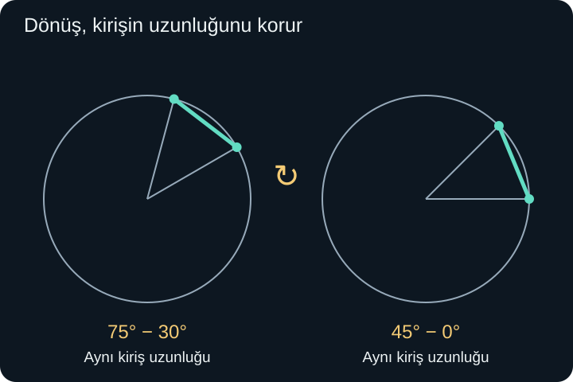
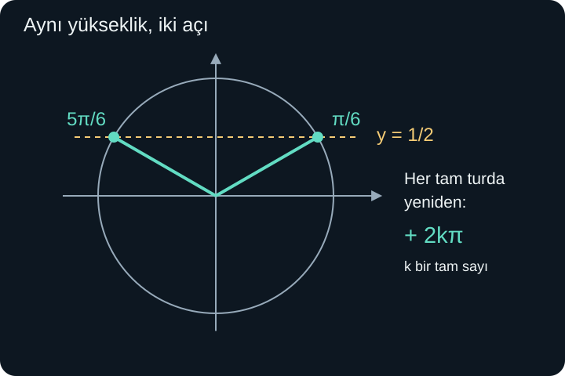

import ArticleVideo from '@/components/ArticleVideo.astro'
import kavram from './media/01-kavram.mp4?url'
import kavramPoster from './media/01-kavram.jpg?url'

30 derecelik bir dönüşün ardından 45 derece daha dönersek toplam dönüş 75 derece olur. Açıları toplamak kolaydır. Peki yeni konumun yüksekliğini bulmak için iki açının sinüslerini de doğrudan toplayabilir miyiz?

Denersek $\sin30^\circ+\sin45^\circ=1/2+\sqrt2/2$ buluruz. Bu sayı 1'den büyüktür. Oysa birim çember üzerindeki hiçbir noktanın yüksekliği 1'i aşamaz. Demek ki açı toplamı ile sinüs değerlerinin toplamı farklı şeylerdir. Yeni açının sinüsünü hesaplamak için, iki dönüşün yatay ve düşey etkilerini birlikte hesaba katmalıyız.

[Önceki yazıda](/blog/birim-cember-radyan-ve-trigonometrik-grafikler/) birim çemberde yatay koordinatın kosinüs, düşey koordinatın sinüs olduğunu gördük. Burada bunlara koordinat düzleminde uzaklık, iki kare toplamı, çarpanlara ayırma ve denklem çözme bilgimizi ekleyeceğiz. Vektörleri veya matrisleri henüz kullanmayacağız. Derece yazılmayan açılar radyanla ölçülecek; $\pi$ radyan ile $180^\circ$ aynı dönüşü gösterecek.

## 1. Bir Özdeşlik Ne Söyler?

$$
\sin^2x+\cos^2x=1
$$

Buradaki $\sin^2x$, $(\sin x)^2$ demektir; açının karesinin sinüsü değildir. Eşitlik, birim çemberin $x$ açısındaki noktasına Pisagor uygulanmasından gelir. Açı hangi gerçek sayı olursa olsun geçerlidir. Böyle bir eşitliğe **özdeşlik** deriz.

Buna karşılık $\sin x=1/2$ eşitliği her açı için doğru değildir. Söz gelimi $x=0$ için sol taraf 0'dır. Bu kez eşitliği sağlayan açıları ararız; elimizde bir **denklem** vardır. Aynı eşitlik işareti kullanılmasına rağmen, yaptığımız iş değişir: özdeşlikte iki ifadenin aynı değeri verdiğini gösterir, denklemde hangi girdilerin eşitliği sağladığını buluruz.

Özdeşliklerin de tanım koşulları vardır. $\tan x=\sin x/\cos x$ eşitliği ancak $\cos x\ne0$ olduğunda anlamlıdır. “Her açı için doğru” yerine, gerektiğinde “iki tarafın da tanımlı olduğu bütün açılar için doğru” dememiz gerekir. Tanımsız bir ifadeyi eşitliğe yazmak onu tanımlı hâle getirmez.

Bir özdeşliği kanıtlarken aradığımız sonuç baştan doğruymuş gibi kullanılamaz. Örneğin $\sin^2x+\cos^2x=1$ eşitliğinin iki tarafını aynı biçime getirmek istiyorsak dayanağımız çemberin uzaklık eşitliği olabilir. Yalnız eşitliğin iki tarafından aynı ifadeyi çıkarıp sonunda $0=0$ yazmak, başlangıçtaki adımların hangi koşullarda geri alınabildiği açıklanmadan tek başına gerekçe oluşturmaz. Her geçişte bilinen bir eşitlik veya geçerli bir cebir kuralı kullanmalıyız.

Sayısal deneme ise başka işe yarar. $x=0$ ve $x=\pi/2$ seçmek, önerilmiş bir formülün bariz işaret hatasını gösterebilir. Bir karşı örnek genel iddiayı çürütmeye yeterlidir; birkaç doğru örnek ise bütün gerçek açılarda doğru olduğunu kanıtlamaz. Bu yazıda geometrik türetimlere yer vermemizin nedeni tam olarak budur. Hesap kontrolü, uzun bir işlemin sonucunu sınar; ispat, bütün uygun girdileri neden kapsadığımızı açıklar. İkisini birbirini tamamlayan fakat farklı görevler olarak kullanacağız.

## 2. Dönüş Bir Uzaklığı Değiştirmez

Kosinüsün fark bağıntısını, aynı doğru parçasının uzunluğunu iki farklı konumda hesaplayarak kurabiliriz. Birim çember üzerinde açıları $a$ ve $b$ olan iki noktayı seçelim. $a$ ve $b$ burada iki gerçek açı ölçüsünü temsil eder. Noktalara $P$ ve $Q$ dersek koordinatları:

$$
P=(\cos a,\sin a),\qquad Q=(\cos b,\sin b)
$$

olur. İki nokta arasındaki doğru parçasına **kiriş** denir. Uzaklığın karesini $d^2$ ile gösterelim. Koordinat farklarına Pisagor uygularız:

$$
d^2=(\cos a-\cos b)^2+(\sin a-\sin b)^2.
$$

Her parantezin karesini açalım. Kosinüslerden $\cos^2a-2\cos a\cos b+\cos^2b$, sinüslerden $\sin^2a-2\sin a\sin b+\sin^2b$ gelir. Aynı açıya ait kareleri yan yana getirince:

$$
d^2=2-2\cos a\cos b-2\sin a\sin b.
$$

Buradaki 2, iki ayrı birim yarıçapın karelerinden geldi: $\cos^2a+\sin^2a=1$ ve $\cos^2b+\sin^2b=1$.

Şimdi bütün şekli merkez çevresinde $-b$ açısı kadar döndürelim. $Q$ noktası $(1,0)$ konumuna gelir. $P$ ise açısı $a-b$ olan konuma taşınır. Bir şekli katı biçimde döndürmek uzunluklarını değiştirmez; bu, düzlem geometrisindeki eşlik düşüncesidir. Dolayısıyla aynı $d$ uzaklığını yeni konumda da hesaplayabiliriz:

$$
d^2=(\cos(a-b)-1)^2+\sin^2(a-b).
$$

Kareyi açınca $\cos^2(a-b)-2\cos(a-b)+1+\sin^2(a-b)$ elde edilir. İki kare toplamı yine 1 olduğundan:

$$
d^2=2-2\cos(a-b).
$$

Aynı uzunluğun karesini iki biçimde bulduk. Sağ tarafları eşitleyip her iki taraftan 2 çıkaralım; sonra sıfırdan farklı olan $-2$'ye bölelim:

$$
\boxed{\cos(a-b)=\cos a\cos b+\sin a\sin b.}
$$

Çizimde iki dar açı gösterilmiş olması, sonucun yalnızca dar açılara ait olduğu anlamına gelmez. Koordinatlar işaretli gerçek sayılardır; dönüş ve uzaklık hesabı bütün yönlü açılar için çalışır. Böylece tek bir şeklin görünüşüne bağlı bir varsayım yapmadan genel bağıntıya ulaştık.

Bu ispatta dönüşü hangi bilgiyle kullandığımızı ayıralım. Açısı $b$ olan ışını $-b$ kadar döndürünce başlangıç ışınına getiririz; aynı dönüş diğer ışının açısını $a-b$ yapar. Bu, yönlü açıların toplanmasıdır. Yeni noktanın koordinatlarını $(\cos(a-b),\sin(a-b))$ yazmamızsa birim çemberdeki tanımın doğrudan kullanımıdır. Henüz bu koordinatların $\cos a$, $\sin a$, $\cos b$, $\sin b$ ile nasıl yazıldığını bilmiyoruz; tam olarak bunu uzaklık eşitliğinden çıkarıyoruz.

Böylece kanıtlamak istediğimiz toplam veya fark formülünü döndürme adımına gizlice yerleştirmedik. Uzunluğun değişmemesi, katı döndürmenin eşliği korumasına dayanır. İşlemin sonunda örneğin $a=b$ seçersek iki nokta aynı olur, kiriş uzunluğu sıfırdır. Bulduğumuz eşitlik de $\cos0=\cos^2a+\sin^2a=1$ verir. $b=0$ seçilirse formül $\cos a=\cos a$ hâline gelir. Bunlar genel ispatın yerine geçmez, fakat özel durumlarda şekil ile hesabın birbirini doğruladığını gösterir.

## 3. Toplam ve Fark Formülleri

Birim çemberde yatay eksene göre yansıma, açıyı $b$'den $-b$'ye götürür. Yatay koordinat değişmez, düşey koordinatın işareti değişir. Bu nedenle $\cos(-b)=\cos b$ ve $\sin(-b)=-\sin b$ olur.

Kosinüs fark bağıntısında $b$ yerine $-b$ yazalım. Solda $a-(-b)=a+b$ kalır; sağdaki sinüs çarpımı eksi işareti kazanır:

$$
\boxed{\cos(a+b)=\cos a\cos b-\sin a\sin b.}
$$

Sinüs formülünü de aynı geometriden çıkarabiliriz. Birim çemberde $\sin t=\cos(\pi/2-t)$ ilişkisi vardır. Buradaki $t$ herhangi bir açıdır; çeyrek turla ilişkilenen iki noktanın yatay ve düşey koordinatları yer değiştirir. Bu ilişkinin bütün açılarda geçerli olmasını, birim çemberi $y=x$ doğrusuna göre yansıtarak da görebiliriz. Bu yansıma $(x,y)$ koordinatlarını $(y,x)$ yapar. $t$ açılı noktanın görüntüsü $\pi/2-t$ açısına karşılık gelir; yatay ve düşey koordinatlar yer değiştirdiğinden $\cos(\pi/2-t)=\sin t$ ve $\sin(\pi/2-t)=\cos t$ olur. Yansıma yalnız birinci bölgeye özgü değildir; işaretli koordinatlarla bütün çemberde tanımlıdır. Dolayısıyla dar dik üçgendeki tümler açı kuralını burada gerekçesiz biçimde büyük açılara taşımıyoruz.

Dolayısıyla:

$$
\sin(a+b)=\cos\bigl((\pi/2-a)-b\bigr).
$$

Sağa az önce kanıtladığımız kosinüs fark bağıntısını uygularsak $\cos(\pi/2-a)\cos b+\sin(\pi/2-a)\sin b$ çıkar. İlk çeyrek tur ilişkisi $\sin a$, ikincisi $\cos a$ olduğundan:

$$
\boxed{\sin(a+b)=\sin a\cos b+\cos a\sin b.}
$$

Burada da $b$ yerine $-b$ yazınca:

$$
\boxed{\sin(a-b)=\sin a\cos b-\cos a\sin b.}
$$

Bu dört bağıntıyı işaretleriyle birlikte okumak gerekir. Kosinüs toplamında eksi, kosinüs farkında artı vardır. Sinüste ise açıların arasındaki işaret iki çarpımın arasında korunur. İşaretleri ezberlerken tereddüt edersek, $a=b$ seçerek küçük bir kontrol yapabiliriz: kosinüs farkı 1 vermeli, sinüs farkı 0 olmalıdır.

### Bilinen açılardan yeni bir değer

$75^\circ=45^\circ+30^\circ$ olduğuna göre:

$$
\sin75^\circ
=\frac{\sqrt2}{2}\frac{\sqrt3}{2}
+\frac{\sqrt2}{2}\frac12
=\frac{\sqrt6+\sqrt2}{4}.
$$

Bu yaklaşık $0{,}966$'dır ve beklediğimiz gibi 1'den küçüktür. Kosinüste aynı iki çarpımı çıkarırız:

$$
\cos75^\circ=\frac{\sqrt6-\sqrt2}{4}\approx0{,}259.
$$

Tam değer köklü ifadedir; ondalık sayı yuvarlanmış bir yaklaşımdır. Ayrıca $75^\circ$ birinci bölgede bulunduğu için hem sinüs hem kosinüs pozitif çıkmalıdır. İşaret kontrolü, uzun bir işlemin sonunda basit ama etkili bir denetim sağlar.

<ArticleVideo src={kavram} poster={kavramPoster} title="İki açının toplamı ve çemberdeki koordinatlar" caption="30 derecelik dönüşe 45 derece eklenince 75 dereceye ulaşılır. Yeni noktanın yatay ve düşey koordinatları birlikte değişir." />

### Tanjant toplamı hangi koşullarda kullanılır?

$\tan(a+b)$ için sinüs toplamını kosinüs toplamına böleriz. Ardından pay ve paydayı $\cos a\cos b$ ile bölersek:

$$
\tan(a+b)=\frac{\tan a+\tan b}{1-\tan a\tan b}.
$$

Bu yazım için $\cos a$ ve $\cos b$ sıfır olmamalıdır. Son payda da sıfır olamaz; bu koşul toplam açının tanjantının tanımlı olmasını sağlar. Örneğin $a=b=45^\circ$ seçildiğinde payda $1-1=0$ olur. Bu bir hesap kazası değildir: toplam $90^\circ$'dir ve tanjantı tanımsızdır.

Fark formülünde benzer biçimde $\tan(a-b)=(\tan a-\tan b)/(1+\tan a\tan b)$ elde edilir. Yine iki ayrı tanjantın ve son bölümün tanımlı olması gerekir. Sinüs ve kosinüs toplamları bu ek bölme kısıtlarına ihtiyaç duymaz.

Tanjant toplamındaki iki kesrin nasıl oluştuğunu açalım. Sinüs ve kosinüs toplamlarının bölümünde payın ilk terimini $\cos a\cos b$ ile böldüğümüzde $\sin a/\cos a=\tan a$ kalır. Payın ikinci terimi aynı yolla $\tan b$ olur. Paydanın ilk terimi kendi kendine bölününce 1, ikinci terimi ise:

$$
\frac{\sin a\sin b}{\cos a\cos b}
=\tan a\tan b
$$

verir. Önündeki eksi işaretini koruyunca son payda $1-\tan a\tan b$ olur. Her terimi aynı sıfırdan farklı ifadeye bölmemiz, bölümün değerini değiştirmez. Koşulların neden ayrı ayrı yazıldığı böylece görünür olur.

Örneğin $a=30^\circ$, $b=45^\circ$ için toplam açı 75 derecedir. Pay $1/\sqrt3+1$ pozitif, payda $1-1/\sqrt3$ de pozitiftir; tanjantın pozitif olması birinci bölgeyle uyumludur. Paydanın eksi işaretini yanlışlıkla artı yapsaydık aynı geometrik açıyı anlatmayan başka bir oran bulurduk. İşaret kontrolü, formüldeki her terimin türetimdeki yerini hatırlatır.

## 4. İki Kat Açı Yeni Bir Konu Değil

Toplam bağıntılarında iki açıyı eşit seçelim: $b=a$. Böylece:

$$
\sin2a=2\sin a\cos a
$$

ve

$$
\cos2a=\cos^2a-\sin^2a
$$

çıkar. İlk formülde aynı çarpım iki kez toplanır. İkincide iki farklı kare çıkarılır. Bu nedenle genel olarak $\sin2a=2\sin a$ diyemeyiz; sağ tarafta bir de $\cos a$ çarpanı bulunmalıdır.

$\sin^2a+\cos^2a=1$ ilişkisini kullanarak kosinüs formülünü iki başka biçimde yazabiliriz:

$$
\cos2a=1-2\sin^2a=2\cos^2a-1.
$$

Örneğin $\sin^2a=(1-\cos2a)/2$ ifadesi, aynı eşitliği sinüsün karesi için çözmektir. Yeni bir ezber gerektirmez: önce $2\sin^2a=1-\cos2a$, sonra ikiye bölme gelir.

Birinci bölgede $\sin a=3/5$ verilsin. Önce $\cos^2a=1-9/25=16/25$ buluruz. Bölge kosinüsün pozitif olduğunu söylediği için $\cos a=4/5$ seçeriz. Ardından $\sin2a=2(3/5)(4/5)=24/25$ ve $\cos2a=16/25-9/25=7/25$ çıkar. İki değerin kareleri toplamı $(576+49)/625=1$ olduğundan çember koşulu da sağlanır.

İki kat açının bölgesini, başlangıç açısının bölgesiyle otomatik olarak aynı sayamayız. Birinci bölgede bulunan 60 derecenin iki katı 120 derecedir ve ikinci bölgededir. Formüller bunu doğru taşır: $\sin120^\circ=2(\sqrt3/2)(1/2)=\sqrt3/2$ pozitifken, $\cos120^\circ=2(1/2)^2-1=-1/2$ negatiftir. Başlangıçta iki değer de pozitif olsa bile yeni kosinüsün işareti değişebilir.

Bu örnek $\sin2a$ ile $2\sin a$ ayrımını da denetler. $a=60^\circ$ için $2\sin a=\sqrt3$ sayısı 1'den büyüktür; herhangi bir açının sinüsü olamaz. Eksik $\cos a$ çarpanı olmadan yazılan kuralın neden geçersiz olduğunu yalnız sembollerle değil, mümkün çıktı aralığıyla da görürüz. İki kat açı bağıntıları yeni açının koordinatlarını verir; eski koordinatları yalnız ikiyle çarpmak birim çemberin dışına taşır. Dönüşte ise noktanın merkeze uzaklığı 1 olarak kalmalıdır.

## 5. Yarım Açıda İşareti Kim Belirler?

İki kat açı bağıntısında $a$ yerine $x/2$ yazarsak:

$$
\begin{aligned}
\sin^2(x/2)&=\frac{1-\cos x}{2},\\
\cos^2(x/2)&=\frac{1+\cos x}{2}.
\end{aligned}
$$

Karelerden fonksiyon değerlerine geçerken işaret bilgisi gerekir:

$$
\sin(x/2)=\pm\sqrt{\frac{1-\cos x}{2}},
$$

$$
\cos(x/2)=\pm\sqrt{\frac{1+\cos x}{2}}.
$$

Buradaki artı-eksi, sinüs veya kosinüsün aynı anda iki değer aldığı anlamına gelmez. **Verilen açı için tek doğru işaret vardır; onu yarım açının bulunduğu bölge belirler.** Karekök sembolü kendi başına sıfır veya pozitif değeri verdiğinden, negatif değer gerekiyorsa dışarıya eksi yazılır.

Örneğin $x=240^\circ$ olsun. $x/2=120^\circ$ ikinci bölgededir: sinüs pozitif, kosinüs negatiftir. $\cos240^\circ=-1/2$ olduğundan:

$$
\sin120^\circ=+\sqrt{\frac{1+1/2}{2}}
=\sqrt{\frac34}=\frac{\sqrt3}{2},
$$

$$
\cos120^\circ=-\sqrt{\frac{1-1/2}{2}}
=-\sqrt{\frac14}=-\frac12.
$$

İşareti $240^\circ$'nin bölgesine göre seçmek yanlış olurdu. Formülde aradığımız değerler $120^\circ$'ye aittir. Aynı şekilde, yalnızca $\cos x$ verilmesi yarım açıların işaretlerini her zaman belirlemeye yetmez; açının aralığı da gerekebilir.

Yarım açı hesabında aynı son ışına sahip iki açının yarılarının aynı son ışına sahip olmayabileceğine dikkat edelim. 240 ve 600 derece arasında bir tam tur vardır; kosinüsleri aynıdır. Ancak yarıları 120 ve 300 derecedir. Birincisinde sinüs pozitif ve kosinüs negatif, ikincisinde sinüs negatif ve kosinüs pozitiftir. Kareleri aynı, işaretleri farklıdır. Bu nedenle yalnız $\cos x$ sayısını bilmek, $x/2$ değerlerinin işaretini her durumda belirleyemez.

Formüldeki artı-eksi işaretinin açıklaması burada somutlaşır. Karekökler büyüklüğü üretir; açı aralığı hangi işaretin seçileceğini söyler. Örneğin $0<x<180^\circ$ verilmişse $0<x/2<90^\circ$ olur ve iki yarım açı değeri de pozitiftir. Fakat $180^\circ<x<360^\circ$ verilirse yarım açı ikinci bölgededir; sinüs pozitif, kosinüs negatiftir. Aralık uçlarını da ayrıca düşünürüz: sınırda değerlerden biri sıfır olabilir. İşaret seçimini yeni açının aralığına taşımak, karekök almanın kaybettiği bilgiyi yerine koyar.

## 6. Bir Denklemde Bütün Açıları Bulmak

$\sin x=1/2$ denklemini birim çemberde düşünelim. Sinüs düşey koordinattı. Yüksekliği $1/2$ olan yatay çizgi, çemberi bir tur içinde iki noktada keser: $\pi/6$ ve $5\pi/6$.

Tam tur eklemek aynı noktaya döndürdüğünden bütün gerçek çözümler:

$$
\begin{aligned}
x&=\frac\pi6+2k\pi\\
\text{veya}\quad x&=\frac{5\pi}6+2k\pi,\\
&\qquad k\in\mathbb Z.
\end{aligned}
$$

$\mathbb Z$ tam sayılar kümesidir; $k$ sıfır, pozitif veya negatif herhangi bir tam sayı olabilir. Böylece ileri ve geri yöndeki bütün turları tek bir yazımda kapsarız. Soruda yalnızca $0\le x<2\pi$ isteniyorsa iki temel açıyı alırız. Genel çözüm ile belirli aralıktaki çözüm aynı şey değildir.

$\cos x=-\sqrt2/2$ için yatay koordinat negatiftir. Bir tur içindeki açılar $3\pi/4$ ve $5\pi/4$ olur; ikisine de $2k\pi$ eklenir. $\tan x=1$ içinse birinci ve üçüncü bölgedeki açılar aynı oranı verir. Tanjantın periyodu $\pi$ olduğundan bütün çözümler $x=\pi/4+k\pi$ biçiminde tek ailede yazılabilir.

Sinüs veya kosinüs için istenen değer $[-1,1]$ aralığının dışındaysa gerçek çözüm yoktur. $\sin x=1{,}2$ denklemi, çember üzerinde bulunmayan bir yüksekliği ister. Denklem çözümüne başlamadan değer aralığını kontrol etmek gereksiz işlemleri engeller.

### İçeride farklı bir açı varsa

$\sin(2x)=1/2$ denkleminde birim çemberin açısı doğrudan $x$ değil, $2x$'tir. Önce:

$$
2x=\frac\pi6+2k\pi
\quad\text{veya}\quad
2x=\frac{5\pi}6+2k\pi
$$

yazarız. İkiye bölerken yalnızca ilk terimi değil, bütün sağ tarafı böleriz:

$$
x=\frac\pi{12}+k\pi
\quad\text{veya}\quad
x=\frac{5\pi}{12}+k\pi.
$$

$0\le x<2\pi$ aralığında $k=0$ ve $k=1$ uygundur. Sonuçlar $\pi/12$, $5\pi/12$, $13\pi/12$ ve $17\pi/12$ olur. İçerideki açı iki kat hızlı ilerlediği için, aynı $x$ aralığında daha çok çözümle karşılaşırız.

İç açıda kayma olduğunda da önce o açıyı çözeriz. Örneğin $0\le x<2\pi$ aralığında $\sin(x-\pi/6)=1/2$ olsun. Geçici olarak $u=x-\pi/6$ yazarsak bildiğimiz iki aile $u=\pi/6+2k\pi$ ve $u=5\pi/6+2k\pi$ olur. Her iki aileye $\pi/6$ eklediğimizde:

$$
\begin{aligned}
x&=\frac\pi3+2k\pi\\
\text{veya}\quad x&=\pi+2k\pi
\end{aligned}
$$

çıkar. Belirtilen aralıkta yalnız $k=0$ uygundur; sonuçlar $\pi/3$ ve $\pi$'dir. Başlangıçta kontrol edersek iç açılar sırasıyla $\pi/6$ ve $5\pi/6$ olur; iki sinüs de $1/2$ verir.

Burada aralığı $u$'ya doğrudan $[0,2\pi)$ diye taşımadık. Aslında $u$ aralığı $[-\pi/6,11\pi/6)$'dır. Genel çözümleri önce bulup son aşamada asıl değişken $x$ için verilen aralığı uygulamak, iç açı dönüşümünün sınırları nasıl değiştirdiğini gözden kaçırmamızı önler. Aynı disiplin hem çarpan hem kayma bulunan denklemlerde de geçerlidir.

## 7. Bölme Yaparken Bir Çözümü Kaybetmemek

Şimdi $\sin2x=\sin x$ denklemini çözelim. İki kat açı bağıntısıyla:

$$
2\sin x\cos x=\sin x.
$$

Burada iki tarafı hemen $\sin x$'e bölmek cazip görünebilir. Fakat $\sin x=0$ olabilirse sıfıra bölmüş oluruz; üstelik bu açılar ilk denklemi sağlar. Güvenli yol bütün terimleri bir tarafa taşıyıp çarpanlara ayırmaktır:

$$
\sin x(2\cos x-1)=0.
$$

Bir çarpımın sıfır olması için çarpanlardan en az biri sıfır olmalıdır. İki durum elde ederiz: $\sin x=0$ veya $\cos x=1/2$. Birincisi $x=k\pi$ verir. İkincisi $x=\pi/3+2k\pi$ veya $x=5\pi/3+2k\pi$ verir.

$0\le x<2\pi$ aralığında çözümler $0$, $\pi/3$, $\pi$ ve $5\pi/3$ olur. Başta sinüse bölseydik $0$ ile $\pi$'yi kaybederdik. Bölme adımı yanlış cebir yapıldığı için değil, bölenin sıfır olabileceği durumu dışladığı için sorun çıkarır.

Kare alma işlemi ters yönde tehlike taşır: çözüm kaybetmek yerine yeni adaylar ekleyebilir. Örneğin $\sin x=-1/2$ denkleminin karesini alınca $\sin^2x=1/4$ olur. Son denklem $\sin x=+1/2$ olan açıları da kabul eder. Bu yüzden adayları başlangıç denkleminde doğrulamak gerekir. Aynı dikkat köklü ve paydalı cebirsel denklemlerde de geçerliydi.

### İkinci derece bir denklemin içinde sinüs varsa

$0\le x<2\pi$ aralığında şu denklemi çözelim:

$$
2\sin^2x-\sin x-1=0.
$$

$\sin^2x$, $\sin(x^2)$ değil, $(\sin x)^2$ demektir. Tekrarlanan $\sin x$ ifadesine geçici olarak $u$ diyelim. Denklem $2u^2-u-1=0$ olur. Çarpanlara ayırarak:

$$
(2u+1)(u-1)=0
$$

elde ederiz. Buradan $u=-1/2$ veya $u=1$ çıkar. Fakat aradığımız şey $u$ değeri değil, açı olan $x$'tir. Bu nedenle geri dönüp iki ayrı trigonometrik denklem çözeriz.

$\sin x=1$ çemberin en üst noktasını verir: belirtilen aralıkta yalnız $x=\pi/2$. $\sin x=-1/2$ ise düşey koordinatın negatif olduğu üçüncü ve dördüncü bölgeleri verir. Referans açı $\pi/6$ olduğundan açılar $x=7\pi/6$ ve $x=11\pi/6$'dır. Toplam üç çözüm bulunur.

Başlangıç denkleminde sinüs değeri 1 olan dal için $2-1-1=0$; sinüs değeri $-1/2$ olan dal için:

$$
2\left(-\frac12\right)^2-\left(-\frac12\right)-1
=\frac12+\frac12-1=0
$$

çıkar. Kontrolü açıların yaklaşık ondalık değerleriyle değil, tam sinüs değerleriyle yaptığımız için yuvarlama hatası taşımadık.

Bu tür bir yerine koymada ayrıca $-1\le u\le1$ koşulunu korumalıyız. İkinci derece denklem örneğin $u=2$ kökünü verseydi, bu sayı cebirsel denklemi sağlayabilir ama gerçek bir açının sinüsü olamazdı. Sonra her kabul edilen $u$ için çemberdeki bütün açıları ve verilen aralık uçlarını denetleriz. Cebirsel kök sayısı ile trigonometrik çözüm sayısının aynı olmak zorunda olmaması, bu iki aşamalı yapının sonucudur.

## 8. Aralığı ve Birimi Sonuca Taşımak

Bir denklemde açı birimi, yalnızca yazının süsü değildir. $\sin x=1/2$ için dereceyle genel çözüm $x=30^\circ+360^\circ k$ veya $x=150^\circ+360^\circ k$ olur. Radyanla yazdığımız iki aile bunlarla aynı dönüşleri anlatır. Ancak $30+2k\pi$ gibi bir yazım, 30'u derece sanıp turu radyanla eklersek iki farklı ölçüyü karıştırır. Başlangıçta hangi birimi seçtiysek bütün işlem boyunca onu koruruz.

Hesap makinesinde de aynı dikkat gerekir. Derece modunda girilen 30 ile radyan modunda girilen 30, çemberde çok farklı dönüşlerdir. Yaklaşık sonuç beklenen bölgede görünmüyorsa önce işlem sırasını ve birim ayarını kontrol ederiz. Sayısal bir sonuç, yalnızca ekranda çıktığı için matematiksel koşulları sağlamış sayılmaz.

Aralık uçlarına da ayrı bakmalıyız. $\sin x=0$ denklemini $[0,2\pi]$ kapalı aralığında çözersek $0$, $\pi$ ve $2\pi$ vardır. $[0,2\pi)$ yarı açık aralığında sonuncusu yoktur. Çember üzerinde $0$ ile $2\pi$ aynı noktaya karşılık gelir; fakat denklemde farklı gerçek sayılardır. Sorunun değişkeni çember noktası değil açı ölçüsü olduğunda ikisini ayrı çözüm olarak sayabiliriz.

Birden fazla dönüşüm içeren örnekte bu disiplin daha görünür olur. $\cos(3x-\pi/2)=0$ denklemini düşünelim. Kosinüsün sıfır olduğu açılar $\pi/2+k\pi$ biçimindedir. Önce içerdeki ifadenin tamamını bu açıya eşitleriz:

$$
3x-\frac\pi2=\frac\pi2+k\pi.
$$

İki tarafa $\pi/2$ ekleyince $3x=\pi+k\pi$ olur. Üçe bölersek $x=\pi/3+k\pi/3$ elde edilir. $k$ bütün tam sayıları dolaştığı için bunu $x=m\pi/3$, $m\in\mathbb Z$ biçiminde de yazabiliriz: yeni tam sayı $m=k+1$'dir. İki farklı görünüş, aynı çözüm kümesini temsil eder.

$0\le x<2\pi$ koşulu verilseydi, $m=0,1,2,3,4,5$ seçilirdi. Altı çözüm elde etmemizin sebebi, içerideki $3x$ açısının üç tam tur taramasıdır. Bunlardan $x=0$'ı başlangıçta denetlersek $\cos(-\pi/2)=0$ buluruz. Böyle bir kontrol, genel çözümü yeniden adlandırırken bir başlangıç değerini yanlışlıkla dışarıda bırakmadığımızı gösterir.

## 9. Özdeşliği Kullanmak ile Kanıtlamak

$\cos x\ne0$ koşulunda şu ifadeyi sadeleştirelim:

$$
\frac{1-\sin^2x}{\cos x}.
$$

Pay, temel özdeşlik gereği $\cos^2x$'tir. Böylece bölüm $\cos x$ olur. Ancak ilk ifadenin tanımından gelen $\cos x\ne0$ koşulu kaybolmaz. Sadeleşmiş ifade daha çok noktada tanımlı olsa bile, iki ifadenin eşitliğini yalnızca ilk ifadenin tanımlı olduğu yerlerde söylüyoruz.

Bir özdeşliği birkaç açı için denemek kontrol sağlar ama ispat değildir. Yukarıdaki dönüşüm ise payı bütün izin verilen açılarda eşit bir ifadeyle değiştirdiği, sonra sıfırdan farklı ortak çarpanı sadeleştirdiği için geneldir. Her adımda “Bu eşitliği hangi bilgiyle yazdım?” sorusuna cevap verebiliriz.

Bu yazıda çemberdeki konumları birbirine bağlayan kuralları kurduk. Sonraki adım, bu kurallarla bir üçgenin eksik kenarlarını ve açılarını bulmak olacak. Bunun için ayrıca, sinüs veya kosinüs değeri verildiğinde bir açının nasıl seçildiğini ve neden bazen iki farklı üçgenin aynı verilere uyduğunu açıklayacağız.

## Kaynakça

Anlatım, çözümlü örneklerin düzeni ve şekiller özgün hazırlanmıştır. Aşağıdaki açık ders kitabı sayfaları 8 Ekim 2026 tarihinde doğrudan kontrol edilmiştir; tanım koşulları ve bağıntıların kapsamı için başvuru niteliğindedir.

- [OpenStax, Precalculus 2e — Sum and Difference Identities](https://openstax.org/books/precalculus-2e/pages/7-2-sum-and-difference-identities): Toplam ve fark bağıntıları ile tanjant formüllerinin bölme koşulları.
- [OpenStax, Precalculus 2e — Double-Angle, Half-Angle, and Reduction Formulas](https://openstax.org/books/precalculus-2e/pages/7-3-double-angle-half-angle-and-reduction-formulas): İki kat açı, yarım açı ve bölgeye bağlı işaret seçimi.
- [OpenStax, Precalculus 2e — Solving Trigonometric Equations](https://openstax.org/books/precalculus-2e/pages/7-5-solving-trigonometric-equations): Periyotla genel çözüm ve sınırlı aralıkta çözüm seçme.
