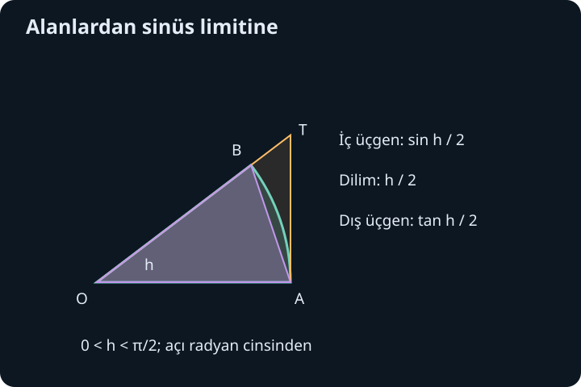
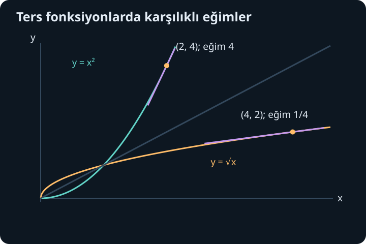

import ArticleVideo from '@/components/ArticleVideo.astro'
import kavram from './media/01-kavram.mp4?url'
import kavramPoster from './media/01-kavram.jpg?url'

Sinüsün türevinin kosinüs olduğunu bir tablodan öğrenebiliriz. Fakat böyle bir tablo iki soruyu açık bırakır: Bu sonuç neden doğrudur ve açıyı hangi birimle ölçüyoruz? Ters fonksiyonlarda da benzer bir sorun vardır. Bir işlemi geri çevirmek, değişim hızını nasıl etkiler? Bu yazıda kuralların arkasındaki limitleri kuracağız; ardından kuralların nerede kullanılabildiğini örneklerle göreceğiz.

[Önceki yazıda](/blog/turevin-anlami-ve-temel-kurallari/) türevi fark oranının limiti olarak tanımladık. Çarpım, bölüm ve zincir kurallarını kullanacağız. Trigonometriden gereken bilgiler birim çember, sinüs ve kosinüsün toplam formülleri ile $\sin^2x+\cos^2x=1$ özdeşliğidir. Ters fonksiyon, bir fonksiyonun çıktısından girdisine dönmemizi sağlar; birazdan bu dönüşün neden uygun bir aralık seçmeyi gerektirdiğini de açıklayacağız.

## 1. Radyan koşulu bir ayrıntı değildir

Yarıçapı $r$ olan bir çemberde uzunluğu $s$ olan yayın gördüğü merkez açı, radyan cinsinden $h=s/r$ olarak tanımlanır. Birim çemberde $r=1$ olduğu için açının radyan değeri, ilgili yayın uzunluğuna sayıca eşittir. Tam çemberin açısı $2\pi$ radyan; düz açınınki $\pi$ radyandır. Dereceyle yazılan 180 sayısı aynı açıyı anlatır, fakat aynı sayısal girdi değildir.

Türev, çıktı değişimini girdi değişimine böler. Girdi birimini değiştirince bu oran da değişir. Dolayısıyla $\sin x$ yazarken $x$'in radyan olarak ölçüldüğünü kabul edeceğiz. Derece cinsinden bir $d$ girdisi kullanırsak aynı fonksiyon $\sin(\pi d/180)$ biçiminde yazılır. Zincir kuralı onun türevine $\pi/180$ çarpanı getirir. Bu çarpanı unutmak, bir birim dönüşümünü unutmak demektir.

### Aynı açıya ait iki farklı değişim oranı

Derece girdisi için $S(d)=\sin(\pi d/180)$ yazalım. $d=0$ çevresinde türev $S'(0)=\pi/180$ olur; bu yaklaşık $0{,}01745$'tir. Çünkü girdiye bir derece eklemek, radyan olarak yalnız $\pi/180$ eklemektir. Radyanla tanımlı $\sin x$ fonksiyonunun sıfırdaki türevi ise 1'dir. İki cevap aynı fiziksel açı değişimini farklı büyüklükte girdi birimleriyle ölçer.

Bu ayrımı yaklaşık değerle kontrol edebiliriz. Bir derece küçük bir açı olduğundan $\sin(1^\circ)\approx\pi/180$ bekleriz; $\sin(1^\circ)\approx1$ beklemeyiz. Türevdeki eksik $\pi/180$ çarpanı yaklaşık 57 katlık fark yaratır. Dolayısıyla hesap makinesinin derece veya radyan ayarı, yalnız sonucu ekranda nasıl gördüğümüzü değil, hangi sayısal fonksiyonu hesapladığımızı belirler.

Ters trigonometrik fonksiyonların burada verdiği açılar da radyandır. Örneğin $\arcsin x$ için bulacağımız türev, girdi değişimi başına radyan cinsinden açı değişimini anlatır. Çıktıyı dereceye çeviren $D(x)=(180/\pi)\arcsin x$ fonksiyonunun türevi ayrıca $180/\pi$ ile çarpılır.

## 2. Üç alanın arasında bir limit

$0<h<\pi/2$ olsun. Birim çemberin merkezi $O$, sağdaki noktası $A=(1,0)$ ve çember üzerindeki diğer noktası $B=(\cos h,\sin h)$ olsun. $OA$ ile $OB$ arasındaki açı $h$'dir. $A$'daki teğet ile $OB$ doğrultusunun kesişimine $T$ diyelim. İçteki $OAB$ üçgeni, çember dilimi ve dıştaki $OAT$ üçgeni birbirini kapsar.

İç üçgenin tabanı 1, yüksekliği $\sin h$ olduğundan alanı $\sin h/2$'dir. Dilimin alanı $h/2$'dir: tam çember alanı $\pi$ ve açı payı $h/(2\pi)$ olduğundan çarpımları bu sonucu verir. Dış üçgenin yüksekliği $\tan h$ olduğundan alanı $\tan h/2$ olur. Kapsama ilişkisi böylece:

$$
\frac{\sin h}{2}\leq\frac h2\leq\frac{\tan h}{2}
$$

eşitsizliğini verir. İkiyle çarpıp $\tan h=\sin h/\cos h$ yazarsak $\sin h\leq h\leq\sin h/\cos h$ elde ederiz. Bu aralıkta bütün bölenler pozitiftir. Eşitsizlikleri düzenleyince:

$$
\cos h\leq\frac{\sin h}{h}\leq1
$$

bulunur. $h$ sıfıra giderken birim çemberdeki nokta $A$'ya yaklaşır; $\cos h\to1$ olur. Sıkıştırma teoremine göre ortadaki oran da 1'e yaklaşır. Negatif $h$ için sinüsün tekliği sayesinde $\sin(-h)/(-h)=\sin h/h$ olduğundan aynı sonuç soldan da geçerlidir:

$$
\boxed{\lim_{h\to0}\frac{\sin h}{h}=1.}
$$

Burada $h=0$ için kesri tanımlamadık. Sıfıra yaklaşırken aldığı değerlere baktık. Ayrıca sinüsün türevini kullanmadık: kanıt, çember geometrisi ve alan karşılaştırmasına dayanıyor. Türevi kanıtlamak için henüz kanıtlanmamış aynı türevi kullanmak bir döngü olurdu.

Kosinüsün sürekliliği de bu geometriyle uyumludur. Küçük $h$ için $|\sin h|\leq|h|$ elde ettik. $1-\cos h=2\sin^2(h/2)$ özdeşliğinden $0\leq1-\cos h\leq h^2/2$ gelir. Dolayısıyla $h\to0$ iken kosinüsün 1'e gitmesi ayrıca bu eşitsizlikle doğrulanabilir; türev bilgisi gerektirmez.

### Alan eşitsizliğini orana dönüştüren iki ayrı işlem

$\sin h\le h\le\sin h/\cos h$ zincirinden istediğimiz oranı tek hamlede çıkarmak zorunda değiliz. Soldaki eşitsizlikte $h>0$ olduğundan iki tarafı $h$'ye böleriz ve $\sin h/h\le1$ buluruz. Sağdaki eşitsizlikte ise önce $\cos h>0$ ile çarpar, sonra $h>0$ ile böleriz:

$$
\begin{aligned}
h&\le\frac{\sin h}{\cos h}\\
h\cos h&\le\sin h\\
\cos h&\le\frac{\sin h}{h}.
\end{aligned}
$$

Böylece alt ve üst sınırlar ayrı ayrı kurulmuş olur. Bölenler negatif olsaydı eşitsizlik yönünü değiştirmemiz gerekirdi. Başlangıçta $0<h<\pi/2$ seçmemizin bir görevi de bu işaretleri güvenceye almaktır.

Negatif açıları aynı eşitsizliğe dikkatsizce yerleştirmek yerine $u=-h>0$ yazarız. Sinüs tek olduğundan $\sin h/h=(-\sin u)/(-u)=\sin u/u$ olur. Sağ tarafta zaten bildiğimiz pozitif açı oranı vardır. Bu nedenle soldan yaklaşma da aynı limite ulaşır. Sıkıştırmada gerekli olan şey, sınırların her küçük girdide aynı olması değil, ikisinin de aynı sayıya yaklaşmasıdır.

## 3. Kosinüslü ikinci limit

Sinüsün toplam formülünde iki farklı küçük değişim ortaya çıkacak. İkincisini şimdiden hazırlayalım. Sıfıra yakın ve sıfırdan farklı $h$ için eşlenikle çarparız:

$$
\begin{aligned}
\frac{\cos h-1}{h}&=\frac{\cos^2h-1}{h(\cos h+1)}\\
&=-\frac{\sin h}{h}\frac{\sin h}{\cos h+1}.
\end{aligned}
$$

İlk oran 1'e, ikinci oran $0/2=0$'a gider. Sonuç:

$$
\lim_{h\to0}\frac{\cos h-1}{h}=0
$$

olur. Payda $\cos h+1$ sıfıra yakın bölgede sıfır değildir. Sadeleştirme ve limit işlemlerini yaparken bu küçük koşul önemlidir. Büyük açılardaki olası sıfırlar, burada yalnız sıfırın çevresini incelediğimiz için soruna yol açmaz.

### İkinci limitin sıfır çıkmasını büyüklükle de görmek

Önceki alan karşılaştırmasından $0\le1-\cos h\le h^2/2$ elde etmiştik. $h\ne0$ için bunu $|h|$'ye bölersek

$$
0\le\left|\frac{\cos h-1}{h}\right|
\le\frac{|h|}{2}
$$

buluruz. Sağdaki sınır sıfıra yaklaştığından aradaki mutlak değer de sıfıra yaklaşır. Bu, eşlenikle yapılan hesabın ikinci bir kontrolüdür. Ayrıca kosinüsün küçük açıdaki değişiminin, açının kendisinden daha hızlı küçüldüğünü söyler: fark en fazla $h^2/2$ büyüklüğündedir.

Sinüs fark oranını açarken bu iki limiti ayrı tutmamız bu yüzden önemlidir. $\sin h$ yaklaşık $h$ büyüklüğünde olduğundan $h$'ye bölündüğünde 1'e yaklaşır. $\cos h-1$ ise en fazla ikinci kuvvet büyüklüğündedir; $h$'ye bölündükten sonra bile sıfıra gider. Sinüsün türevinde ilk katkının silinip ikinci katkının kalması, bu iki farklı küçülme davranışının sonucudur.

Buradaki “yaklaşık” ifadeler kanıtın yerine geçmiyor; eşitsizlikler ve limitler kanıtı zaten kurdu. Yaklaşık ifadeler yalnızca bu kanıtın neden böyle bir sonuca ulaştığını zihnimizde canlandırıyor.

## 4. Sinüs ve kosinüsün türevlerini çıkarmak

$f(x)=\sin x$ için fark oranını yazalım. Toplam formülü $\sin(x+h)=\sin x\cos h+\cos x\sin h$ olduğundan:

$$
\begin{aligned}
\frac{\sin(x+h)-\sin x}{h}&=\sin x\frac{\cos h-1}{h}\\
&\quad+\cos x\frac{\sin h}{h}.
\end{aligned}
$$

$x$ sabitken $h\to0$ alıyoruz. İlk terim $\sin x\cdot0$, ikincisi $\cos x\cdot1$ olur. Böylece $(\sin x)'=\cos x$ sonucunu elde ederiz. Aynı işlemi $\cos(x+h)=\cos x\cos h-\sin x\sin h$ toplam formülüne uygulayalım:

$$
\begin{aligned}
\frac{\cos(x+h)-\cos x}{h}&=\cos x\frac{\cos h-1}{h}\\
&\quad-\sin x\frac{\sin h}{h}.
\end{aligned}
$$

Limit $-\sin x$ olur. İki temel kuralımız her gerçek radyan girdisi için geçerlidir:

$$
\boxed{(\sin x)'=\cos x,\qquad(\cos x)'=-\sin x.}
$$

Bu sonuçlar grafikle de okunur. Sinüs, sıfırda yukarı doğru en dik biçimde geçer ve türevi 1'dir. $\pi/2$ noktasında değeri 1 iken türevi 0 olur; teğeti yataydır. $\pi$ noktasında türevi $-1$'dir, yani artan girdi karşısında çıktı azalmaktadır. Türevin işareti ile fonksiyonun değeri farklı bilgilerdir: fonksiyon pozitifken azalabilir.

<ArticleVideo src={kavram} poster={kavramPoster} title="Sinüs boyunca değişen teğet" caption="Birim çemberde açı ilerlerken sinüs grafiğindeki teğetin eğimi kosinüs değerini izler." />

## 5. Yeni kuralları önceki kurallarla birleştirmek

Tanjant, $\tan x=\sin x/\cos x$ olduğundan yalnız $\cos x\ne0$ iken tanımlıdır. Bölüm kuralı:

$$
(\tan x)'=\frac{\cos^2x+\sin^2x}{\cos^2x}
=\frac1{\cos^2x}
$$

verir. Burada payın 1 olması trigonometrik özdeşlikten gelir. Tanjantın türevi tanımlı olduğu her noktada pozitiftir; ancak tanjant bütün gerçek doğru üzerinde kesintisiz bir fonksiyon değildir. Farklı dalları tek bir artma aralığı gibi birleştirmemeliyiz.

Örneğin $p(x)=\sin(3x^2)$ için dış fonksiyon sinüs, iç fonksiyon $3x^2$'dir. Önce dışın türevini iç girdide değerlendirir, sonra iç türevle çarparız:

$$
p'(x)=\cos(3x^2)\cdot6x.
$$

$6x$ çarpanı, iç açının $x$ ile ne hızla değiştiğini taşır. $x=0$ noktasında kosinüs 1 olsa da iç değişim hızı sıfırdır; sonuç $p'(0)=0$ olur.

Başka bir örnekte $q(x)=x^2\cos x$ olsun. İki çarpanın da değiştiğini hesaba katmalıyız:

$$
q'(x)=2x\cos x-x^2\sin x.
$$

$x=\pi/2$ noktasında ilk terim sıfır, ikinci terim $-\pi^2/4$ olur. Fonksiyonun o noktadaki değeri sıfırdır ama türevi sıfır değildir. Grafiğin ekseni kesmesi ile yatay teğet taşıması farklı olaylardır.

### Tanjantın payındaki artı işareti nereden gelir?

Bölüm kuralında payın türeviyle payda çarpılır; ardından payla paydanın türevinin çarpımı çıkarılır. Sinüs ve kosinüs için bu iki işlemi açık yazalım:

$$
\begin{aligned}
(\tan x)'
&=\frac{(\cos x)\cos x
-\sin x(-\sin x)}{\cos^2x}\\
&=\frac{\cos^2x+\sin^2x}{\cos^2x}\\
&=\frac1{\cos^2x}.
\end{aligned}
$$

İki eksi işareti artıya dönüştü. Payda $\cos^2x$ olduğu için sıfır olmadığı her yerde pozitiftir; ama $\cos x=0$ olan noktalarda başlangıçtaki tanjant zaten tanımsızdır. Türev formülü bu eksik noktaları doldurmaz.

Bir bileşke örneğinde $F(x)=\tan(2x)$ için bu sonucun yanına iç türev olan 2'yi koyarız: $F'(x)=2/\cos^2(2x)$. $x=\pi/8$ için iç açı $\pi/4$, kosinüs karesi $1/2$ ve türev 4 olur. Kontrol olarak aynı fonksiyonu $\sin(2x)/\cos(2x)$ biçiminde türevleyebiliriz. Bu kez hem payın hem paydanın türevinde 2 çıkar; ortak çarpan olarak ayrıldığında aynı formüle ulaşırız. Türevde iç çarpanı unutmak burada sonucu yarıya indirir.

## 6. Ters fonksiyonda neden aralık seçiyoruz?

$f(x)=x^2$ bütün gerçek sayılarda bire bir değildir: 2 ve $-2$ aynı 4 sonucunu verir. Yalnız $x\geq0$ girdilerine kısıtlarsak ters işlem $g(y)=\sqrt y$ olur. Ters fonksiyonun varlığı için girdiyi çıktıdan tek biçimde geri bulabilmemiz gerekir. Yerel ters fonksiyon derken de tüm doğruyu değil, ilgilendiğimiz noktanın çevresindeki uygun aralığı kastediyoruz.

Sinüs de periyodik olduğundan tüm doğru üzerinde terslenemez. $[-\pi/2,\pi/2]$ aralığında sürekli ve kesin artandır; bu aralıktaki tersine $\arcsin$ denir. $\arcsin y$, sinüsü $y$ olan ve seçilen aralıkta kalan açıyı verir. $\sin^{-1}y$ gösterimi de kullanılabilir, fakat bu ifade $1/\sin y$ anlamına gelmez. Karışıklığı önlemek için burada arcsin yazacağız.

### Ters eşitlikleri hangi girdiler için yazabiliriz?

$\sin(\arcsin y)=y$ eşitliği bütün $-1\le y\le1$ girdileri için geçerlidir: önce seçilen açıya gider, sonra onun sinüsünü alıp başlangıç değerine döneriz. Buna karşılık $\arcsin(\sin x)=x$ eşitliği ancak seçilmiş açı aralığındaki $x$ değerleri için doğrudur. Ters fonksiyon, hangi dala ait olduğumuzu bilmeden bütün açıları geri getiremez.

Kare fonksiyonunda da aynı durum vardır. $\sqrt{x^2}=|x|$ olduğundan $x=-3$ için sonuç 3 olur. Pozitif karekök dalını seçtikten sonra $-3$'ü geri beklemek, seçtiğimiz tersin tanımına aykırıdır. Terslik, uygun iki küme arasındaki işlemler için söylenir; yalnızca formüllerin görünüşüne bakılarak karar verilmez.

Bu kümeler türevde de karşımıza çıkar. Bir tersin $b$ girdisindeki eğimini ararken ileri fonksiyonun hangi $a$ girdisini $b$'ye taşıdığını bulmalıyız. Kare örneğinde tersin 9'daki eğimi için ileri fonksiyonun 9'daki değil, 3'teki eğimi kullanılır. Karşılıklı noktalar $(3,9)$ ile $(9,3)$'tür; türevleri $6$ ve $1/6$ olur.

## 7. Ters türevin fark oranı

$f$, $a$'yı içeren açık bir aralıkta sürekli ve kesin monoton olsun; yani o aralıkta ya sürekli artan ya da sürekli azalan bir ilişki kursun. Bu özellikler, görüntü aralığında sürekli bir ters $g$ verir. Ayrıca $f$'nin $a$'da türevli ve $f'(a)\ne0$ olduğunu varsayalım. $b=f(a)$ olduğundan $g(b)=a$'dır.

$b$'ye yakın bir $y\ne b$ seçip $x=g(y)$ diyelim. Tersin sürekliliği $y\to b$ iken $x\to a$ demektir. Bire birlik nedeniyle $y\ne b$ iken $x\ne a$'dır. Şimdi tersin fark oranı:

$$
\frac{g(y)-g(b)}{y-b}
=\frac{x-a}{f(x)-f(a)}
=\frac1{\dfrac{f(x)-f(a)}{x-a}}
$$

olur. Alttaki oran $f'(a)$'ya gider. Bu limit sıfır olmadığı için tersini alabiliriz:

$$
\boxed{g'(b)=\frac1{f'(a)}=\frac1{f'(g(b))}.}
$$

Bu bir ezberden önce bir oran ilişkisidir. İleri yönde çıktı değişimini girdi değişimine bölüyorduk; geri yönde aynı iki değişimin yerini değiştiriyoruz. Ancak limitin sıfır olmaması ve tersin sürekliliği, bu fikri geçerli bir kanıta dönüştüren koşullardır.

Örneğin $f(x)=x^2$'nin pozitif dalında $a=2$, $b=4$ olsun. İleri türev 4, ters türev $1/4$ olur. Gerçekten $g(y)=\sqrt y$ için $g'(y)=1/(2\sqrt y)$ ve $g'(4)=1/4$'tür. Kare fonksiyonunun sıfırdaki türevi ise sıfırdır; ters kuralın varsayımı orada bozulur. Karekökün sıfırdaki sağ fark oranı $\sqrt h/h=1/\sqrt h$ sınırsız büyür; sonlu türev elde edilmez.

### Karşılıklı eğimleri bir tam örnekle kontrol etmek

$f(x)=3x+2$ için ters fonksiyonu önce cebirle bulalım. $y=3x+2$ denkleminden $y-2=3x$, ardından $x=(y-2)/3$ çıkar. Dolayısıyla $g(y)=(y-2)/3$'tür. İleri türev 3, ters türev $1/3$ olduğundan çarpımları 1 olur.

Örneğin ileri yönde $x=4$ noktasından $x=4+h$ noktasına gidersek çıktı $14$'ten $14+3h$'ye değişir. Geri yönde aynı iki noktayı kullanınca girdi değişimi $3h$, çıktı değişimi $h$ olur. Oran $h/(3h)=1/3$'tür. Ters türev kuralı, doğrusal olmayan fonksiyonlarda aynı oran tersliğini limit düzeyinde kullanır.

İleri türevin sıfır olmasının neden sorun olduğunu da bu örnek ayırır. İleri değişim oranı sıfıra yaklaşırken onun tersinin sonlu bir limite yaklaşması garanti değildir. $x^3$ bütün gerçek sayılarda terslenebilir, fakat sıfırdaki türevi sıfırdır; küpkökün sıfırdaki fark oranı $h^{-2/3}$ sınırsız büyür. Demek ki tersin var olması, her noktada sonlu türevinin de bulunacağı anlamına gelmez.

## 8. Üç ters trigonometrik türev

$y=\arcsin x$ yazarsak $x=\sin y$ ve $-\pi/2\leq y\leq\pi/2$ olur. İç noktalarda $\cos y>0$'dır. Ters kural ve çember özdeşliğiyle:

$$
\begin{aligned}
\frac{dy}{dx}&=\frac1{\cos y}\\
&=\frac1{\sqrt{1-\sin^2y}}\\
&=\frac1{\sqrt{1-x^2}},\\
&-1<x<1.
\end{aligned}
$$

Karekökün pozitif işaretini rastgele seçmedik; seçilen açı aralığında kosinüs pozitif olduğu için seçtik. $x=\pm1$ uçlarında payda sıfırdır ve bu formül sonlu türev vermez. Fonksiyon uçlarda tanımlı olabilirken türev orada bulunmayabilir.

$y=\arccos x$ için $0\leq y\leq\pi$ dalını seçeriz. Kosinüs bu aralıkta azalandır ve iç noktalarda $\sin y>0$ olur. İleri türev $-\sin y$ olduğundan:

$$
(\arccos x)'=-\frac1{\sqrt{1-x^2}},\qquad -1<x<1.
$$

Eksi işareti anlamlıdır: daha büyük bir kosinüs değeri, bu dalda daha küçük bir açıya karşılık gelir. Arcsin artarken arccos azalır.

Son olarak $y=\arctan x$ için $-\pi/2<y<\pi/2$ dalını kullanırız. Tanjant bu açık aralıkta bütün gerçek çıktıları bir kez alır. İleri türev $1/\cos^2y=1+\tan^2y$ olduğundan:

$$
(\arctan x)'=\frac1{1+x^2},\qquad x\in\mathbb R.
$$

Burada $\mathbb R$ gerçek sayılar kümesidir. Payda en az 1 olduğu için sonlu türev bütün gerçek girdilerde vardır. Büyük $|x|$ değerlerinde türev küçülür; arktanjant grafiği yatay sınırlara yaklaşırken giderek yatıklaşır.

### Sinüsü geri çevirirken mutlak değer neden ortaya çıkar?

$F(x)=\arcsin(\sin x)$ ifadesinde ters işlemlerin her zaman birbirini yok ettiğini düşünmek kolaydır. Ancak arksinüsün seçtiği çıktı aralığı $[-\pi/2,\pi/2]$'dir. Bu yüzden $F(\pi/3)=\pi/3$ iken $F(2\pi/3)=\pi/3$ olur: ikinci girdi seçilen dalın dışındadır ve aynı sinüse sahip daha küçük açıya döner.

Türev hesabı bu farkı nasıl taşır? $\sin x\ne\pm1$ olan noktalarda zincir kuralı:

$$
F'(x)=\frac{\cos x}{\sqrt{1-\sin^2x}}
=\frac{\cos x}{\sqrt{\cos^2x}}
=\frac{\cos x}{|\cos x|}
$$

verir. Son paydada mutlak değer zorunludur. Bir sayının karesinin karekökü, sayı negatifse onun kendisi değil pozitif büyüklüğüdür. Dolayısıyla kosinüs pozitifken türev 1, negatifken $-1$ olur. $x=\pi/3$ için oran $(1/2)/(1/2)=1$'dir. $x=2\pi/3$ için ise $(-1/2)/(1/2)=-1$ çıkar. Paydayı yanlışlıkla $\cos x$ yazsaydık ikinci noktada yanlış işaret bulurduk.

Bunu fonksiyon değerlerinden de kontrol edebiliriz. $\pi/2$ ile $3\pi/2$ arasında $\pi-x$, arksinüsün çıktı aralığındadır ve $\sin(\pi-x)=\sin x$ olur. Bu aralıkta $F(x)=\pi-x$ yazılır; türevi gerçekten $-1$'dir. $-\pi/2<x<\pi/2$ aralığında ise doğrudan $F(x)=x$ olduğundan türev 1'dir.

Birleşme noktası $x=\pi/2$'de fonksiyon değeri vardır: $F(\pi/2)=\pi/2$. Sol tarafta eğim 1, sağ tarafta $-1$ olduğu için burada köşe oluşur ve sonlu iki taraflı türev yoktur. Zincir kuralı formülünün bu noktada sıfır paydaya ulaşması, ayrıca incelenmesi gereken bir koşulu işaret eder. Tek başına formülün tanımsız olmasıyla yetinmedik; fonksiyonun iki taraftaki açık ifadelerinden türevin gerçekten bulunmadığını gösterdik.

Bu iki açık aralıktaki parçalar doğrusal olduğu için ikinci türevleri sıfırdır. Fakat köşe noktasını bu ifadelerin kapsamına ekleyemeyiz; orada birinci türev bile bulunmamaktadır.

### Ters türevlerde karekökü ve işareti birlikte seçmek

Arkkosinüs için $x=\cos y$ ve $0<y<\pi$ yazdık. Özdeşlikten $\sin^2y=1-x^2$ elde edilir. Bu aralıkta sinüs pozitif olduğu için $\sin y=\sqrt{1-x^2}$ olur. İleri türev $-\sin y$ olduğundan karşılıklısını alınca eksi işareti kaybolmaz:

$$
\frac1{-\sin y}
=-\frac1{\sqrt{1-x^2}}.
$$

Örneğin $x=1/2$ için seçilen açı $\pi/3$ ve türev $-2/\sqrt3$'tür. Girdiyi biraz artırınca açı küçüldüğü için negatif işaret beklediğimiz davranışla uyumludur. Arksinüste aynı girdiye karşılık seçilen açı $\pi/6$ olur; türev ise $+2/\sqrt3$'tür. Aynı köklü payda, aynı yönlü değişim demek değildir.

Arktanjanttaki dönüşüm de bir özdeşliğin bölünmesidir. $\sin^2y+\cos^2y=1$ eşitliğini $\cos^2y$'ye bölünce $\tan^2y+1=1/\cos^2y$ bulunur. Seçilen açık dalda kosinüs sıfır olmadığı için bu işlem geçerlidir. Sonra $\tan y=x$ yazıp ileri türevi $1+x^2$ biçiminde ifade eder, bunun tersini alırız. Böylece formülde hâlâ bilinmeyen bir açı bırakmadan yalnız başlangıç girdisi $x$ ile çalışırız.

## 9. Bileşkede alanı ve işareti birlikte takip etmek

$r(x)=\arcsin(2x)$ fonksiyonunda önce tanım alanını bulalım. İç değer $-1\leq2x\leq1$ olmalıdır; dolayısıyla $-1/2\leq x\leq1/2$. Türev formülü iç noktalar için:

$$
r'(x)=\frac{2}{\sqrt{1-4x^2}},\qquad |x|<\frac12
$$

olur. Paydaki 2 iç fonksiyonun türevidir. $x=1/4$ için payda $\sqrt{3/4}=\sqrt3/2$ olduğundan sonuç $4/\sqrt3$'tür. Uçlarda fonksiyon değeri vardır, ama bu hesap sonlu türev vermez.

$s(x)=\arctan(x^2)$ için ise bütün gerçek $x$ değerleri kullanılabilir ve $s'(x)=2x/(1+x^4)$ olur. $x<0$ iken türev negatiftir; arktanjantın kendisinin artan olması bileşkenin her yerde artacağını garanti etmez. İçteki kare fonksiyonu negatif tarafta azalır ve bileşke bu değişimi izler. Bu örnek, zincir kuralının çarpanlarını yalnız cebirsel zorunluluk olarak değil, iki ardışık değişimin hesabı olarak okumamızı sağlar.

Trigonometrik türevleri artık geometrik bir limitten, ters türevleri ise karşılıklı fark oranlarından elde ettik. Üstel ve logaritmik türevlerin tam gerekçesini integral yardımıyla kuracağız. Ondan önce türevin yalnız teğet hesaplamakla kalmayıp bir fonksiyonun artışı, azalışı ve en iyi değerleri hakkında nasıl kesin sonuçlar verdiğini inceleyeceğiz.

## Kaynaklar

Bu yazıdaki anlatım, örnekler ve görseller özgündür. Kuralların kapsamı ve ters fonksiyon koşulları açık ders kaynaklarıyla karşılaştırılmıştır.

- [OpenStax, Calculus Volume 1: Derivatives of Trigonometric Functions](https://openstax.org/books/calculus-volume-1/pages/3-5-derivatives-of-trigonometric-functions)
- [OpenStax, Calculus Volume 1: Derivatives of Inverse Functions](https://openstax.org/books/calculus-volume-1/pages/3-7-derivatives-of-inverse-functions)
