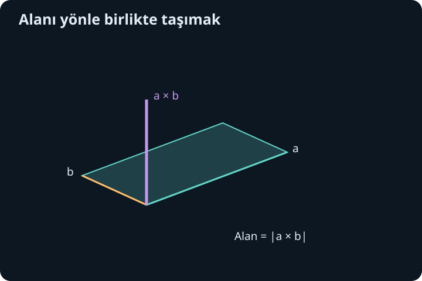
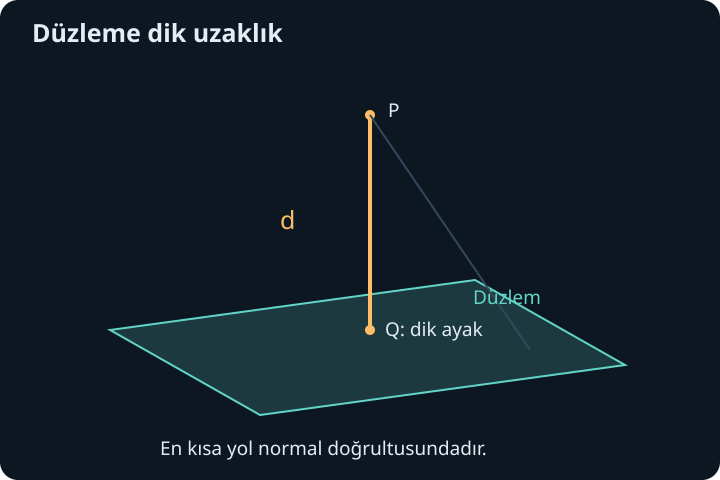

import ArticleVideo from '@/components/ArticleVideo.astro'
import kavram from './media/01-kavram.mp4?url'
import kavramPoster from './media/01-kavram.jpg?url'

İki vektörü çarpmak tek bir anlama gelmez. Skaler çarpım, iki yönün birbirine ne kadar hizalandığını bir sayı olarak verir. Üç boyutta başka bir bilgiye de ihtiyaç duyarız: iki vektörün oluşturduğu düzleme dik yön hangisidir ve bu vektörlerin gerdiği alan ne büyüklüktedir? Vektörel çarpım bu iki bilgiyi tek bir vektörde birleştirir.

[Önceki yazıda](/blog/karmasik-sayilar-ve-euler-bagintisi/) karmaşık çarpmanın düzlemde dönme ve ölçekleme anlamını gördük. Buradaki işlem farklıdır: girdiler üç boyutlu gerçek vektörlerdir. Önce koordinat düzenini ve skaler çarpımı hatırlayacağız; sonra yeni çarpımı kurup düzlem, doğru, alan ve hacim hesaplarına uygulayacağız. İleride dönme hareketinde aynı yapıyla karşılaşacağız, fakat burada hiçbir fizik yasası varsaymayacağız.

## 1. Üç bileşen ve sağ el düzeni

Bir uzay vektörünü $\mathbf a=(a_x,a_y,a_z)$ biçiminde yazalım. Alt indisler bileşenin hangi eksene ait olduğunu gösterir. Eksenler birbirine diktir ve aynı uzunluk birimini kullanır. Birim eksen vektörleri $\mathbf e_x=(1,0,0)$, $\mathbf e_y=(0,1,0)$, $\mathbf e_z=(0,0,1)$ olsun. Her vektör $a_x\mathbf e_x+a_y\mathbf e_y+a_z\mathbf e_z$ biçiminde ayrılır.

Koordinat takımını **sağ elli** seçiyoruz. Sağ elin parmakları pozitif $x$ yönünden pozitif $y$ yönüne kıvrıldığında başparmak pozitif $z$ yönünü gösterir. Eksenlerin sayfada nasıl çizildiği perspektife göre değişebilir; yönelimi belirleyen şey bu kuraldır. Bir ekseni tek başına ters çevirmek, takımın yönelimini değiştirir.

Vektörün uzunluğu $|\mathbf a|=\sqrt{a_x^2+a_y^2+a_z^2}$'dir. Sıfır olmayan bir vektörü uzunluğuna bölersek aynı yönde birim vektör elde ederiz: $\widehat{\mathbf a}=\mathbf a/|\mathbf a|$. Şapka işareti burada uzunluğu 1 olan vektörü belirtir. Sıfır vektörünün yönü bulunmadığı için onu normalleştiremeyiz.

Nokta ile vektör gösterimi benzer görünse de görevleri farklıdır. $P=(1,2,3)$ bir konumu, $\mathbf a=(1,2,3)$ bir yer değiştirmeyi anlatabilir. $P$'den $Q=(4,1,5)$'e giden vektör $Q-P=(3,-1,2)$'dir: önce hedefin koordinatından başlangıcın koordinatını çıkarırız. Aynı vektörü başka bir başlangıca taşısak da yönü ve uzunluğu değişmez. Bu yüzden iki noktadan düzlem yönü üretirken noktaların koordinatlarını doğrudan çarpmak yerine önce farklarını alacağız.

Normalleştirmeyi de bu örnekte görebiliriz. $(3,-1,2)$ vektörünün uzunluğu $\sqrt{9+1+4}=\sqrt{14}$ olduğundan birim yönü $(3,-1,2)/\sqrt{14}$'tür. Üç bileşenin de aynı sayıya bölünmesi yönü korur. Yeni uzunluğun karesi $(9+1+4)/14=1$ çıkar. Yalnız bir bileşeni bölmek genel olarak yönü değiştirir; yapılan işlem bütün vektöre uygulanan tek bir ölçeklemedir.

## 2. Skaler çarpımın kısa hatırlatması

İki vektörün skaler çarpımı:

$$
\mathbf a\cdot\mathbf b=a_xb_x+a_yb_y+a_zb_z
=|\mathbf a||\mathbf b|\cos\theta
$$

olur. $\theta$, sıfır olmayan iki vektör arasındaki $[0,\pi]$ aralığındaki açıdır. Sonuç bir sayıdır. Skaler çarpım sıfırsa, iki vektör de sıfırdan farklı olduğu sürece aralarındaki açı dik açıdır.

Bir vektörün birim $\widehat{\mathbf n}$ yönündeki işaretli bileşeni $\mathbf a\cdot\widehat{\mathbf n}$'dir. Bu sayı pozitifse o yöne, negatifse tersine uzanır. İzdüşüm vektörü ise $(\mathbf a\cdot\widehat{\mathbf n})\widehat{\mathbf n}$ olur. Birazdan hacmin yüksekliğini ve noktanın düzleme uzaklığını bu izdüşümle hesaplayacağız.

Örneğin $(1,2,0)\cdot(2,-1,3)=2-2+0=0$ olduğundan bu iki vektör diktir. Uzayda dik olmak için bileşenlerden birinin veya aynı koordinatların sıfır olması gerekmez; belirleyici olan toplamın sıfır olmasıdır.

## 3. Vektörel çarpımın bileşenleri

Sağ elli koordinatlarda **vektörel çarpımı** şu biçimde tanımlayalım:

$$
\begin{aligned}
\mathbf a\times\mathbf b&=\begin{pmatrix}a_yb_z-a_zb_y\\a_zb_x-a_xb_z\\a_xb_y-a_yb_x\end{pmatrix}.
\end{aligned}
$$

$\times$ işareti burada sayı çarpımı veya skaler çarpım değildir; sonuç yine bir vektördür. Formülü ezberlemeden önce temel eksenlerde ne yaptığını görelim: $\mathbf e_x\times\mathbf e_y=\mathbf e_z$, $\mathbf e_y\times\mathbf e_z=\mathbf e_x$, $\mathbf e_z\times\mathbf e_x=\mathbf e_y$. Döngüyü tersine çevirirsek işaret değişir.

Formül iki girdi bakımından ayrı ayrı doğrusaldır. Örneğin $(\mathbf a+\mathbf b)\times\mathbf c=\mathbf a\times\mathbf c+\mathbf b\times\mathbf c$ ve $(\lambda\mathbf a)\times\mathbf b=\lambda(\mathbf a\times\mathbf b)$ olur. $\lambda$ gerçek bir sayıdır. Bu özellikler ile eksen çarpımlarını açınca aynı bileşen formülüne ulaşabiliriz.

Çarpımın girdilere dik olduğunu cebirle kontrol edelim. $\mathbf a\cdot(\mathbf a\times\mathbf b)$ açıldığında:

$$
\begin{aligned}
&a_xa_yb_z-a_xa_zb_y\\&\quad+a_ya_zb_x-a_ya_xb_z\\&\quad+a_za_xb_y-a_za_yb_x=0
\end{aligned}
$$

olur. Her terim karşı işaretli eşiyle gider. $\mathbf b$ ile skaler çarpımda da aynı iptal gerçekleşir. Böylece yeni vektör iki girdiye de diktir; bu geometrik iddia yalnız çizime dayanmıyor.

### Bileşen formülündeki farklar nereden geliyor?

Örneğin sonucun $\mathbf e_z$ yönündeki kısmını düşünelim. $\mathbf a$'nın $a_x\mathbf e_x$ parçasıyla $\mathbf b$'nin $b_y\mathbf e_y$ parçasının çarpımı $a_xb_y\mathbf e_z$ verir. Ters eksen sırasındaki $a_y\mathbf e_y$ ve $b_x\mathbf e_x$ ise $-a_yb_x\mathbf e_z$ verir. Bu iki katkı toplanınca $z$ bileşeni $a_xb_y-a_yb_x$ olur. Aynı eksenin kendisiyle çarpımı sıfır olduğu için $a_xb_x$ gibi bir terim bu bileşene katkı yapmaz.

Diğer iki bileşen de aynı mantıkla kurulur: $y$ ile $z$ eksenlerinden $x$ bileşeni, $z$ ile $x$ eksenlerinden $y$ bileşeni gelir. Böylece üç fark, dağıtma kuralının ve yön seçiminin sonucudur. Her bileşen, ilgili koordinat düzlemine düşen iki vektörün yönlü alanını ölçer. Tek başına bir bileşen negatif olabilir; bu, toplam alanın negatif olduğu anlamına gelmez. Alan, üç bileşenin oluşturduğu vektörün uzunluğudur.

## 4. Determinant yazımı ve eksi işareti

Bileşenleri hatırlamak için biçimsel determinant düzeni kullanabiliriz:

$$
\mathbf a\times\mathbf b=
\begin{vmatrix}
\mathbf e_x&\mathbf e_y&\mathbf e_z\\
a_x&a_y&a_z\\
b_x&b_y&b_z
\end{vmatrix}.
$$

İlk satırdan açarken işaretler artı, eksi, artıdır. Ortadaki bileşen $-(a_xb_z-a_zb_x)$ olduğundan $a_zb_x-a_xb_z$ çıkar. Bu düzen bir hesap hatırlatıcısıdır; ilk satırdaki nesneler sayılardan farklı olarak vektördür. Sonucun üç bileşenini açık yazmak, işaretleri denetlemek için en güvenli yoldur.

$\mathbf a=(1,2,0)$ ve $\mathbf b=(0,1,3)$ seçelim. Birinci bileşen $2\cdot3-0\cdot1=6$, ikinci bileşen $0\cdot0-1\cdot3=-3$, üçüncü bileşen $1\cdot1-2\cdot0=1$ olur. Dolayısıyla $\mathbf a\times\mathbf b=(6,-3,1)$'dir. Kontroller $\mathbf a\cdot(6,-3,1)=6-6=0$ ve $\mathbf b\cdot(6,-3,1)=-3+3=0$ verir.

## 5. Uzunluğu neden alandır?

$\mathbf a$ ve $\mathbf b$'nin oluşturduğu paralelkenarın tabanını $|\mathbf a|$ seçelim. Yüksekliği, ikinci vektörün ilkine dik bileşeninin büyüklüğü olan $|\mathbf b|\sin\theta$'dır. Alan $|\mathbf a||\mathbf b|\sin\theta$ olur. Vektörel çarpımın uzunluğu da tam olarak budur:

$$
|\mathbf a\times\mathbf b|=|\mathbf a||\mathbf b|\sin\theta.
$$

Bunu bileşenlerden gerekçelendiren özdeşlik:

$$
|\mathbf a\times\mathbf b|^2
=|\mathbf a|^2|\mathbf b|^2-(\mathbf a\cdot\mathbf b)^2
$$

biçimindedir. Sol taraftaki üç bileşen karesini açıp benzer terimleri toplamak sağ tarafı verir. Skaler çarpımın açı formülünü koyunca $|\mathbf a|^2|\mathbf b|^2(1-\cos^2\theta)$ elde ederiz. $0\leq\theta\leq\pi$ için sinüs negatif olmadığından karekök alan formülünü verir.

Vektörel çarpım böylece **yönlü alan** taşır: uzunluğu paralelkenarın alanı, yönü düzleme dik ve sağ el kuralıyla seçilen normaldir. Üçgen alanı aynı taban ve yüksekliğin yarısı olduğu için $|\mathbf a\times\mathbf b|/2$ olur. Önceki sayısal örnekte uzunluk $\sqrt{36+9+1}=\sqrt{46}$; üçgen alanı $\sqrt{46}/2$'dir.

Alan bağıntısını ayrı bir sayısal hesapla da denetleyelim. Yukarıdaki $(1,2,0)$ ve $(0,1,3)$ vektörlerinin uzunluk kareleri 5 ve 10, skaler çarpımları 2'dir. O halde:

$$
|\mathbf a|^2|\mathbf b|^2
-(\mathbf a\cdot\mathbf b)^2
=5\cdot10-2^2=46.
$$

Vektörel çarpımdan bulduğumuz $6^2+(-3)^2+1^2=46$ ile aynı sonuç çıktı. Bu kontrol birinci hesabın işaret veya bileşen hatalarını yakalayabilir. Ayrıca $\mathbf a\cdot\mathbf b=2$ sayısını alan sanmadık: o, hizalanmayı ölçer; alan için dik bileşen gerekir. Geometride hangi çarpımı kullanacağımızı aranan büyüklük belirler. Alan sorusu uzunluk ile dik yüksekliği, izdüşüm sorusu ise aynı yöndeki bileşeni birleştirir.

Bileşen özdeşliğinin genel açılımını da görmek istersek sağ taraftan başlayabiliriz. $|\mathbf a|^2|\mathbf b|^2$ çarpımında dokuz kare çarpımı vardır. $(\mathbf a\cdot\mathbf b)^2$ çıkarıldığında aynı indisli üç kare iptal olur. Kalanlar şu üç grupta toplanır:

$$
\begin{aligned}
&a_y^2b_z^2+a_z^2b_y^2-2a_ya_zb_yb_z\\
&\quad=(a_yb_z-a_zb_y)^2,\\
&a_z^2b_x^2+a_x^2b_z^2-2a_za_xb_zb_x\\
&\quad=(a_zb_x-a_xb_z)^2,\\
&a_x^2b_y^2+a_y^2b_x^2-2a_xa_yb_xb_y\\
&\quad=(a_xb_y-a_yb_x)^2.
\end{aligned}
$$

Her satır $u^2+v^2-2uv=(u-v)^2$ özdeşliğidir. Bu üç kareyi toplamak, vektörel çarpımın üç bileşeninin karelerini toplamakla aynıdır. Dolayısıyla alan bağıntısını yalnız çizimden çıkarmadık; tanımladığımız bileşen formülünün istenen geometrik büyüklüğü gerçekten verdiğini doğruladık.

## 6. Sıra, paralellik ve sıfır

Girdileri yer değiştirince bileşen formülündeki her fark tersine döner:

$$
\mathbf b\times\mathbf a=-(\mathbf a\times\mathbf b).
$$

Bu özelliğe karşıt değişme denir. Geometrik alanın büyüklüğü değişmez, fakat seçilen normalin yönü ters döner. İşlem sırası bu nedenle önemli bir bilgidir. Sıfırdan farklı vektörlerde çarpım sıfırsa sinüs sıfırdır; vektörler aynı veya zıt doğrultudadır. Girdilerden biri sıfırsa da sonuç sıfır olur.

$\mathbf a\times\mathbf a=\mathbf0$ olduğundan, bir vektörün kendisiyle vektörel çarpımı uzunluğunun karesi değildir. Uzunluk karesi $\mathbf a\cdot\mathbf a$ ile bulunur. Nokta ve çarpı işaretlerini karıştırmak hem sonucu hem sonucun türünü değiştirir.

Vektörel çarpım birleşmeli de değildir. $\mathbf e_x\times(\mathbf e_x\times\mathbf e_y)=\mathbf e_x\times\mathbf e_z=-\mathbf e_y$ iken $(\mathbf e_x\times\mathbf e_x)\times\mathbf e_y=\mathbf0$ olur. Parantezleri sıradan sayı çarpımındaki gibi kaldırmayız. Bu uyarı özellikle üç vektör içeren ifadelerde gereklidir.

<ArticleVideo src={kavram} poster={kavramPoster} title="Vektörel çarpımın büyüklüğü" caption="İki vektörün uzunlukları sabitken aralarındaki açı değişir. Dik konumda alan en büyüktür; paralelliğe yaklaşırken vektörel çarpımın büyüklüğü sıfıra iner." />

## 7. Üçlü çarpımla hacim

Üç vektörün gerdiği paralelyüzün tabanı $\mathbf a$ ile $\mathbf b$ paralelkenarı olsun. Taban alanı $|\mathbf a\times\mathbf b|$'dir. Üçüncü vektör $\mathbf c$'nin taban normaline izdüşümünün mutlak değeri yüksekliği verir. Dolayısıyla hacim:

$$
V=|\mathbf c\cdot(\mathbf a\times\mathbf b)|.
$$

İçerideki sayı **skaler üçlü çarpımdır**. İşareti üç vektörün yönelimini, mutlak değeri hacmi taşır. Taban vektörleri paralelse çarpım sıfır olur ve hacim de sıfırdır; ayrıca normalleştirme yapmamız gerekmez.

$\mathbf a=(2,0,0)$, $\mathbf b=(0,3,0)$ ve $\mathbf c=(1,1,4)$ seçelim. İlk çarpım $(0,0,6)$'dır. Üçlü çarpım 24 ve hacim 24 birim küptür. Üçüncü vektörün yatay bileşenleri cismi yana yatırır ama dik yüksekliği 4 olarak bırakır. Bu nedenle hacim taban alanı 6 ile yükseklik 4'ün çarpımıdır.

Üçlü çarpım sıfırsa üç vektör aynı düzlem içinde kalır veya başka bir doğrusal bağımlılık taşır. Bu, determinantın sıfır olmasıyla da ifade edilir. Hacmin sıfır olması, üç boyutlu bir bölge gerilemediğinin geometrik karşılığıdır.

Determinantla bağlantıyı sırası açık bir eşitlikle yazabiliriz:

$$
\mathbf c\cdot(\mathbf a\times\mathbf b)
=\begin{vmatrix}
c_x&c_y&c_z\\
a_x&a_y&a_z\\
b_x&b_y&b_z
\end{vmatrix}.
$$

İlk satırdan açınca $c_x(a_yb_z-a_zb_y)$, $c_y(a_zb_x-a_xb_z)$ ve $c_z(a_xb_y-a_yb_x)$ terimleri gelir; bunlar tam skaler çarpımın üç katkısıdır. Satırları döngüsel kaydırmak iki satır değişimine karşılık geldiğinden işaret değişmez: $\mathbf c\cdot(\mathbf a\times\mathbf b)=\mathbf a\cdot(\mathbf b\times\mathbf c)$. Yalnız iki vektörü yer değiştirmek ise tek satır değişimidir ve işareti ters çevirir. Böylece hacim için başka bir yüzü taban seçmek büyüklüğü değiştirmez; yönlü işareti izlerken sıra bilgisi korunur.

Hacim formülündeki normalleştirme neden görünmüyor? Taban normali $\mathbf n=\mathbf a\times\mathbf b\ne0$ ise birim normal $\widehat{\mathbf n}=\mathbf n/|\mathbf n|$'dir. Yükseklik $|\mathbf c\cdot\widehat{\mathbf n}|=|\mathbf c\cdot\mathbf n|/|\mathbf n|$ olur. Taban alanı $|\mathbf n|$ ile çarpınca paydadaki aynı uzunluk sadeleşir ve yalnız $|\mathbf c\cdot\mathbf n|$ kalır. Formülde yüksekliği ayrıca yazmamamızın nedeni, onun zaten skaler çarpım içinde bulunmasıdır.

Sıra işaretini de kontrol edebiliriz. $\mathbf a$ ve $\mathbf b$ yer değiştirince $\mathbf n$ eksilenir, yönlü üçlü çarpımın işareti değişir. Mutlak değeri aynı kalır; dolayısıyla geometrik hacim eksilmez. Taban alanı sıfırsa bu normalleştirme hesabında bölme yapılamaz, fakat cisim üç boyutlu hacim oluşturmaz ve doğrudan üçlü çarpım da sıfır verir. Sıfır durumu ayrı ele almak cebir ile geometriyi tutarlı tutar.

## 8. Bir nokta ve bir normal düzlemi belirler

$\mathbf n=(A,B,C)\ne\mathbf0$ düzleme dik bir normal, $\mathbf r_0=(x_0,y_0,z_0)$ düzlem üzerindeki bir nokta olsun. Başka bir $\mathbf r=(x,y,z)$ noktasının aynı düzlemde olması, aradaki farkın normale dik olması demektir:

$$
\mathbf n\cdot(\mathbf r-\mathbf r_0)=0.
$$

Bileşenlerle $A(x-x_0)+B(y-y_0)+C(z-z_0)=0$ olur. Düzenlersek $Ax+By+Cz=D$ biçimini elde ederiz; burada $D=Ax_0+By_0+Cz_0$'dır. Normalin bütün bileşenlerini aynı sıfırdan farklı sayıyla çarpmak aynı düzlemi verir.

Örneğin $\mathbf n=(2,-1,3)$ ve $P=(1,0,2)$ için $D=2+0+6=8$ olur; düzlem $2x-y+3z=8$'dir. $P$'yi yerine koymak denklemi doğrular. $(0,1,3)$ noktası da $0-1+9=8$ verdiği için düzlemdedir; $(0,0,0)$ ise değildir.

Bir düzlemin normalini bilmek, onun uzaydaki yönünü verir ama konumunu vermez. Aynı normalle farklı $D$ değerleri paralel düzlemler oluşturur. Nokta bilgisi bu aileden tek bir düzlemi seçer.

Düzlem denklemi üç koordinat için tek koşuldur. Örnekte $2x-y+3z=8$ eşitliğini $y=2x+3z-8$ biçiminde çözebiliriz. $x$ ve $z$'yi bağımsız seçtiğimizde $y$ belirlenir; bu iki serbest seçim düzlemin iki boyutlu oluşunu gösterir. $x=z=0$ seçersek $(0,-8,0)$, $x=1,z=2$ seçersek verilen $(1,0,2)$ noktası çıkar.

Normal vektör düzlemin üzerinde ilerleme yönü değildir. Normal boyunca bir adım, sol tarafı değiştirir. Nitekim $P$'den $\mathbf n$ kadar ilerlersek $\mathbf n\cdot(P+\mathbf n)=8+|\mathbf n|^2=22$ elde ederiz; yeni nokta düzlemde değildir. Düzlem içinde kalmak için eklediğimiz yönün normalle skaler çarpımı sıfır olmalıdır. Bu ayrım, düzlem denklemindeki katsayılardan yön okurken sık yapılan karışıklığı önler.

## 9. Üç noktadan düzlem kurmak

$P=(1,0,0)$, $Q=(0,1,0)$ ve $R=(0,0,1)$ noktalarından geçen düzlemi bulalım. Önce aynı başlangıçlı iki yön vektörü oluştururuz: $Q-P=(-1,1,0)$ ve $R-P=(-1,0,1)$. Vektörel çarpımları $(1,1,1)$ olur. Bu normalle $P$ noktasını kullanırsak:

$$
(x-1)+y+z=0,\qquad x+y+z=1
$$

elde edilir. Üç nokta da denklemi sağlar. Sıra ters seçilse normal $(-1,-1,-1)$ çıkardı; denklemin tamamı eksiyle çarpılacağından aynı düzlem bulunurdu.

Üç nokta aynı doğru üzerindeyse iki yön vektörü paraleldir ve çarpım sıfır çıkar. Bu durumda tek bir düzlem belirlenmez; o doğruyu içeren sonsuz düzlem vardır. “Üç nokta bir düzlem belirler” cümlesinin eksik koşulu, noktaların doğrusal olmamasıdır. Hesaptaki sıfır normal, bu geometrik eksikliği haber verir.

## 10. Doğruyu parametreyle anlatmak

Uzayda bir doğru için bir başlangıç noktası $\mathbf r_0$ ve sıfırdan farklı bir yön vektörü $\mathbf v$ yeterlidir. Doğru üzerindeki noktalar:

$$
\mathbf r(t)=\mathbf r_0+t\mathbf v,\qquad t\in\mathbb R
$$

biçimindedir. $t$ bir parametredir; bağlam söylemedikçe zaman olmak zorunda değildir. Pozitif ve negatif değerler başlangıçtan iki zıt yöne gitmeyi sağlar. $0\leq t\leq1$ ile kısıtlarsak uygun iki nokta arasındaki doğru parçasını elde ederiz.

$\mathbf r_0=(1,0,0)$ ve $\mathbf v=(1,1,1)$ için $x=1+t$, $y=t$, $z=t$ olur. Bu doğruyu $2x-y+3z=8$ düzlemiyle kesiştirelim. Yerine koyunca $2(1+t)-t+3t=8$, yani $2+4t=8$ bulunur. $t=3/2$ ve kesişim noktası $(5/2,3/2,3/2)$'dir. Doğrudan kontrol $5-3/2+9/2=8$ verir.

Genel olarak yerine koyma $\mathbf n\cdot\mathbf r_0+t\,\mathbf n\cdot\mathbf v=D$ denklemini üretir. $\mathbf n\cdot\mathbf v\ne0$ ise tek kesişim vardır. Bu çarpım sıfırsa doğru düzleme paraleldir; başlangıç noktası düzlemin içindeyse doğrunun tamamı düzlemdedir, değilse kesişim yoktur.

### Kesişmeyen iki doğru arasındaki dik uzaklık

Uzayda paralel olmayan iki doğru yine de kesişmeyebilir. Bu tür, aynı düzlemde bulunmayan doğrulara aykırı doğrular denir. Birinin noktaları $P+t\mathbf u$, diğerininkiler $Q+s\mathbf v$ olsun. İki parametreyi ayrı harflerle yazıyoruz; doğrular üzerindeki noktalar birbirinden bağımsız seçilir. $\mathbf u\times\mathbf v\ne\mathbf0$ ise bu çarpım iki doğru yönüne de diktir.

Örnek olarak $P=(0,0,0)$, $\mathbf u=(1,0,1)$, $Q=(1,1,0)$ ve $\mathbf v=(0,1,1)$ seçelim. Normal vektör:

$$
\mathbf n=\mathbf u\times\mathbf v=(-1,-1,1)
$$

olur. Doğrular arasındaki herhangi bir bağlayıcı vektör $\mathbf d=Q+s\mathbf v-(P+t\mathbf u)$ biçimindedir. $\mathbf n$ ile skaler çarpınca $s\mathbf v$ ve $t\mathbf u$ terimleri yok olur; bu yönlerde ilerlemek normal bileşeni değiştirmez. Dolayısıyla her bağlayıcının normal yöndeki bileşen büyüklüğü:

$$
\frac{|(Q-P)\cdot\mathbf n|}{\|\mathbf n\|}
=\frac{|(1,1,0)\cdot(-1,-1,1)|}{\sqrt3}
=\frac2{\sqrt3}
$$

olur. Her uzaklık en az bu kadardır. Şimdi bu alt sınıra gerçekten ulaşan noktaları bulalım. Bağlayıcı vektör $\mathbf d=(1-t,1+s,s-t)$'dir. En kısa bağlantının iki doğruya da dik olması için:

$$
\begin{aligned}
\mathbf d\cdot\mathbf u&=1+s-2t\\
&=0,\\
\mathbf d\cdot\mathbf v&=1+2s-t\\
&=0
\end{aligned}
$$

isteriz. İlkinden $s=2t-1$ yazıp ikincide kullanınca $1+4t-2-t=0$, yani $t=1/3$ bulunur; ardından $s=-1/3$ çıkar. Bu seçimde $\mathbf d=(2/3,2/3,-2/3)$ ve uzunluğu $\sqrt{12/9}=2/\sqrt3$'tür. Alt sınıra ulaştık, dolayısıyla gerçekten en kısa uzaklığı hesapladık.

Uzaklığın pozitif olması, bu doğruların kesişmediğini de gösterir. Paralel doğrularda ise $\mathbf u\times\mathbf v=\mathbf0$ olur; yukarıdaki bölme kullanılamaz. O durumda bir noktadan diğer doğruya dik izdüşüm hesabına dönmek gerekir. Yeni formül, yön vektörlerinin bağımsız olması koşuluyla çalışır.

## 11. Noktanın düzleme uzaklığı

$\mathbf n\cdot\mathbf r=D$ düzleminden bir $\mathbf r_0$ noktası seçelim. Dışarıdaki $P$ noktasına ait vektör $\mathbf p$ olsun. $\mathbf p-\mathbf r_0$ farkının normal yönündeki işaretli bileşeni $(\mathbf n\cdot\mathbf p-D)/|\mathbf n|$'dir. En kısa uzaklık bunun mutlak değeridir:

$$
d=\frac{|Ax_P+By_P+Cz_P-D|}{\sqrt{A^2+B^2+C^2}}.
$$

Neden en kısadır? Noktadan düzlemdeki başka bir noktaya giden her fark vektörü, aynı dik bileşene ek olarak bir düzlem içi bileşen taşır. Dik bileşenler için Pisagor bağıntısı, bu ek bileşenin toplam uzunluğu ancak artırabileceğini söyler. Dik izdüşüm, düzlem içi bileşeni sıfıra indirir.

Orijinin $2x-y+3z=8$ düzlemine uzaklığı $8/\sqrt{14}$'tür. Dik ayağı $\mathbf q=(8/14)(2,-1,3)$ olarak bulabiliriz. Bu nokta düzlem üzerindedir, çünkü normalle skaler çarpımı $(8/14)14=8$ olur. Orijinden bu noktaya giden vektör normale paraleldir ve uzunluğu da $8/\sqrt{14}$ çıkar.

### Dik ayağın formülünü kurmak

Orijin dışındaki bir $P$ noktası için de en yakın noktayı açıkça bulabiliriz. Ayağa $Q$ diyelim. Bağlantı normal yönünde olduğundan $Q=P-t\mathbf n$ yazılır. $Q$'nun düzlemde olması için $\mathbf n\cdot Q=D$ gerekir. Yerine koyunca $\mathbf n\cdot P-t|\mathbf n|^2=D$ ve dolayısıyla:

$$
t=\frac{\mathbf n\cdot P-D}{|\mathbf n|^2}
$$

bulunur. Burada $t$ henüz uzaklık değildir; normal vektörünü kaç kat kullanacağımızdır. Bağlantının uzunluğu $|t|\,|\mathbf n|$ olduğu için uzaklık formülünün paydasında uzunluğun karesi yerine uzunluğu kalır. Örneğin $P=(1,0,0)$ ve $2x-y+3z=8$ düzlemi için $t=-6/14=-3/7$ olur. Ayak $Q=(13/7,-3/7,9/7)$'dir; denkleme koymak $(26+3+27)/7=8$ verir. Eksi $t$, bu noktadan düzleme ulaşmak için pozitif normal yönünde gitmemiz gerektiğini söyler; uzaklık yine pozitif $6/\sqrt{14}$'tür.

Uzay geometrisindeki hesaplar artık birkaç bağlantılı fikre dayanıyor: fark vektörü iki noktayı ilişkilendirir, skaler çarpım dikliği ve izdüşümü ölçer, vektörel çarpım normal ile alanı verir. Bir sonraki adımda girdinin kendisi iki veya üç bileşenden oluştuğunda fonksiyonun nasıl değiştiğini inceleyeceğiz; bu geometri kısmi türev ve gradyanı okumamıza yardım edecek.

## Kaynaklar

- [OpenStax, Calculus Volume 3: The Cross Product](https://openstax.org/books/calculus-volume-3/pages/2-4-the-cross-product)
- [OpenStax, Calculus Volume 3: Equations of Lines and Planes in Space](https://openstax.org/books/calculus-volume-3/pages/2-5-equations-of-lines-and-planes-in-space)
