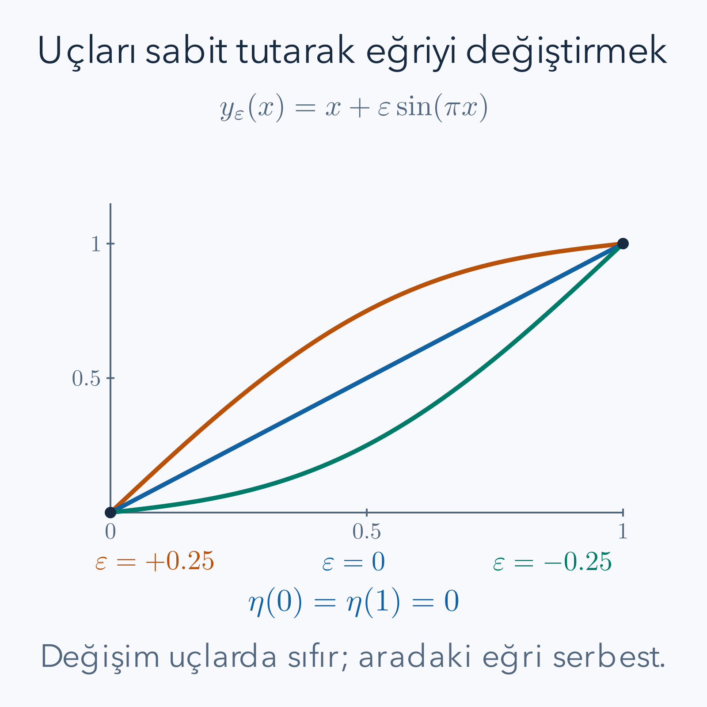

İki noktayı birleştiren çizgiler arasında en kısasını seçmek istediğimizde bilinmeyenimiz tek bir sayı değildir. Her yatay konumda çizginin yüksekliğini söyleyen bütün bir fonksiyon arıyoruz. Bir cetvel doğru parçanın kısa olduğunu gösterir; fakat daha genel enerji ve hareket problemlerinde cetvelin yerini alacak bir hesap yöntemi gerekir. **Varyasyon hesabı**, fonksiyonları girdileri olarak kabul eden bir büyüklüğün nasıl değiştiğini inceler.

Bu yazıda [türev kuralları](/blog/turevin-anlami-ve-temel-kurallari/), [belirli integral](/blog/belirli-integral-ve-temel-teorem/), [kısmi integrasyon](/blog/integral-alma-yontemleri/) ve [çok değişkenli türev](/blog/cok-degiskenli-fonksiyonlar-ve-turev/) kullanılacak. İkinci dereceden bir denklemi çözerken gereken yöntemleri de [diferansiyel denklemler](/blog/ikinci-derece-diferansiyel-denklemler/) yazısından hatırlayabiliriz. Bununla birlikte yeni hesap zincirindeki her türev ve sınır işlemini burada yeniden açacağız.

## 1. Fonksiyon ile Fonksiyonel Arasındaki Fark

Bir fonksiyon, örneğin $f(z)=z^2$, sayıyı sayıya götürür. $z=3$ yazınca $f(3)=9$ elde ederiz. Şimdi $y$ harfi, kapalı $[a,b]$ aralığındaki gerçek değerli bir fonksiyonun tamamını göstersin. Şu kuralı tanımlayalım:

$$
J[y]=\int_a^b y(x)^2\,dx.
$$

Köşeli parantez, girdinin bütün bir fonksiyon olduğunu hatırlatır. $J[y]$ ise yine tek bir sayıdır. Fonksiyonlardan sayılara giden böyle kurallara **fonksiyonel** denir. $[0,1]$ aralığında $y(x)=x$ verirsek $J[y]=\int_0^1x^2dx=1/3$; $y(x)=x^2$ verirsek $J[y]=\int_0^1x^4dx=1/5$ çıkar. Aynı tanım aralığı üzerinde iki farklı eğri iki farklı değer üretmiştir.

En küçük değeri ararken yalnız bir noktadaki yüksekliği seçemeyiz. Eğrinin her noktasındaki değeri ve bazen eğimini birlikte seçeriz. Bu nedenle fonksiyonun değişimini tek bir $\Delta y$ sayısıyla anlatmak yeterli olmaz. Nerede ne kadar değiştireceğimizi belirleyen başka bir fonksiyona ihtiyaç duyarız. Bir sayıdaki yönlü değişimin, bir fonksiyon uzayındaki karşılığını kuracağız.

## 2. Önce İzin Verilen Eğrileri Belirleyelim

Uç noktaların $y(a)=A$ ve $y(b)=B$ olduğunu varsayalım. Burada $a,b$ yatay koordinatlar, $A,B$ sabit yüksekliklerdir; $b>a$ olmalıdır. Eğrilerin en az bir sürekli türevi bulunsun. Bu sınıfa $C^1$ denir: hem $y$ hem $y'$ süreklidir. Birazdan klasik diferansiyel denklemi yazarken gerekli ek düzgünlüğü ayrıca isteyeceğiz.

Bu koşulları sağlayan eğriler **kabul edilebilir eğriler**dir. Çözümün hangi adaylarla karşılaştırılacağı problemin bir parçasıdır. Örneğin yalnız pozitif eğriler, belirli bir alanı çevreleyen eğriler veya dikey teğete izin veren parametrik yollar başka problemlerdir. Bu yazıda ek eşitsizlik veya integral kısıtı koymuyoruz; yalnız iki uç sabittir. İzin verilen değişimlerin de bu iki ucu koruması gerekir.

Bir fonksiyonel için minimum demek, aynı koşullardaki bütün yakın adayların daha büyük veya eşit değer vermesi demektir. “Yakın” sözcüğünün bir ölçüsü bulunmalıdır. Burada hem yüksekliğin hem eğimin küçük değiştiği $C^1$ yakınlığını düşünmek yeterlidir. Daha geniş fonksiyon sınıflarında varlık, yakınlık ve düzgünlük ayrı teknik sorular olur. Türetilen denklem tek başına bir minimumun var olduğunu garanti etmez.

## 3. Bir Eğriyi Nasıl Değiştiririz?

$\eta(x)$, $\eta(a)=\eta(b)=0$ koşulunu sağlayan düzgün bir değişim şekli olsun. Yunan harfi eta, eğrinin nerede yukarı veya aşağı itileceğini gösterir. $\varepsilon$ ise bu değişimin büyüklüğünü belirleyen gerçek sayıdır. Yeni eğriyi

$$
y_\varepsilon(x)=y(x)+\varepsilon\eta(x)
$$

diye kurarız. $\varepsilon=0$ başlangıç eğrisini verir. Pozitif ve negatif küçük değerler aynı şeklin iki ters yöndeki değişimidir. Uçları kontrol edelim:

$$
\begin{aligned}
y_\varepsilon(a)&=y(a)+\varepsilon\eta(a)=A+\varepsilon\,0=A,\\
y_\varepsilon(b)&=y(b)+\varepsilon\eta(b)=B+\varepsilon\,0=B.
\end{aligned}
$$

Türevi alırken $\varepsilon$ sabit tutulur; türev değişkeni $x$'tir. Bu nedenle $y_\varepsilon'=y'+\varepsilon\eta'$ olur. Hem yükseklik hem eğim değişmiştir. Fonksiyonelin girdisinde eğim de bulunuyorsa yalnız $y$'yi değiştirip $y'$'yi eski bırakmak yanlış bir varyasyondur.

*Çizimde $y=x$ doğrusu, $y_\varepsilon=x+\varepsilon\sin(\pi x)$ ailesinin merkezidir. Her eğri $(0,0)$ ve $(1,1)$ noktalarından geçer; renkli farkın uçlarda kaybolması sabit uç koşuludur.*

Burada değişim şekli ile değişimin büyüklüğünü ayırmak yeni bir hesap kolaylığı sağlar. Örneğin sabit uçlu bir eğrinin ortasını yukarı itmek için sinüs biçiminde bir şekil, iki ayrı bölgede ters yönlere itmek için iki tümsekli bir şekil seçilebilir. Bunlar aynı küçük sayının farklı noktalara dağıtılması değildir; farklı yönlerdir. Bir adayın birinci yönde iyi görünmesi ikinci yönde de iyi olduğu anlamına gelmez. Minimum iddiası bu nedenle seçtiğimiz tek bir aileden daha güçlüdür.

Değişimin ölçeği keyfidir. Bir şekli iki katına çıkarıp parametreyi yarıya indirirsek aynı yeni eğriyi elde ederiz. Yönlü türev ise değişim şekline göre doğrusal olmalıdır: iki kat büyük şekil iki kat birinci cevap üretir. Bu özellik birinci varyasyonun neden bir fonksiyon değil, değişim yönünü alıp sayı veren doğrusal bir kural olarak düşünülebileceğini açıklar. İkinci varyasyonun karesel olması da aynı ölçek hesabında görünür: şekli iki katına çıkarmak ikinci cevabı dört katına çıkarır.

## 4. Sonsuz Seçeneği Tek Sayılık Bir Türeve İndirmek

İnceleyeceğimiz genel yapı

$$
J[y]=\int_a^b F\bigl(x,y(x),y'(x)\bigr)\,dx
$$

olsun. $F$ üç bağımsız yeri olan bir fonksiyondur: yatay konum, yükseklik ve eğim. Üçüncü yere geçici olarak $v$ dersek $F_y$ ikinci yere, $F_v$ üçüncü yere göre kısmi türevdir. Bu türevleri ancak aldıktan sonra $v=y'(x)$ yerleştireceğiz. Bu ayrım, $F_y$ ile bütün ifadenin $x$ türevini birbirine karıştırmamızı önler.

Belirli bir $\eta$ seçince

$$
\phi(\varepsilon)=J[y+\varepsilon\eta]
$$

yalnız $\varepsilon$'a bağlı sıradan bir fonksiyondur. $y$ minimumsa, izin verilen her $\eta$ için $\varepsilon=0$ bu tek değişkenli fonksiyonun yerel minimumudur. İç noktadaki türev koşulundan $\phi'(0)=0$ gerekir. Buradaki “her” önemlidir: tek bir değişim şeklinde türevin sıfır olması bütün yönlerde durağanlık anlamına gelmez.

$\delta J[y;\eta]=\phi'(0)$ sayısına **birinci varyasyon** deriz. $\delta$ sembolü yeni bir bağımsız değişken değildir. Fonksiyonelin, verilen eğride ve verilen değişim yönünde birinci dereceden cevabını adlandırır. Minimum arayışını böylece her yön için bir türev koşuluna çevirmiş olduk.

Tek parametreli türevin ne yaptığını küçük bir hesapla görelim. Önceki kare integralinde aralık birim uzunlukta olsun. Başlangıç eğrisini doğru, değişim şeklini uçlarda sıfırlanan bir parabol seçelim: $y=x$ ve $\eta=x(1-x)$. Şimdilik uzunluğu ölçmüyoruz; fonksiyonel yalnız yükseklik karesinin integralidir. Aynı eğri farklı bir ölçü için farklı nitelikte olabilir.

$$
\begin{aligned}
J[x+\varepsilon x(1-x)]
&=\int_0^1\left[x+\varepsilon x(1-x)\right]^2dx\\
&=\int_0^1\left[x^2+2\varepsilon(x^2-x^3)
+\varepsilon^2(x^2-2x^3+x^4)\right]dx\\
&=\frac13+2\varepsilon\left(\frac13-\frac14\right)
+\varepsilon^2\left(\frac13-\frac12+\frac15\right)\\
&=\frac13+\frac{\varepsilon}{6}+\frac{\varepsilon^2}{30}.
\end{aligned}
$$

Şimdi türev sıradan bir polinom türevidir. Parametrenin sıfır olduğu noktada cevap altıda birdir; sıfır değildir. Küçük negatif bir değişim integral değerini azaltır. Örneğin parametre eksi onda bir seçilince birinci dereceden azalma, ikinci dereceden artıştan daha büyüktür. İki uç aynı kalmasına rağmen doğru bu fonksiyonelde durağan değildir. Bu hesap, doğru çizgiyi her ölçü için otomatik olarak en iyi sayamayacağımızı gösterir.

Burada yalnız bir değişim yönü denedik. Durağan olmadığını göstermek için tek bir başarısız yön yeterlidir; bütün yönleri incelememiz gerekmez. Buna karşılık durağan olduğunu göstermek için her izin verilen yönün türevinin sıfır olması gerekir. Mantıktaki bu asimetri hesap yükünü de belirler. Bir karşı örnek adayı eleyebilir, tek bir başarılı kontrol ise adayı kesinleştiremez. Birazdan genel formül bu sonsuz sayıda yönü tek bir diferansiyel denklemle denetlememizi sağlayacak.

## 5. Zincir Kuralını İntegralin İçinde Uygulamak

$F$'nin gerekli kısmi türevleri sürekli olsun. Sonlu aralıkta, yeterince küçük $\varepsilon$ değerleri için $y_\varepsilon$ ve $y_\varepsilon'$ ortak bir kapalı ve sınırlı bölge içinde kalır. $F_y,F_v$ bu bölgede sürekli olduğunda sınırlıdır. Sabit, integrallenebilir bir üst sınır bulunması türevi integralin içine almamızı sağlar. Tek başına bir formül görmüş olmak bu yer değiştirmeyi her uygunsuz integralde geçerli yapmaz.

$x$ sabitken $x$'in $\varepsilon$ türevi sıfır, $y+\varepsilon\eta$'nın türevi $\eta$, $y'+\varepsilon\eta'$'ninki $\eta'$ olur. Zincir kuralı:

$$
\begin{aligned}
\phi'(\varepsilon)
&=\int_a^b\left[
 F_y(x,y_\varepsilon,y_\varepsilon')\eta
 +F_v(x,y_\varepsilon,y_\varepsilon')\eta'
\right]dx,\\
\delta J[y;\eta]
&=\int_a^b\left(F_y\eta+F_v\eta'\right)dx.
\end{aligned}
$$

Son satırdaki kısmi türevler $(x,y(x),y'(x))$ boyunca değerlendirilmiştir. Durağan eğri için bu integral her kabul edilebilir $\eta$'da sıfırdır. Henüz $F_y$ veya $F_v$'yi ayrı ayrı sıfır sayamayız; integraldeki iki terim birbirini dengeleyebilir.

## 6. Kısmi İntegrasyon ve Kaybolan Sınır Terimi

Amacımız değişim fonksiyonunun türevini kaldırıp bütün ifadeyi $\eta$ ile çarpılan tek katsayıya dönüştürmektir. Çarpım türevi kuralı

$$
\frac{d}{dx}(F_v\eta)=\frac{dF_v}{dx}\eta+F_v\eta'
$$

der. İkinci terimi yalnız bırakıp integral alırsak

$$
\int_a^bF_v\eta'\,dx
=[F_v\eta]_a^b-\int_a^b\frac{dF_v}{dx}\eta\,dx
$$

buluruz. Köşeli sınır gösterimi, $F_v(b)\eta(b)-F_v(a)\eta(a)$ demektir. Her iki $\eta$ değeri sıfır olduğu için sınır terimi sıfırdır. $F_v$'nin kendisinin uçlarda sıfır olması gerekmez. Hangi çarpanın sıfırlandığını bilmek, serbest uç problemlerine geçerken özellikle önem taşır.

Sonuç artık

$$
\delta J[y;\eta]
=\int_a^b\left(F_y-\frac{dF_v}{dx}\right)\eta\,dx
$$

biçimindedir. $F_v$ bileşik fonksiyonunun $x$ boyunca türevlenebilmesini istedik. Örneğin $F$ iki kez sürekli türevlenebilir ve aranan $y$ iki kez sürekli türevlenebilir olduğunda klasik hesap geçerlidir. Daha az düzgün eğriler için kısmi integrasyon öncesi integral eşitliği zayıf denklem olarak kullanılabilir; bu yazıda o çözüm kuramını geliştirmiyoruz.

## 7. İntegral Sıfırsa İçerisi Neden Sıfırdır?

$G(x)=F_y-dF_v/dx$ sürekli olsun. Bildiğimiz, $\int_a^bG\eta\,dx=0$ eşitliğinin uçlarda sıfırlanan **bütün** düzgün $\eta$ fonksiyonları için geçerli olduğudur. Bir tek $\eta$ için geçerli olsaydı pozitif ve negatif alanlar birbirini götürebilirdi.

İçeride bir $x_0$ noktasında $G(x_0)>0$ olduğunu varsayalım. Süreklilik nedeniyle $x_0$ çevresindeki küçük bir aralıkta da $G$ pozitif kalır. O küçük aralığın dışında sıfır olan, içinde pozitif bir tümsek $\eta$ seçebiliriz. Bu seçim uç koşullarına uyar. Çarpım o aralıkta negatif değildir ve bir bölgede pozitiftir; integrali pozitif çıkar. Bu, integralin her seçimde sıfır olmasıyla çelişir. $G(x_0)<0$ için aynı tümsekle negatif integral elde ederiz.

Dolayısıyla içeride $G=0$ olmalıdır. Bu düşünce **varyasyon hesabının temel lemması**nın sürekli fonksiyonlar için özüdür. İntegrallenebilir fonksiyonların daha genel sürümünde sonuç nokta nokta yerine hemen her yerde söylenir. Burada süreklilik varsayımımız klasik noktasal sonucu kullanmamızı sağlıyor.

## 8. Euler–Lagrange Denklemini Okumak

Üçüncü argüman yeniden $y'$ ile adlandırıldığında ulaştığımız gerekli koşul

$$
\boxed{\frac{\partial F}{\partial y}
-\frac{d}{dx}\left(\frac{\partial F}{\partial y'}\right)=0}
$$

olur. Bu **Euler–Lagrange denklemi**dir. Eşitliği eksiyle çarparak iki terimin yerini değiştirmek aynı denklemi verir. Farklı kaynaklarda işaretin ters yazılması, aynı fonksiyonel tanımı kullanıldığı sürece bir çelişki değildir.

Kısmi türevde $x,y,y'$ ayrı girişler gibi tutulur. Sonra $d/dx$ türevinde eğri boyunca bağımlılıklar hesaba katılır. Örneğin $F=xy^2+(y')^2/2$ için $F_y=2xy$, $F_{y'}=y'$, $dF_{y'}/dx=y''$ olduğundan $y''=2xy$ çıkar. $F_y$ hesaplanırken $y$'yi $x$'e göre türevlemek, kısmi türevin görevini değiştirmiş olur.

Denklem ile iki uç koşulu birlikte çözülür. Çözüm bulunduğunda üç ayrı soru kalır: uçlar sağlanıyor mu, birinci varyasyon gerçekten sıfır mı, aday minimum mu? Sonuncusu için ikinci varyasyon veya doğrudan karşılaştırma kullanacağız. Birinci türev testi tek başına minimum ile maksimumu ayıramaz.

## 9. Çözülmüş Örnek: İki Nokta Arasındaki En Kısa Grafik

$(0,0)$ ve $(1,1)$ arasındaki $C^1$ grafiklerin uzunluğunu seçelim. Küçük bir yatay ilerleme $dx$ için düşey ilerleme yaklaşık $y'dx$ olur. Pisagor'dan küçük uzunluk $\sqrt{1+(y')^2}\,dx$; limitte toplam uzunluk

$$
\ell[y]=\int_0^1\sqrt{1+(y')^2}\,dx
$$

olur. Burada $F$ yüksekliğe bağlı değildir, yani $F_y=0$. Eğim türevinde karekökün zincir kuralını kullanalım:

$$
F_{y'}=\frac12(1+(y')^2)^{-1/2}\,2y'
=\frac{y'}{\sqrt{1+(y')^2}}.
$$

Euler–Lagrange bu ifadenin $x$ türevini sıfır yapar. Dolayısıyla $y'/\sqrt{1+(y')^2}=C$ sabittir. Sonlu eğimde $|C|<1$ olur. Kare alıp düzenlersek

$$
\begin{aligned}
(y')^2&=C^2\bigl(1+(y')^2\bigr),\\
(1-C^2)(y')^2&=C^2.
\end{aligned}
$$

İşaret özgün eşitlikten seçilir; eğim $y'=C/\sqrt{1-C^2}$ sabittir. İntegral alınca $y=mx+d$ gelir. İlk uç $d=0$, ikinci uç $m=1$ verir. Aday $y=x$, uzunluğu $\sqrt2$'dir.

İkinci türevde işaretin nereden geldiğini açalım. Eğim değişkeni artık $v$ olmak üzere $g(v)=\sqrt{1+v^2}$ fonksiyonu için ilk türev $g'(v)=v(1+v^2)^{-1/2}$'dir. Çarpım kuralını bir kez daha kullanırsak

$$
\begin{aligned}
g''(v)&=(1+v^2)^{-1/2}-v^2(1+v^2)^{-3/2}\\
&=\frac{1+v^2-v^2}{(1+v^2)^{3/2}}
=\frac1{(1+v^2)^{3/2}}>0.
\end{aligned}
$$

Bu sonuç birinci türevin artan olduğunu söyler. Dolayısıyla herhangi bir sabit eğim çevresinde grafiğin teğetinin üstünde kalması yalnız bir çizim gözlemi değildir. Sabit eğimden daha büyük bir değere giderken birinci türev başlangıçtaki türevden küçük olamaz; daha küçük değere giderken integral yönü de ters döner. İki durumda da fonksiyon artışı, teğetin öngördüğü doğrusal artıştan az değildir. Dışbükeylik eşitsizliğinin burada kullandığımız gerekçesi budur. Temel teoremle tam farkı yazarsak

$$
g(v)-g(1)-g'(1)(v-1)=\int_1^v[g'(s)-g'(1)]\,ds
$$

elde edilir. $v>1$ için integrand negatif değildir. $v<1$ için integrand sıfırdan büyük değildir ama integralin yönü de terstir; iki işaret birbirini götürür. Eşitlik yalnız $v=1$'de oluşur, çünkü birinci türev kesin artandır. Bu hesap, kullanacağımız teğet eşitsizliğini her gerçek eğim için doğrular.

Minimum olduğunu doğrudan doğrulayabiliriz. $g(v)=\sqrt{1+v^2}$ fonksiyonunun ikinci türevi $g''(v)=(1+v^2)^{-3/2}>0$'dır. Dışbükeylikten teğet doğru fonksiyonun altında kalır: $g(v)\ge g(1)+g'(1)(v-1)$. İntegral alınca son terim $g'(1)\int_0^1(y'-1)dx=g'(1)[y(1)-y(0)-1]=0$ olur. Böylece her adayın uzunluğu en az $\sqrt2$'dir; eşitlik yalnız sabit eğimde oluşur. Hesabımız yalnız durağan bir aday bulmamış, bu sınıfta küresel minimumu belirlemiştir.

## 10. Çözülmüş Örnek: Eğim Karesi Neden Doğruyu Seçer?

Şimdi $[0,2]$ aralığında $y(0)=1$, $y(2)=3$ olsun:

$$
J[y]=\int_0^2(y')^2dx.
$$

Bu uzunluk değildir; büyük eğimleri daha ağır cezalandıran başka bir ölçüdür. $F_y=0$, $F_{y'}=2y'$ ve onun türevi $2y''$ olduğundan $y''=0$ gerekir. İki integral $y=mx+d$ verir. $d=1$ ve $2m+1=3$ den $m=1$; aday $y_*(x)=x+1$ ve $J[y_*]=\int_0^2 1dx=2$ çıkar.

Her rakibi $y_*+\eta$ biçiminde yazabiliriz; iki eğri aynı uçları taşıdığı için $\eta(0)=\eta(2)=0$ olur. Kareyi açalım:

$$
\begin{aligned}
J[y_*+\eta]
&=\int_0^2(1+\eta')^2dx\\
&=2+2\int_0^2\eta'dx+\int_0^2(\eta')^2dx\\
&=2+2[\eta]_0^2+\int_0^2(\eta')^2dx\\
&=2+\int_0^2(\eta')^2dx.
\end{aligned}
$$

Son integral negatif olamaz. Sıfır olması için sürekli $\eta'$ her yerde sıfır; ardından $\eta$ sabit; uç değeri nedeniyle o sabit sıfır olmalıdır. Minimum tektir. Burada küçük değişim varsayımına bile gerek kalmadı; her büyüklükteki kabul edilebilir rakiple karşılaştırdık.

Somut bir eğriyle farkı hesaplayalım. $\eta=\varepsilon x(2-x)$ seçince $\eta'=\varepsilon(2-2x)$ olur. $\int_0^2(2-2x)^2dx=\int_0^2(4-8x+4x^2)dx=8-16+32/3=8/3$ bulunur. O halde $J=2+8\varepsilon^2/3$; örneğin $\varepsilon=0.3$ için $J=2.24$'tür. Pozitif ve negatif sapmalar aynı artışı vermiştir.

## 11. Çözülmüş Örnek: Potansiyel İçeren Sabit Uç Problemi

Boyutsuz $[0,1]$ aralığında uçlar sıfır olsun. Eğim maliyeti ile yerel potansiyeli birleştirelim:

$$
J[y]=\int_0^1\left[\frac12(y')^2+V(y)\right]dx,
\qquad V(y)=\frac12y^2-2y.
$$

Potansiyel $V(y)=(y-2)^2/2-2$ olduğundan yüksekliğin 2'ye yaklaşmasını tercih eder; fakat sıfır uçlara bağlanmak eğim maliyeti doğurur. Bu, yalnız $V$'yi her noktada minimum yaparak çözülemez. Sabit $y=2$ uç koşullarına uymaz. Aranan eğri bu iki etkinin dengesidir.

Türevler $F_y=y-2$ ve $F_{y'}=y'$ verir. Denklem $y-2-y''=0$, yani $y''-y=-2$ olur. Sabit özel çözüm 2'dir. Homojen çözüm $Ae^x+Be^{-x}$ olduğundan simetrik merkez kullanarak

$$
y(x)=2+C\cosh(x-1/2)+D\sinh(x-1/2)
$$

yazabiliriz. Burada $\cosh z=(e^z+e^{-z})/2$ çift, $\sinh z=(e^z-e^{-z})/2$ tek fonksiyondur. İki uç denkleminden biri diğerinden çıkarılınca $2D\sinh(1/2)=0$, yani $D=0$ gelir. Kalan denklem $2+C\cosh(1/2)=0$ verir:

$$
\boxed{y_*(x)=2\left[1-\frac{\cosh(x-1/2)}{\cosh(1/2)}\right].}
$$

Uçlarda oran 1, dolayısıyla yükseklik sıfırdır. Hiperbolik fonksiyonların türevini de üstel tanımlarından kontrol edelim. Üstelde eksi argümanın türevi bir eksi getirir. Bu yüzden $(\cosh z)'=(e^z-e^{-z})/2=\sinh z$ ve $(\sinh z)'=(e^z+e^{-z})/2=\cosh z$ olur. İçteki $x-1/2$ ifadesinin türevi 1 olduğu için ek çarpan gelmez. Paydadaki hiperbolik kosinüs ise sabit bir sayıdır; ona bölüm türevi uygulamak gerekmez. İki türev alınca $y_*''=-2\cosh(x-1/2)/\cosh(1/2)$; buna $-y_*+2$ eklenince sıfır çıkar. Ortadaki yükseklik $2[1-1/\cosh(1/2)]\approx0.22636$'dır. Potansiyelin tercih ettiği 2'ye ulaşmaması, eğim maliyetinin baskınlığını gösterir.

Değerini uzun kareler açmadan bulabiliriz. Denklem $-y_*''+y_*=2$'yi $y_*$ ile çarpıp integral alalım. Kısmi integrasyonda uç çarpımı sıfırdır; $\int[(y_*')^2+y_*^2]dx=2\int y_*dx$ elde edilir. Fonksiyonelde yerine koyunca $J[y_*]=-\int_0^1y_*dx$ çıkar. $\cosh$ integrali $\sinh$ olduğundan

$$
\begin{aligned}
\int_0^1y_*dx
&=2-\frac{2}{\cosh(1/2)}[\sinh(x-1/2)]_0^1\\
&=2-4\tanh(1/2),\\
J[y_*]&=-2+4\tanh(1/2)\approx-0.151531.
\end{aligned}
$$

Minimum kontrolünde $y_*+\eta$ yazıp kareleri açarız. Birinci dereceden terim $\int[y_*'\eta'+(y_*-2)\eta]dx$ olup denklem ve sıfır uçlar nedeniyle sıfırdır. Bu sıfırlanmayı terim terim görelim. İlk terime kısmi integrasyon uygulayınca $\int y_*'\eta'\,dx=[y_*'\eta]_0^1-\int y_*''\eta\,dx$ gelir. Sınırda değişim sıfırdır. Geri kalan iki terim birleştirilince $\int(-y_*''+y_*-2)\eta\,dx$ oluşur. Parantez, çözdüğümüz diferansiyel denklemin tam sol tarafıdır; her noktada sıfırdır. Bu nedenle çapraz katkıyı ihmal etmedik, çözüm denklemiyle tam olarak sıfırladık. Kalan fark $\frac12\int[(\eta')^2+\eta^2]dx$'tir. Sıfırdan farklı her sürekli değişimde pozitiftir. Bu aday da tek küresel minimumdur.

## 12. İkinci Varyasyon Tam Olarak Neyi Ölçer?

$\delta^2J[y;\eta]=\phi''(0)$ tanımıyla, aynı yön boyunca ikinci dereceden değişimi ölçeriz. $F$ yeterince düzgünse zincir kuralını bir kez daha uygulamak

$$
\delta^2J
=\int_a^b\left[
F_{yy}\eta^2+2F_{yv}\eta\eta'+F_{vv}(\eta')^2
\right]dx
$$

verir. Alt indisleri ayrı türevlerin sırası olarak okumalıyız. $F_{yy}$ yükseklik yerine göre iki türev, $F_{vv}$ eğim yerine göre iki türev, $F_{yv}$ ise önce bir yerine sonra diğerine göre türevdir. Bunlar fonksiyonun kareleri veya yeni bağımsız değişkenler değildir. Yeterli süreklilikte iki karışık türev eşit olduğundan tek bir karışık terim yazabildik. Karışık terimdeki 2, $F_y\eta$ ve $F_v\eta'$ türevlerinden birer aynı katkı gelmesindendir. Taylor açılımında ise $J[y+\varepsilon\eta]=J[y]+\varepsilon\delta J+\varepsilon^2\delta^2J/2+\cdots$ yazılır. İkinci varyasyon ile açılımdaki ikinci dereceli terimin katsayısı arasındaki $1/2$ farkını korumalıyız.

Minimum için her yönde ikinci varyasyonun negatif olmaması gerekir. Fakat yalnız tek tek yönlerde pozitiflikten genel bir yeterlilik teoremi çıkarmak, fonksiyon uzayında ek denetimler gerektirebilir. Yukarıdaki iki kuadratik örnekte kalan terimler tam olarak hesaplandığı için bu teknik sorun yoktur. En kısa grafik örneğinde de dışbükeylikle bütün rakiplere karşı doğrudan karşılaştırma yaptık.

## 13. Durağanlık Minimum Olmayabilir

Sıfır uçlu $[0,1]$ aralığında

$$
K[y]=\frac12\int_0^1\left[(y')^2-4\pi^2y^2\right]dx
$$

fonksiyonelini düşünelim. $y=0$ için birinci varyasyon sıfırdır ve Euler–Lagrange denklemi $y''+4\pi^2y=0$ sağlanır. Fakat birinci ve üçüncü sinüs yönleri farklı sonuç verir. $y=\varepsilon\sin(n\pi x)$ koyarsak sinüs ve kosinüs karelerinin her birinin integrali $1/2$'dir:

$$
K[\varepsilon\sin(n\pi x)]
=\frac{\varepsilon^2\pi^2}{4}(n^2-4).
$$

$n=1$ için $-3\pi^2\varepsilon^2/4$, $n=3$ için $5\pi^2\varepsilon^2/4$ çıkar. Keyfi küçük sapmalarla hem daha düşük hem daha yüksek değerler vardır; sıfır eğri bir **eyer**dir. Bu örnek, “Euler–Lagrange çözüldü, öyleyse minimum bulundu” çıkarımının neden yanlış olduğunu somut olarak gösterir.

## 14. Sonucu Kullanırken Sormamız Gerekenler

Varyasyon hesabının zinciri artık açıktır: aday sınıfını belirleriz, uçları bozmayan değişimleri kurarız, tek parametreli türevi alırız, kısmi integrasyondaki sınırları kontrol ederiz, her değişime karşı sıfırlanmayı diferansiyel denkleme çeviririz. Çözümün türünü ise ayrıca inceleriz. Fizikte aynı yapı bazen enerji minimumunu, bazen yalnız durağan bir etkiyi anlatır; kullanılan fonksiyonelin anlamı değişse de türev mantığı aynıdır.

Uçlardan biri serbest bırakılırsa $\eta$ o uçta sıfır olmak zorunda değildir; sınır çarpımını silmek artık doğru olmaz. Ek kısıtlar varsa izin verilen $\eta$'lar değişir ve temel lemmanın “her değişim” varsayımı yeniden değerlendirilir. Bir çizgiyi $y(x)$ grafiğiyle temsil etmek mümkün değilse parametrik tanım gerekir. Bu sınırlar yöntemin kusuru değil, kurduğumuz problemin kapsamıdır.

Serbest uç farkını basit bir örnekle somutlaştırabiliriz. Eğim karesi fonksiyonelinde sol yükseklik sabit, sağ yükseklik serbest olsaydı sağdaki değişim keyfi kalırdı. İç denklem yine eğimin sabit olduğunu söylerdi. Fakat sınır terimindeki sağ çarpımın her değişimde sıfır olması, sağ eğimin sıfır olmasını gerektirirdi. Sabit eğim ile sağda sıfır eğim birlikte bütün eğrinin yatay olmasını seçerdi. İki yüksekliği baştan sabitlemekle tek yüksekliği sabitlemek aynı minimum problemi değildir; farklı cevabın nedeni integraldeki formülün değişmesi değil, izin verilen rakiplerin değişmesidir.

Bu yazıda hesapladığımız minimumlar, adayların yeterince düzgün olduğu sınıfta açık karşılaştırmayla doğrulandı. Düzgünlük gereksinimini kaldırmak veya bir fonksiyonelin alt sınırına gerçekten ulaşan bir adayın varlığını kanıtlamak ayrı bir çalışmadır. Yaklaşan eğriler dizisi her zaman izin verilen sınıfta bir limit bırakmayabilir. Bu yüzden yöntem uygulanırken “denklem çözülemiyor” ile “minimum yok” ifadeleri de ayrılmalıdır. Biri hesap güçlüğü, diğeri problemin yapısı hakkında bir iddiadır.

## Kaynaklar

Türetimler ve örnek hesaplar bu yazı için kurulmuştur. Fonksiyonel türev, sabit uçlar ve Euler–Lagrange yapısını karşılaştırmak için [MIT OCW, Gilbert Strang: Calculus of Variations](https://ocw.mit.edu/courses/18-086-mathematical-methods-for-engineers-ii-spring-2006/e94c05947ed036cd6ad0150102087062_am72.pdf) ve [MIT OCW 18.S096: Calculus of Variations](https://ocw.mit.edu/courses/18-s096-matrix-calculus-for-machine-learning-and-beyond-january-iap-2023/mit18_s096iap23_lec10.pdf) açık ders notları kullanılabilir. İlk kaynak zayıf ve güçlü denklem ayrımını, ikinci kaynak fonksiyonlardan sayılara giden dönüşümün türevini de ele alır.
