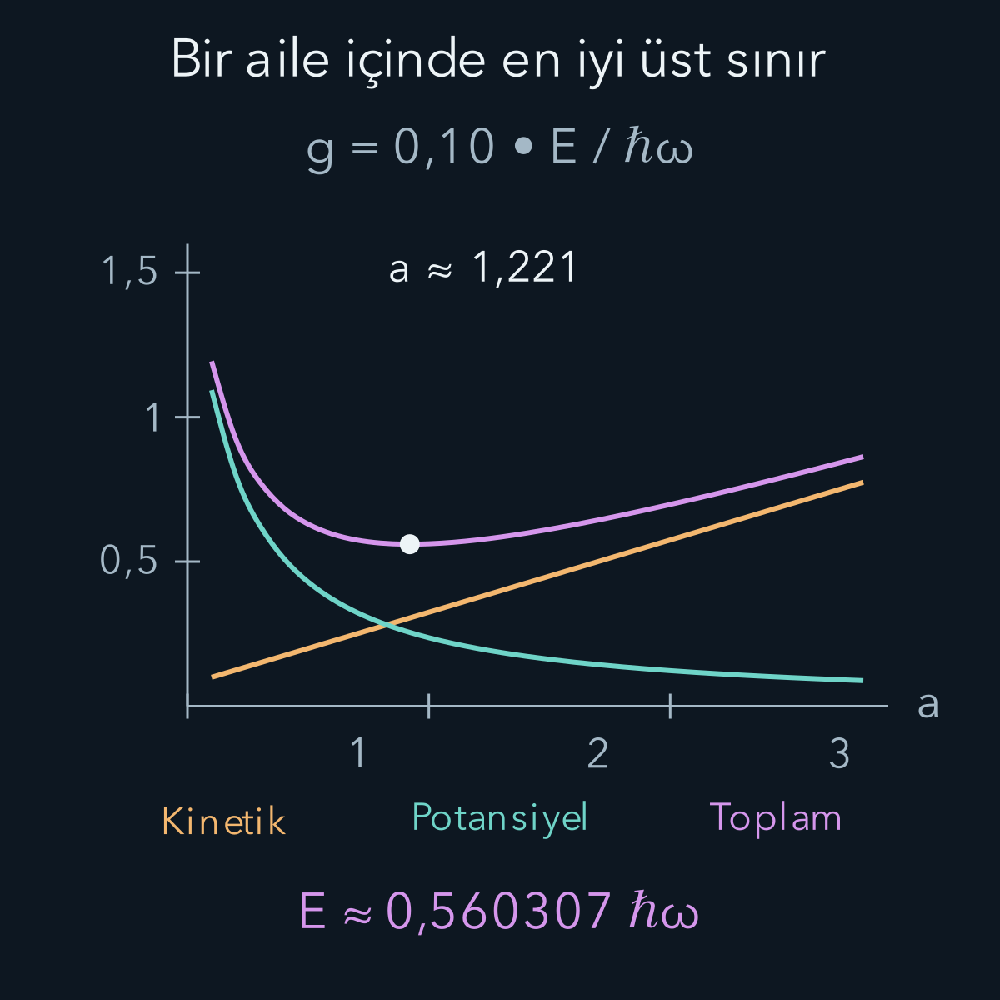
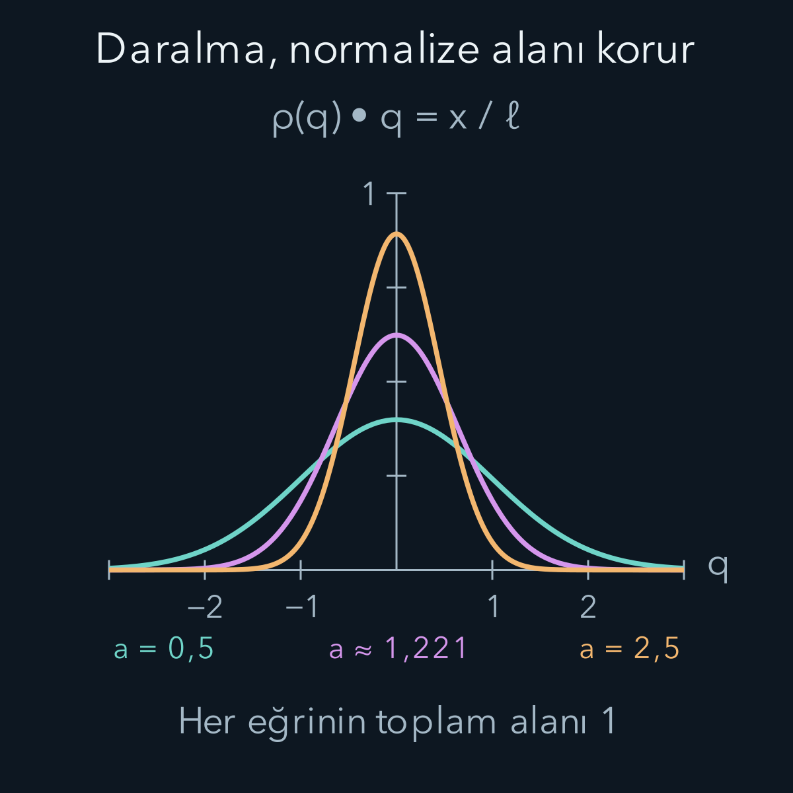

import ArticleVideo from '@/components/ArticleVideo.astro'
import kavram from './media/01-kavram.mp4?url'
import kavramPoster from './media/01-kavram.jpg?url'

Bir Hamiltonyenin temel durumunu tam çözemediğimizi düşünelim. Yine de normalize, fiziksel olarak kabul edilebilir bir dalga fonksiyonu deneyip ortalama enerjisini hesaplayabiliriz. İlginç olan, bu sayının yalnız bir tahmin olmamasıdır: Uygun koşullarda gerçek temel enerjinin altına inemez. **Varyasyon yöntemi**, bu üst sınırı olabildiğince aşağı çekmek için deneme durumunu değiştirme fikridir.

[Dejenerasyon ve Zeeman yazısında](/blog/dejenerasyon-ve-zeeman-etkisi/) doğru başlangıç altuzayını seçmeyi öğrendik. [Pertürbasyon yöntemi](/blog/zamandan-bagimsiz-perturbasyon-teorisi/) bilinen bir Hamiltonyenin çevresinde küçük değişim arıyordu. Burada hareket noktamız bir deneme ailesidir; ek etkinin mutlaka küçük olması gerekmez. [Beklenen değer](/blog/kuantum-gozlenebilirleri-ve-beklenen-deger/), [harmonik osilatör](/blog/kuantum-harmonik-osilatoru/), [integral](/blog/belirli-integral-ve-temel-teorem/) ve türevle minimum arama bilgilerini kullanacağız. Yeni integrallerin nereden çıktığını ayrıca göstereceğiz.

## 1. Ortalamadan daha düşük bir temel enerji

$H$, enerjisi aşağıdan sınırlı, öz-eşlenik bir Hamiltonyen olsun; bu özellik enerji ölçümünün gerçek değerlerle tutarlı olmasını sağlar. En düşük özdeğerini $E_0$, normalize özdurumunu $|0\rangle$ ile gösterelim. Önce ayrık bir özbazla açıklayalım: $H|n\rangle=E_n|n\rangle$ ve bütün $E_n\ge E_0$ olsun. Normalize deneme durumunu bu bazda açabiliriz:

$$
|\phi\rangle=\sum_n c_n|n\rangle,
\qquad \sum_n|c_n|^2=1.
$$

$c_n$ karmaşık genliklerdir. Ortonormallik, enerji beklentisindeki çapraz terimleri kaldırır:

$$
E[\phi]=\langle\phi|H|\phi\rangle
=\sum_n|c_n|^2E_n.
$$

Köşeli parantez, enerjinin seçilen fonksiyona bağlı olduğunu hatırlatır. $E_0$'ı çıkaralım:

$$
\begin{aligned}
E[\phi]-E_0&=\sum_n|c_n|^2(E_n-E_0)\\
&\ge0.
\end{aligned}
$$

Çünkü her olasılık ve her enerji farkı sıfır veya pozitiftir. Böylece:

$$
\boxed{E_0\le E[\phi].}
$$

Bu ispat için gerçek özdurumları sayısal olarak bilmek gerekmez; onların varlığı ve enerji sıralaması yeterlidir. Sürekli spektrum katkıları varsa toplam yerine ilgili integraller eklenir; aşağıdan sınırlılık yine belirleyicidir. Burada bağlı bir temel durum bulunan örneklerle çalışacağız.

Eşitlik, deneme durumu yalnız temel enerji altuzayında bulunduğunda gerçekleşir. Temel enerji dejenere değilse durum, genel faz dışında gerçek temel durumdur. Temel enerji dejenereyse bu altuzaydaki her normalize birleşim aynı en düşük enerjiye sahiptir.

## 2. Her yazdığımız fonksiyon uygun bir deneme değildir

Deneme durumu sıfır olmayan, normalize edilebilir ve sonlu enerji beklentisine sahip bir durum olmalıdır. Ayrıca problemin sınır koşullarını ve varsa parçacık simetrisini sağlamalıdır. Örneğin sonsuz kuyuda duvarlarda sıfırlanmayan sıradan bir Gauss fonksiyonu uygun deneme değildir. Onu duvarın dışında birden sıfırlamak da türevlerde sorun yaratabilir; kinetik enerji hesabını yeniden denetlemek gerekir.

Bu koşulların matematikteki karşılığı, denemenin Hamiltonyenin uygun tanım kümesinde bulunmasıdır. Bir diferansiyel ifadeyi kâğıda yazmak, onun her fonksiyona uygulanabileceği anlamına gelmez. Duvarlarda hangi değerlerin izinli olduğu da Hamiltonyenin tanımının parçasıdır. Aşağıdaki Gauss denemeleri bütün gerçek eksende düzgün ve hızla sönen fonksiyonlardır; hem türevleri hem gerekli potansiyel integralleri sonludur. Bu nedenle enerji hesabındaki kısmi integrasyon adımı güvenlidir. Daha az düzgün denemelerde bazen enerji, birinci türevlerin integralinden tanımlanabilir; bunun için yine sınır koşullarını sağlayan uygun enerji tanım kümesi gerekir. Bu teknik genişletmeyi keyfî sıçramalara izin olarak yorumlayamayız.

Normalize edilmemiş $|f\rangle$ ile çalışmak istersek oran kullanırız:

$$
\mathcal R[f]=\frac{\langle f|H|f\rangle}{\langle f|f\rangle}.
$$

Buna Rayleigh oranı denir. f'yi sıfır olmayan bir sabitle çarpınca pay ve payda aynı mutlak kareyle çarpılır; oran değişmez. Paydanın unutulması üst sınır güvencesini yok eder: Fonksiyonu küçülterek normalize edilmemiş enerji integralini keyfî biçimde küçültmek fiziksel bir iyileştirme değildir.

Çok elektronlu bir problemde düşük enerji bulmak için Pauli koşulunu ihlal eden bir durum seçersek, fiziksel fermiyon probleminin çözümünü yaklaşık bulmuş olmayız. Varyasyon yöntemi, seçtiğimiz Hamiltonyenin doğru durum uzayında uygulanır. Bu yüzden uygunluk kontrolü minimum aramadan önce gelir.

Normalizasyonun etkisini somutlaştıralım. Uygun bir normalize fonksiyonun enerji beklentisi bir enerji birimi olsun. Fonksiyonun genliğini yarıya indirirsek norm karesi dörtte bire, paydaki enerji integrali de dörtte bire iner. Payı tek başına raporlamak daha düşük enerji bulmuşuz izlenimi verir. Oysa oran hâlâ birdir; aynı fiziksel durumun yalnız ölçeğini değiştirmişizdir. Gerçek eniyileme, olasılık dağılımının şeklini değiştirerek gerçekleşir. Bu yüzden bir sonraki bölümde genişlik parametresini her değiştirdiğimizde normalizasyon katsayısını da yeniden belirleyeceğiz.

## 3. Genişliği değişen bir Gauss ailesi

Gerçek eksenin tamamında şu deneme fonksiyonunu seçelim:

$$
\phi_\alpha(x)=A\,e^{-\alpha x^2/2},\qquad \alpha>0.
$$

x konum, α genişliği kontrol eden pozitif parametre, A normalizasyon katsayısıdır. Üs boyutsuz olacağından α'nın birimi uzunluğun ters karesidir. α büyüyünce eğri daralır. A'yı gerçek ve pozitif seçebiliriz; genel faz enerji beklentisini değiştirmez.

Gauss integralini $I(\alpha)=\int_{-\infty}^{\infty}e^{-\alpha x^2}dx=\sqrt{\pi/\alpha}$ diye yazalım. Bu bağıntı, α=1 integralinin karesini iki boyutlu düzlemde kutupsal koordinatlara çevirerek elde edilir:

$$
\begin{aligned}
I(1)^2&=\int_0^{2\pi}d\theta\int_0^\infty r e^{-r^2}dr\\
&=2\pi(1/2)=\pi.
\end{aligned}
$$

Sonra $u=\sqrt\alpha x$ değişkeni genel α sonucunu verir.

Normalizasyon $A^2 I(\alpha)=1$ istediği için:

$$
A=\left(\frac\alpha\pi\right)^{1/4}.
$$

Bunun karesinden olasılık yoğunluğu:

$$
|\phi_\alpha(x)|^2=\sqrt{\frac\alpha\pi}e^{-\alpha x^2}.
$$

Dalga fonksiyonu ile yoğunluğun üslerindeki iki farkına dikkat edelim. Ortalama konum simetriden sıfırdır; genişliği bulmak için $\langle x^2\rangle$ gerekir.

## 4. İki gerekli momenti türeterek bulmak

I integralinin α'ya göre türevi, integrale bir $-x^2$ çarpanı getirir. Gauss'un hızla sönmesi bu türevi integral içine almamıza izin verir:

$$
\begin{aligned}
I'(\alpha)&=-\int x^2e^{-\alpha x^2}dx\\
&=-\frac{\sqrt\pi}{2\alpha^{3/2}}.
\end{aligned}
$$

Dolayısıyla normalize yoğunlukla:

$$
\langle x^2\rangle=-\frac{I'(\alpha)}{I(\alpha)}
=\frac1{2\alpha}.
$$

Bir kez daha türev alınca eksi işaret de kaybolur:

$$
\begin{aligned}
I''(\alpha)&=\int x^4e^{-\alpha x^2}dx\\
&=\frac{3\sqrt\pi}{4\alpha^{5/2}}.
\end{aligned}
$$

Yine normalizasyon integraline bölerek:

$$
\langle x^4\rangle=\frac3{4\alpha^2}.
$$

İntegraller burada tüm gerçek eksendedir. $\langle x\rangle=0$ olduğundan konum standart sapması $\Delta x=1/\sqrt{2\alpha}$ olur. α'nın genişlikle ters ilişkisini artık nicel olarak da görüyoruz.

## 5. Kinetik enerjinin daralmayla artması

Kinetik enerji işleci $T=-\hbar^2d^2/(2m\,dx^2)$'dir; m parçacık kütlesidir. Türevleri açıkça alalım:

$$
\begin{aligned}
\phi_\alpha'&=-\alpha x\phi_\alpha,\\
\phi_\alpha''&=(\alpha^2x^2-\alpha)\phi_\alpha.
\end{aligned}
$$

Enerji beklentisine koyduğumuzda:

$$
\begin{aligned}
\langle T\rangle&=-\frac{\hbar^2}{2m}(\alpha^2\langle x^2\rangle-\alpha)\\
&=\frac{\hbar^2\alpha}{4m}.
\end{aligned}
$$

Aynı sonucu kısmi integrasyonla $\langle T\rangle=\hbar^2\int|\phi_\alpha'|^2dx/(2m)$ biçiminde de elde ederiz; sınırdaki terim Gauss sönümü nedeniyle sıfırdır. Bu ikinci ifade kinetik enerjinin neden pozitif olduğunu açıkça gösterir.

Dar bir deneme, potansiyelin düşük olduğu merkeze daha fazla ağırlık koyabilir. Fakat hızlı uzaysal değişim türevleri büyütür; kinetik enerji artar. Varyasyonun minimumu bu iki eğilimin dengesidir. Yalnız potansiyel ortalamasını küçültmek, toplam enerjiyi küçültmekle aynı değildir.

## 6. Önce bildiğimiz osilatörle sınayalım

$V(x)=m\omega^2x^2/2$ için potansiyel beklentisi $m\omega^2/(4\alpha)$ olur. ω osilatörün açısal frekansıdır. Deneme enerjisi:

$$
E(\alpha)=\frac{\hbar^2\alpha}{4m}+
\frac{m\omega^2}{4\alpha}.
$$

Türevi sıfırlayalım: $\hbar^2/(4m)-m\omega^2/(4\alpha^2)=0$. Buradan pozitif çözüm $\alpha_*=m\omega/\hbar$ çıkar. Yıldız, en iyi parametreyi işaretler. İkinci türev $m\omega^2/(2\alpha^3)>0$ olduğundan bu bir minimumdur. Her iki enerji katkısı burada $\hbar\omega/4$; toplam $\hbar\omega/2$ olur.

Bu sayı bildiğimiz tam temel enerjidir. Neden bu kadar iyi çıktı? Çünkü harmonik osilatörün gerçek temel dalga fonksiyonu seçtiğimiz Gauss ailesinin içindedir. Varyasyon ilkesi, her deneme ailesinin gerçek çözümü içerdiğini söylemez. İyi sonucu yöntemin otomatik kesinliğiyle karıştırmamalıyız.

## 7. Dördüncü dereceli terim ekleyelim

Şimdi $V(x)=m\omega^2x^2/2+\kappa x^4$ seçelim; $\kappa>0$ enerji/uzunluk⁴ birimindedir. Pozitif ek terim, merkezden uzaklaşmayı daha maliyetli yapar. Önceki moment sayesinde:

$$
\begin{aligned}
E(\alpha)&=\frac{\hbar^2\alpha}{4m}+\frac{m\omega^2}{4\alpha}\\
&\quad+\frac{3\kappa}{4\alpha^2}.
\end{aligned}
$$

Boyutları azaltmak için $\ell=\sqrt{\hbar/(m\omega)}$ uzunluğunu, $a=\alpha\ell^2$ boyutsuz genişlik parametresini ve $g=\kappa\ell^4/(\hbar\omega)$ boyutsuz bağlaşımı tanımlayalım. a burada bir yükseltme/alçaltma işleci değildir; sıradan pozitif sayıdır. Enerji birimi $\hbar\omega$ ile:

$$
\begin{aligned}
\varepsilon(a)&=\frac{E(a)}{\hbar\omega}\\
&=\frac a4+\frac1{4a}+\frac{3g}{4a^2}.
\end{aligned}
$$

Minimizasyon için:

$$
\varepsilon'(a)=\frac14-\frac1{4a^2}-\frac{3g}{2a^3}=0.
$$

Pozitif $4a^3$ ile çarparsak $a^3-a-6g=0$ denklemini buluruz. Ayrıca $\varepsilon''(a)=1/(2a^3)+9g/(2a^4)>0$ olduğundan a>0 bölgesinde enerji kesin dışbükeydir. Enerji a sıfıra yaklaşırken de sonsuza giderken de büyür; tek durağan nokta küresel minimumdur.

Türevi sıfırlamakla hangi soruyu çözdüğümüzü netleştirelim. Burada yalnız bir sayıyı, Gauss'un genişliğini değiştiriyoruz. Dolayısıyla bulduğumuz nokta, bu aile içinde daha iyi bir genişlik bulunmadığını söyler. Bütün olası dalga fonksiyonları arasında minimum bulduğumuzu söylemez. Örneğin tepeye yakın biçimi ile uzaktaki kuyrukları birbirinden bağımsız değiştirmek, tek bir genişlik parametresinin yapamadığı bir iyileştirme sağlayabilir. Ailenin en iyi üyesi ile bütün durum uzayının en iyi üyesi arasındaki fark, varyasyon hesabının kalan hatasıdır.

Üst sınırın gücü, optimumu kusursuz bulmamıza da bağlı değildir. Pozitif herhangi bir genişlik seçip integralleri doğru hesaplarsak geçerli bir deneme enerjisi elde ederiz. Minimumu daha hassas aramak sınırı iyileştirir; yöntemin eşitsizliğini ilk kez doğru hale getirmez. Buna karşılık sayısal integralde hata yapıp enerjiyi gerçekte olduğundan küçük hesaplarsak üst sınır güvencesini bilgisayarda kaybedebiliriz. Matematiksel teorem ile sayısal uygulamanın doğruluğunu ayrı kontrol etmemizin nedeni budur.

## 8. Sayısal bir üst sınır

$g=0{,}10$ seçelim. Kübik denklemi sayısal çözünce $a_*\simeq1{,}221197$ bulunur. Enerji:

$$
E_{\mathrm{G}}\simeq0{,}560307\,\hbar\omega
$$

olur. G alt indisi Gauss ailesinden gelen sonucu belirtir. Parametreyi değiştirmeden eski osilatör Gauss'unu, a=1'i kullansaydık $E=(1/2+3g/4)\hbar\omega=0{,}575\hbar\omega$ bulurduk. Yalnız genişliği ayarlamak üst sınırı 0,575'ten 0,560307'ye indirdi.

Daha geniş bir osilatör bazında sayısal köşegenleştirme yaklaşık $0{,}559146\hbar\omega$ verir. Bu, karşılaştırma için yakınsaklığı ayrıca sınanmış bir sayısal sonuçtur; basit bir kapalı tam çözüm veya bu yazıda kanıtlanmış alt sınır değildir. Gauss tahmini bu sayının yaklaşık yüzde 0,21 üzerindedir. Kesin matematiksel güvencemiz yine $E_0\le E_{\mathrm G}$ eşitsizliğidir; yalnız bu üst sınırdan hatanın ne kadar olduğunu çıkaramayız.

$a_*>1$ olması dalga fonksiyonunun eski osilatöre göre daraldığını gösterir. Konum standart sapması $\ell/\sqrt{2a_*}\simeq0{,}640\ell$ olur; a=1 için $0{,}707\ell$ idi. Dördüncü derece potansiyelin uzak konumları daha pahalı yapmasıyla bu daralma tutarlıdır. Yine de gerçek yoğunluğun her noktasını bu tek parametreyle doğru bulduğumuzu iddia etmiyoruz.

<ArticleVideo src={kavram} poster={kavramPoster} title="Gauss denemesinde en iyi genişliği aramak" caption="g = 0,10 sabitken deneme parametresi a taranıyor. Üstte normalize yoğunluk, altta aynı denemenin enerji eğrisi ve güncel noktası var. Daralma kinetik maliyeti artırırken genişleme potansiyel maliyeti artırıyor. Hareket deneme ailesini tarar; parçacığın zaman evrimi değildir." />

Bu örnekte basit bir alt sınır da bağımsız bir gerekçeyle elde edilebilir. $\kappa x^4$ her yerde sıfır veya pozitiftir. Bu yüzden herhangi bir normalize durumun yeni Hamiltonyendeki beklentisi, aynı durumun harmonik Hamiltonyendeki beklentisinden küçük değildir. Harmonik beklenti de kendi temel enerjisi $\hbar\omega/2$'den küçük olamaz. Sonuç olarak $g=0{,}10$ için kanıtlanmış aralık:

$$
0{,}5\hbar\omega\le E_0\le0{,}560308\hbar\omega
$$

olur; üst uç güvenli yönde yukarı yuvarlandı. Buradaki alt sınır varyasyon denemesinin otomatik çıktısı değildir; potansiyelleri karşılaştırarak ayrıca elde edilmiştir. Sayısal köşegenleştirmenin verdiği 0,559146 değeri bu aralığın içindedir, fakat daha dar bir kesin aralık iddiası için ek hata denetimi gerekir. Üst ve alt sınırları bu şekilde ayırmak, çok basamaklı bir sayının tek başına kesinlik anlamına gelmediğini hatırlatır.

Yöntem küçük g'ye bağlı olmadığı için g=1 örneğini de aynı ailede ele alabiliriz. Kübik denklem $a^3-a-6=0$ bu kez tam olarak a=2 verir. Enerji katkıları $a/4=0{,}5$, $1/(4a)=0{,}125$ ve $3g/(4a^2)=0{,}1875$ olur; toplam üst sınır $0{,}8125\hbar\omega$'dır. Eski genişliği koruyan a=1 denemesi $1{,}25\hbar\omega$ verirdi. Ailenin esnekliği daha büyük bağlaşımda da sınırı belirgin biçimde iyileştirir. Bununla birlikte aynı tek parametreli biçimin her potansiyelde benzer doğruluk sağlayacağı sonucunu çıkaramayız.

Gauss'un dördüncü dereceli problemde neden tam özdurum olamayacağını doğrudan da görebiliriz. H'yi denemeye uygulayıp fonksiyona bölersek:

$$
\begin{aligned}
\frac{H\phi_\alpha}{\phi_\alpha}&=\frac{\hbar^2\alpha}{2m}\\
&\quad+\left(\frac{m\omega^2}{2}-\frac{\hbar^2\alpha^2}{2m}\right)x^2\\
&\quad+\kappa x^4.
\end{aligned}
$$

Tam özdurumda bu oran bütün x değerlerinde aynı enerji sabiti olmalıdır. α'yı ayarlayarak ikinci derece katsayısını yok edebiliriz; fakat pozitif κ varken dördüncü derece terim kalır. Dolayısıyla iyi enerji bulsak bile tek Gauss kesin çözüm değildir. Bu kontrol, aileyi genişletme gereğini yalnız sayısal farktan bağımsız olarak da ortaya koyar.

Görsellerde konum $q=x/\ell$ biçiminde boyutsuzlaştırıldı. Çizilen yoğunluk, bu koordinatta normalize $\rho(q)=\sqrt{a/\pi}e^{-aq^2}$ fonksiyonudur; eğrinin altındaki alan her denemede birdir. Daralan eğrinin tepesinin yükselmesi toplam olasılığın arttığını göstermez; aynı alan daha küçük bir aralığa yayılır. Enerji grafiğinin yatay ekseni ise konum değil deneme parametresi a'dır. İki grafiği bağlayan şey, aynı a değerinin hem yoğunluğu hem hesaplanan beklentiyi belirlemesidir.

## 9. İyi enerji, iyi durum anlamına ne kadar gelir?

Varyasyon enerjisi bir beklenen değerdir. Deneme durumu tam özdurum değilse tek bir enerji ölçümünde mutlaka bu sayı çıkmaz; farklı özenerjiler dağılımından ortalama elde edilir. Enerji varyansı $\langle H^2\rangle-\langle H\rangle^2$ sıfırsa durum bir enerji özaltuzayında bulunur. Küçük enerji hatası ile sıfır varyans aynı koşul değildir.

Bu paragrafta temel durumun dejenere olmadığını varsayalım. Temel durumla ilk uyarılmış durum arasında $\Delta=E_1-E_0>0$ aralığı varsa daha nicel bir ilişki kurabiliriz. $p_0=|c_0|^2$ temel durum ağırlığı olsun. İlk ispatta bütün n>0 katkılarının enerji farkı en az Δ olduğundan:

$$
\begin{aligned}
E[\phi]-E_0&\ge\Delta\sum_{n>0}|c_n|^2\\
&=\Delta(1-p_0).
\end{aligned}
$$

Demek ki $1-p_0\le(E[\phi]-E_0)/\Delta$ olur. Enerji hatasını ve aralığı gerçekten biliyorsak temel durum örtüşmesi için sınır çıkarabiliriz. Enerji aralığı çok küçükse aynı enerji hatası durum hakkında daha zayıf bilgi verir.  $E_0$ bilinmiyorken bu formüle üst sınırımızı $E_0$ yerine koyamayız; önce bağımsız hata bilgisi gerekir.

## 10. Deneme ailesini genişletmek

Tek bir Gauss yerine birkaç uygun fonksiyonun doğrusal birleşimini kullanabiliriz: $|\phi\rangle=\sum_j d_j|f_j\rangle$. $d_j$ ayarlanacak genlikler, $|f_j\rangle$ seçilmiş baz fonksiyonlarıdır. Ortonormal bazda enerji eniyilemesi, H'nin bu sonlu altuzaydaki matrisinin en küçük özdeğerini bulmaya dönüşür. Böylece varyasyon yöntemi ile matris köşegenleştirme birleşir.

Baz fonksiyonları ortogonal değilse örtüşme matrisi $S_{ij}=\langle f_i|f_j\rangle$ de hesaba girer; denklem $H\mathbf d=ES\mathbf d$ olur. Bu, normalizasyon paydasının çok katsayılı biçimidir. Bazı büyütürken eski denemelerin tamamı yeni aile içinde kalıyorsa bulunabilecek en düşük enerji artamaz; önceki optimum hâlâ izin verilen bir seçenektir. Sayısal integral ve yuvarlama hataları bu matematiksel güvencenin bilgisayarda ayrıca denetlenmesini gerektirir.

Son olarak, herhangi bir denemeyi küçültmek doğrudan uyarılmış enerji için üst sınır vermez. Deneme durumunda temel bileşen kalırsa minimizasyon aşağıya, temel duruma yönelir. Daha yüksek durum için alt durumlara ortogonallik veya uygun simetri altuzayı gibi ek koşullar gerekir. Doğru durum uzayı, normalizasyon ve enerji beklentisi birlikte korunduğunda varyasyon yöntemi, tam çözüm yokken bile hangi yönde güvenilir bilgi elde ettiğimizi açıkça söyleyen bir araç olur.

## Kaynaklar

Varyasyon eşitsizliği, normalize edilmemiş denemeler için enerji oranı ve Gauss denemesi [MIT OCW, Quantum Physics II, Wave Mechanics, §5 Variational Principle](https://ocw.mit.edu/courses/8-05-quantum-physics-ii-fall-2013/61bc31b8d8bf0680c322733910a71aa0_MIT8_05F13_Chap_01.pdf) ile doğrulandı. Bu yazıdaki dördüncü dereceli osilatör ölçekleri, sayısal optimizasyon, geniş baz karşılaştırması ve görseller bağımsız hesaplanarak özgün biçimde hazırlandı.

Kaynağa erişim ve formül kontrolü: **12 Ekim 2026**.
