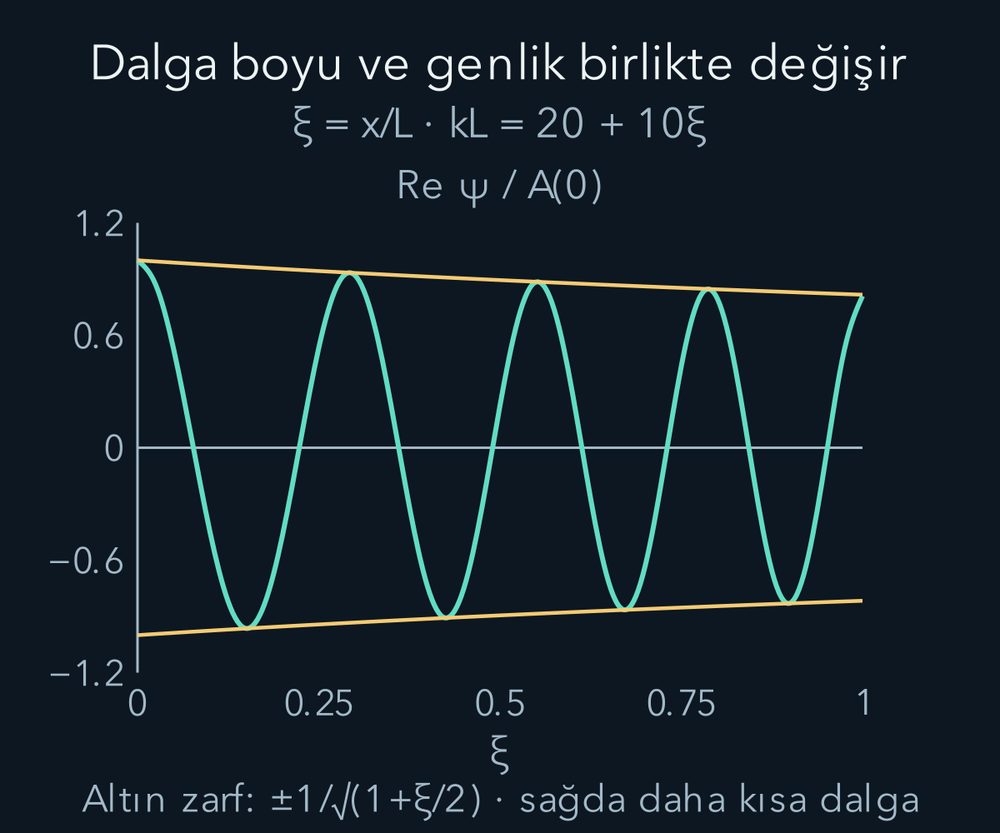
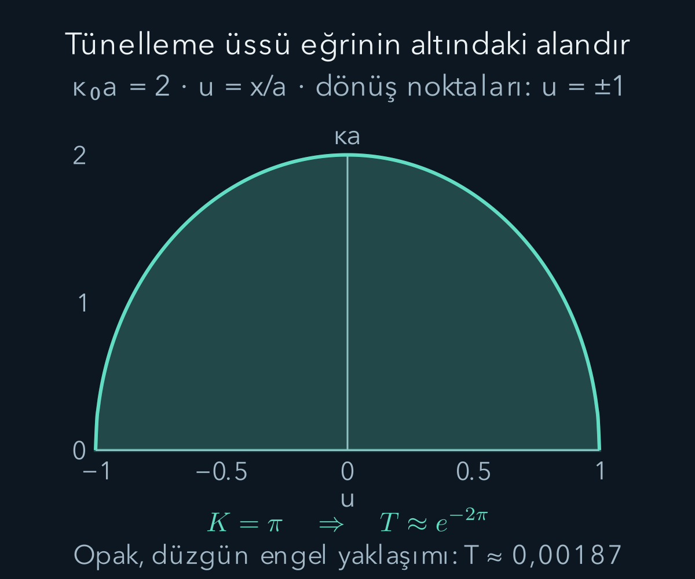

import ArticleVideo from '@/components/ArticleVideo.astro'
import kavram from './media/01-kavram.mp4?url'
import kavramPoster from './media/01-kavram.jpg?url'

Bir potansiyeli küçük aralıklara ayırıp her aralıkta yaklaşık sabit sayabiliriz. Her parçada bildiğimiz sinüs dalgası oluşur; ancak potansiyel değiştikçe dalganın aralığı da değişmelidir. Parçaları birleştirmek için yalnız dalga boyunu değiştirmek yetmez. Genliğin nasıl değişeceğini de aynı denklemden bulmalıyız. **WKB yaklaşımı**, bu fikri potansiyelin yeterince yavaş değiştiği bölgelerde sistemli bir hesaba dönüştürür.

[Önceki varyasyon yöntemi](/blog/varyasyon-yontemi/) bir deneme durumundan enerji üst sınırı üretiyordu. Burada [Schrödinger denklemi](/blog/schrodinger-denklemi-ve-olasilik-akimi/), [dalga sayısı ve faz](/blog/atom-tayflari-ve-madde-dalgalari/) ile [tünelleme](/blog/potansiyel-basamagi-ve-tunelleme/) kullanılacak. Yaklaşık dalga fonksiyonu elde edeceğiz; sonuçların varyasyon hesabındaki gibi otomatik üst sınır özelliği olmayacak. “Yaklaşık” sözcüğünün hangi küçük sayıya dayandığını her bölgede kontrol edeceğiz.

## 1. Yerel dalga sayısı neyi gösterir?

Kütlesi $m$ olan bir parçacık, gerçek ve zamandan bağımsız $V(x)$ potansiyelinde bulunsun. $x$ konum, $E$ toplam enerji, $\hbar$ indirgenmiş Planck sabitidir. Uzaysal enerji denklemi:

$$
-\frac{\hbar^2}{2m}\psi''(x)+V(x)\psi(x)=E\psi(x)
$$

olsun. İkinci türevi yalnız bırakırsak, $E>V(x)$ bölgesinde:

$$
\begin{aligned}
\psi''+k(x)^2\psi&=0,\\
k(x)&=\frac{\sqrt{2m[E-V(x)]}}{\hbar}.
\end{aligned}
$$

elde ederiz. $\psi$ uzaysal dalga fonksiyonu; asal işareti $x$'e göre türevdir. $k$ uzunluğun tersi birimindedir; yerel dalga boyu $\lambda(x)=2\pi/k(x)$ olur. Sabit potansiyelde bildiğimiz $e^{\pm ikx}$ çözümlerine döneriz.

$p(x)=\hbar k(x)$ büyüklüğü klasik enerji eşitliğinden gelen yerel momentum ölçeğidir. Bu ifade, kuantum durumunun her konumda kesin momentum ölçüm sonucu taşıdığını söylemez. $k$ değişiyorsa durum genellikle momentum özdurumu değildir. Burada dalga fonksiyonunun fazının ne kadar hızlı değiştiğini betimleyecek bir büyüklük tanımladık.

Potansiyel yükselip $E-V$ küçüldüğünde $k$ azalır ve yerel dalga boyu uzar. Dolayısıyla “potansiyel daha yüksek, dalga daha sık” çıkarımı bu bölgede yanlıştır. Toplam enerji sabit tutulduğundan değişen büyüklük, klasik karşılığı olan kinetik enerji payıdır.

## 2. Genlik ile fazı ayırmak

Tek yönde ilerleyen bir çözüm dalı için:

$$
\psi(x)=A(x)e^{i\theta(x)}
$$

yazalım. $i^2=-1$ sanal birimiyle yazılan bu ifadede $A$ gerçek, pozitif genlik; $\theta$ radyanla ölçülen boyutsuz fazdır. Genel çözüm daha sonra iki karşıt dalın birleşimi olabilir. Çarpım ve zincir kuralını sırayla uygulayalım:

$$
\psi'=(A'+iA\theta')e^{i\theta},
$$

$$
\psi''=[A''+2iA'\theta'+iA\theta''-A(\theta')^2]e^{i\theta}.
$$

Denkleme koyup ortak üstel çarpanı kaldırdığımızda gerçek ve sanal kısımlar ayrı ayrı sıfır olmalıdır:

$$
\begin{aligned}
A''+[k^2-(\theta')^2]A&=0,\\
2A'\theta'+A\theta''&=0.
\end{aligned}
$$

İkinci eşitliği $A$ ile çarpınca $2AA'\theta'+A^2\theta''=0$ olur. Sol taraf tam olarak $(A^2\theta')'$ türevidir. Demek ki:

$$
A^2\theta'=\text{sabit}.
$$

Buraya kadar, yazdığımız dalın genliği ve fazı düzgün olduğu bölgede bir yaklaşım yapmadık. Değişen faz hızıyla değişen genlik birbirinden bağımsız seçilemiyor.

## 3. Küçük kabul edilen terim

Genlik birkaç dalga boyunca çok az değişiyorsa $A''$ terimi $k^2A$ yanında küçük olabilir. İlk gerçek eşitlikte onu ihmal edince $(\theta')^2\approx k^2$ elde ederiz. Sağa giden dal için $\theta'\approx k$ seçilir. İntegral alınca:

$$
\theta(x)\approx\int_{x_*}^{x}k(s)\,ds+\theta_*.
$$

$s$ integralin geçici konum değişkeni; $x_*$ seçtiğimiz referans noktasıdır. Başlangıç fazı $\theta_*$ sabit katsayının içine alınabilir. $A^2k$ sabit olduğundan $A\propto1/\sqrt{k}$ olur. İki dalı birlikte yazarsak:

$$
\begin{aligned}
\psi_{\rm WKB}(x)&=
\frac{C_+}{\sqrt{k(x)}}e^{i\int_{x_*}^{x}k(s)ds}\\
&\quad+\frac{C_-}{\sqrt{k(x)}}e^{-i\int_{x_*}^{x}k(s)ds}.
\end{aligned}
$$

$C_+$ ve $C_-$ sınır veya başlangıç koşullarınca belirlenecek karmaşık sabitlerdir. Eşitlik işaretli bu tanım, tam çözümü değil kullandığımız yaklaşık fonksiyonu adlandırır. Dalgayı keyfî biçimde her noktada ayrı normalleştirmedik; bütün fonksiyon tek bir fiziksel probleme aittir.

Yaklaşımın boyutsuz denetimi için sık kullanılan ölçüler $|k'|/k^2\ll1$ ve uygun düzgünlükte $|k''|/k^3\ll1$ koşullarıdır. $\ll1$, yalnız birden küçük değil, hedeflenen doğruluk için yeterince küçük demektir. İlk oran, yaklaşık bir $1/k$ uzunluğunda dalga sayısının bağıl değişimini ölçer. Potansiyelin küçük olması gerekmez; değişiminin dalganın ölçeğine göre yavaş olması gerekir.

Bunu yerine koyma hatasıyla da görebiliriz. $A=k^{-1/2}$ için iki türev alınca:

$$
\frac{A''}{A}=\frac34\left(\frac{k'}k\right)^2
-\frac12\frac{k''}k.
$$

İhmal edilen terimin $k^2A$'ya oranı bu ifadenin $k^2$'ye bölünmesidir. Sadece “grafik düzgün görünüyor” demek yerine, denklemde kalan katkıyı ölçebiliriz. Bu yerel hata denetimi, çok uzun aralıkta birikebilecek toplam faz hatasının tek başına garantisi değildir.

## 4. Genlik değişimi akımı nasıl korur?

Tek sağa giden dalı alalım. Olasılık akımı:

$$
j=\frac{\hbar}{m}\operatorname{Im}(\psi^*\psi')
=\frac{\hbar}{m}A^2\theta'
\approx\frac{\hbar}{m}|C_+|^2
$$

olur. $j$ olasılık akımıdır; yıldız karmaşık eşleniği, $\operatorname{Im}$ sanal kısmı gösterir. Genliğin türevinden gelen $AA'$ gerçektir ve akıma katkı vermez. Yerel dalga sayısı büyürken yoğunluğun $1/k$ ile azalması, bu dalın akımını sabit tutar.

Klasik karşılıkta daha hızlı hareket edilen yerde daha az zaman geçirilmesi benzer bir yoğunluk ilişkisi verir. Ancak bu benzetme parçacığın ölçülmemiş kesin yolunu ispatlamaz. Ayrıca karşıt iki dalı toplarsak yoğunlukta girişim oluşur. Sabit akım, her noktada sabit yoğunluk veya kesin bir konum anlamına gelmez.

## 5. Bir aralıkta açık hesap

$0\le x\le L$ aralığında $k(x)=k_0(1+x/(2L))$ seçelim. $L$ uzunluk, $k_0>0$ başlangıç dalga sayısıdır. $k_0L=20$ olsun. Boyutsuz konumu $\xi=x/L$ yazarsak faz integralimiz:

$$
\int_0^x k(s)ds=k_0\left(x+\frac{x^2}{4L}\right)
=20\xi+5\xi^2
$$

olur. Başlangıç genliğine oranla $A(x)/A(0)=(1+\xi/2)^{-1/2}$ elde edilir. Sağ uçta $k/k_0=3/2$, dalga boyu oranı $2/3$, genlik oranı $\sqrt{2/3}\approx0{,}8165$ ve yoğunluk oranı $2/3$'tür. Yoğunlukla dalga sayısını çarparsak yine başlangıç değeri çıkar.

Bu örnekte $k'=k_0/(2L)$ ve $k''=0$'dır. İlk küçük oran en büyük değerini sol uçta alır: $|k'|/k^2\le1/(2k_0L)=0{,}025$. Yerine koyma hatasının yerel oranı da en fazla $3/[16(k_0L)^2]=0{,}00046875$ olur. Bunlar seçtiğimiz aralık için yaklaşımın makul olduğunu gösterir; aralığın dışına aynı yorumu otomatik taşımayız.

Videodaki “yoğunluk zamanla değişmez” ifadesi, yoğunluğun bütün konumlarda eşit olduğunu söylemez: burada $|\psi(x,t)|^2$ konuma göre $1/k(x)$ ile değişir, her sabit konumda zamanla aynı kalır. Gerçek kısmın karesi tek başına yoğunluk değildir; sanal kısmın karesi de hesaba katılır.

Şekildeki fonksiyonun tamamını sonsuz doğru üzerinde normalize ettiğimizi iddia etmiyoruz. Belirli bir aralıkta tek akım dalının göreli genliğini çiziyoruz. Böyle bir dal, uygun saçılma problemindeki çözümün parçası olarak kullanılabilir.

<ArticleVideo src={kavram} poster={kavramPoster} title="Değişen dalga boyu, korunan akım" caption="Yatay değişken ξ=x/L. Çizgi, sabit enerjili WKB dalının cos(20ξ+5ξ²−τ)/√(1+ξ/2) gerçek kısmıdır; τ=Et/ℏ ortak zaman fazıdır. Altın çizgiler genlik zarfıdır. Gerçek kısım hareket ederken yoğunluk zarfı sabit kalır; görüntü tek parçacığın yörüngesi değildir." />

## 6. Klasikçe yasak bölgede iki üstel dal

$V(x)>E$ olduğunda $k$ yerine pozitif gerçek:

$$
\kappa(x)=\frac{\sqrt{2m[V(x)-E]}}{\hbar}
$$

tanımlarız. Denklem $\psi''-\kappa^2\psi=0$ olur. Aynı yavaş değişim fikri yaklaşık çözümleri:

$$
\psi\approx\frac{D_+}{\sqrt\kappa}e^{\int\kappa(x)dx}
+\frac{D_-}{\sqrt\kappa}e^{-\int\kappa(x)dx}
$$

biçimine getirir. İntegralin referans noktası sabit katsayılara dahildir. Sonsuz uzaklığa uzanan yasak bölgede normalleştirme büyüyen dalı eleyebilir. Sonlu bir engelin içinde ise iki dal da genellikle gerekir; yalnız azalan çözümü tutmak iki sınırı birden eşleştirmeyebilir.

Azalma üssü genliğe aittir. Olasılık veya akım oranı hesaplanırken mutlak kare, dolayısıyla üste gelen iki çarpanı önemlidir. Tünelleme üssünde en sık yapılan hata, genliğin azalmasını doğrudan geçiş olasılığı saymaktır.

## 7. Dönüm noktasında yaklaşım neden bozulur?

$V(x_t)=E$ sağlayan $x_t$ konumuna **dönüm noktası** denir. Burada $k$ veya $\kappa$ sıfır olur; WKB genliği $1/\sqrt{k}$ ile büyürken küçük değişim oranları da bozulur. Tam dalga fonksiyonunun sonsuza gitmesi gerekmez. Sonsuza giden şey, artık geçerli olmayan yaklaşık ifadedir.

Bu bozulmayı ölçekle görmek yararlıdır. Dönüm noktasına yaklaşırken yerel dalga boyu uzar; potansiyelin o dalga boyu boyunca değişimini artık küçük sayamayız. Dolayısıyla aynı düzgün potansiyel, dönüm noktasından uzakta WKB için uygunken yakında uygun olmayabilir. Sorun yalnız grafikteki sivri bir uç değildir; ihmal ettiğimiz türevin önem kazanmasıdır.

Basit bir dönüm noktasında $V'(x_t)=F>0$ olsun. Çok yakınında $V(x)-E\approx F(x-x_t)$ yazılır. Yeni uzunluk $\ell_t=[\hbar^2/(2mF)]^{1/3}$ ve $z=(x-x_t)/\ell_t$ seçildiğinde denklem:

$$
\frac{d^2\psi}{dz^2}-z\psi=0
$$

biçimine iner. Ara ölçek adımını açalım: $d/dx=\ell_t^{-1}d/dz$ ve $x-x_t=\ell_t z$ olduğundan ilk denklem

$$
\frac{d^2\psi}{dz^2}
=\frac{2mF\ell_t^3}{\hbar^2}z\psi
$$

olur. $\ell_t$ tam da sağdaki katsayıyı bir yapmak için seçildi. Buradaki $F$, potansiyelin eğimidir; mekanik kuvvet bu noktada $-F$ olur. Böylece işaretin neden azalan çözüm veren tarafa ait olduğunu da takip edebiliriz. Elde edilen denklem **Airy denklemi**dir. Pozitif $z$ yönünde azalan özel çözümüne $\operatorname{Ai}(z)$ adı verilir. Adlandırma yeni bir fizik kuralı değildir; doğrusal potansiyel için tam yerel denklemin çözümünü belirtir.

Airy çözümünün iki uzaktaki davranışını eşleştirmek, yasak taraftaki azalan dalı izinli taraftaki sinüsle bağlar. Sağda yasak, solda izinli bölge için bağlantının biçimi:

$$
\begin{gathered}
\frac{D}{\sqrt\kappa}e^{-\int_{x_t}^{x}\kappa ds}\\
\Downarrow\\
\frac{2D}{\sqrt k}\sin\!\left(\int_x^{x_t}k ds+\frac\pi4\right).
\end{gathered}
$$

Ok, yasak tarafta büyüyen katkısı bulunmayan azalan çözümden izinli taraftaki salınıma geçişi gösterir. Asimptotik bir salınımı ters yönde okuyup üstel küçük bir büyüyen katkının kesinlikle bulunmadığını söylemek güvenli değildir. Bu asimptotik Airy eşleştirmesini burada bir matematik sonucu olarak kullanıyoruz; $x_t$'nin tam üstünde iki WKB formülünü birbirine eşitlemiyoruz. Dönüm noktasının yakınında Airy çözümü, ondan yeterince uzakta WKB çözümü kullanılır. $V'(x_t)=0$ olan birleşen dönüm noktalarında veya keskin potansiyel sıçramalarında bu basit bağlantı ayrıca geçerli sayılmaz.

## 8. Engelin altında biriken azalma

İki basit dönüm noktası $x_1<x_2$ arasındaki düzgün bir engelde:

$$
K=\int_{x_1}^{x_2}\kappa(x)dx
$$

boyutsuz eylem ölçeğini tanımlayalım. Engel yeterince opaksa, yani $K\gg1$ ise, önde gelen WKB geçişi $T\approx e^{-2K}$ olur. $T$ geçen akımın gelen akıma oranıdır. Üssün dışındaki katsayılar ve daha yüksek düzeltmeler kullanılan bağlantı problemine bağlıdır. Çok ince engelde veya tepeye yakın enerjide yalnız bu ifadeyle hassas sonuç beklenmez.

Bir hesap örneğinde engel içinde $V(x)-E=\Delta V(1-x^2/a^2)$, $-a<x<a$ olsun. $a>0$ engelin iki dönüm noktası arasındaki uzaklığın yarısı, $\Delta V>0$ tepeyle enerji farkıdır; potansiyelin dış parçalarının düzgün bağlandığını varsayıyoruz. $\kappa_0=\sqrt{2m\Delta V}/\hbar$ dersek $\kappa=\kappa_0\sqrt{1-x^2/a^2}$ bulunur. $u=x/a$ değişkeniyle:

$$
K=\kappa_0a\int_{-1}^{1}\sqrt{1-u^2}\,du
=\frac\pi2\kappa_0a.
$$

Son integral birim yarım çemberin alanıdır. $\kappa_0a=2$ için $K=\pi$ ve $T\approx e^{-2\pi}\approx0{,}001867$ çıkar. Genişlik ölçeğini iki katına çıkarıp diğer ölçekleri korursak $T\approx e^{-4\pi}\approx0{,}000003487$ olur. Bu sayılar, küçük ön katsayı düzeltmelerini içermeyen WKB tahminleridir.

Dikdörtgen engelde ise potansiyel sıçramaları tam eşleştirme ister. Örneğin genişliği $d$, yüksekliği $V_0$ olan dikdörtgen engelde $E=V_0/2$ durumunun kesin sonucu $T=1/\cosh^2(\kappa d)$ olur; burada $\kappa=\sqrt{2m(V_0-E)}/\hbar$ sabittir. Kalın engelde bu sonuç $4e^{-2\kappa d}$ biçimine yaklaşır. Aynı baskın üstel azalma görülse de ön katsayı farklıdır. Düzgün engelin bağlantı formülünü keskin duvara düşünmeden uygulamak bu farkı kaybettirir.

## 9. Bir kuyuda enerji düzeyini seçmek

WKB bize yerel fazın integralini, genliğin akımla ilişkisini ve engel altındaki baskın üstel azalmayı verir. Potansiyel bir bölgede yavaş değişirken başka bir bölgede yaklaşımı bozabilir. Bu yüzden geçerlilik, modele bir kez yapıştırılan genel bir etiket değil, çözüm boyunca kontrol edilen koşuldur.

Düzgün bir kuyunun iki dönüm noktasında elde edilen faz kaymaları ayrıca enerji seçimine yol açar: $\int_{x_1}^{x_2}p(x)dx\approx(n+1/2)\pi\hbar$, $n=0,1,2,\ldots$. Yarım katkı iki bağlantının fazından gelir; sonsuz sert duvarın koşuluyla aynı değildir. Bu sonucu kullanmak için iki basit dönüm noktası ve aralarındaki uygun WKB bölgesi gerekir. Enerji düzeylerini seçen şey yine dalga denklemiyle sınırların birlikte tutarlı olmasıdır.

Yarım katkıyı iki sınırın fazlarını karşılaştırarak takip edelim. İzinli bölgede $\theta(x)=\int_{x_1}^{x}k(s)ds$ ve toplam faz $\Theta=\int_{x_1}^{x_2}k(s)ds$ olsun. Sol dış bölgede azalan çözüme bağlanan iç dal, sabit çarpan dışında $\sin[\theta(x)+\pi/4]/\sqrt{k}$ biçimindedir. Sağdaki azalan çözüme bağlanan ise $\sin[\Theta-\theta(x)+\pi/4]/\sqrt{k}$ olur. Aynı fonksiyonu vermeleri gerekir.

$u=\theta+\pi/4$ yazarsak ikinci sinüs $\sin(\Theta+\pi/2-u)$ olur. Açılımı:

$$
\sin(\Theta+\pi/2)\cos u
-\cos(\Theta+\pi/2)\sin u
$$

şeklindedir. Birinci dal yalnız $\sin u$ içerdiğinden $\cos u$ katsayısı sıfırlanmalıdır: $\Theta+\pi/2=N\pi$. Pozitif fazlar için $N=n+1$ yazmak $\Theta=(n+1/2)\pi$ verir. Son olarak $p=\hbar k$ kullanılır. Böylece yarım sayı, kuyunun her iki ucunda azalan bir bağlı çözüm istememizin ve iki $\pi/4$ fazının birlikte sonucudur.

Bu enerji koşulunu bildiğimiz [harmonik osilatörde](/blog/kuantum-harmonik-osilatoru/) deneyelim. $V=m\omega^2x^2/2$ için $\omega$ açısal frekanstır. Dönüm noktaları $\pm x_t$, $x_t=\sqrt{2E/(m\omega^2)}$ olur. Kökün içinden $m^2\omega^2$ çarpanını ayırınca:

$$
p(x)=m\omega\sqrt{x_t^2-x^2}.
$$

Bu nedenle eylem integrali yine yarım çember alanına dönüşür:

$$
\begin{aligned}
\int_{-x_t}^{x_t}p(x)dx
&=m\omega\frac{\pi x_t^2}{2}\\
&=\frac{\pi E}{\omega}.
\end{aligned}
$$

Bunu enerji seçme koşuluna eşitleyip $\pi$'leri sadeleştirirsek $E_n\approx(n+1/2)\hbar\omega$ çıkar. Bu özel potansiyelde sonuç tam enerji değerleriyle çakışır. Yine de dönüm noktasındaki WKB dalga fonksiyonu tam çözüm hâline gelmiş değildir. Doğru enerji bulmakla her konumda doğru dalga fonksiyonu bulmak ayrı doğruluk sorularıdır. Genel düzgün kuyularda özellikle çok düşük düzeyler için aynı başarıyı varsayamayız; enerji arttıkça araya daha çok salınım sığması çoğu durumda yaklaşımı iyileştirir.

## 10. Sabit enerji, değişen uzaysal biçim

Burada dışarıdan zamana bağlı enerji verilmedi. Bir engelden geçen durumun enerji kazanması veya kısa süreliğine enerji ödünç alması gerekmiyor. Bir sonraki konuda Hamiltonyene zamana bağlı dış etki eklediğimizde ise farklı enerji durumlarının katsayıları gerçekten değişecek; bu ayrı fiziksel koşulu açıkça kuracağız.

## Kaynaklar

Yerel faz-genlik hesabı, Airy bağlantısı ve tünelleme yaklaşımı [MIT OCW, Barton Zwiebach — Semiclassical Approximation](https://ocw.mit.edu/courses/8-06-quantum-physics-iii-spring-2018/bf207c35150e1f5d93ef05d4664f406d_MIT8_06S18ch3.pdf) ile karşılaştırıldı. Metindeki doğrusal dalga sayısı örneği, sayısal hata oranı ve parabolik engel alanı bu yazı için hesaplandı. Kaynak 13 Ekim 2026 tarihinde doğrudan açıldı.
