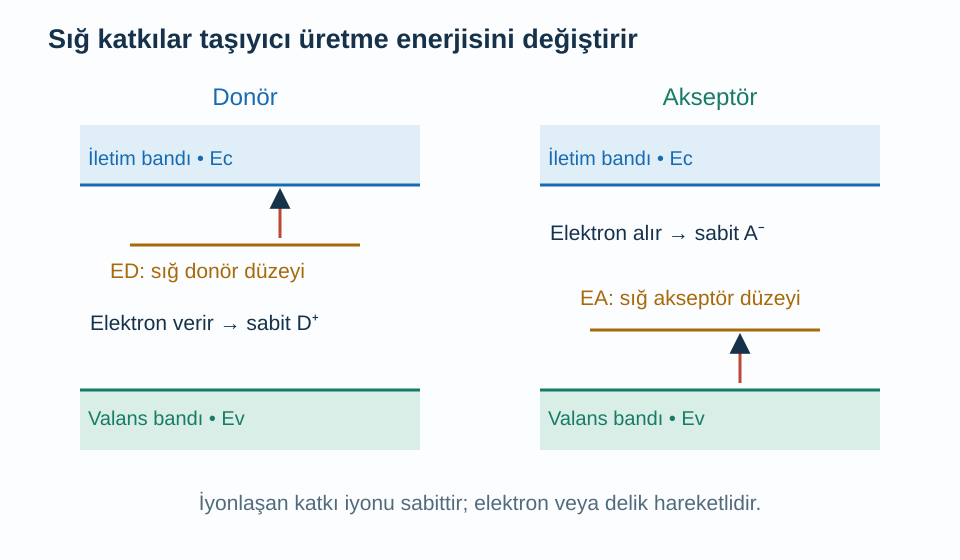
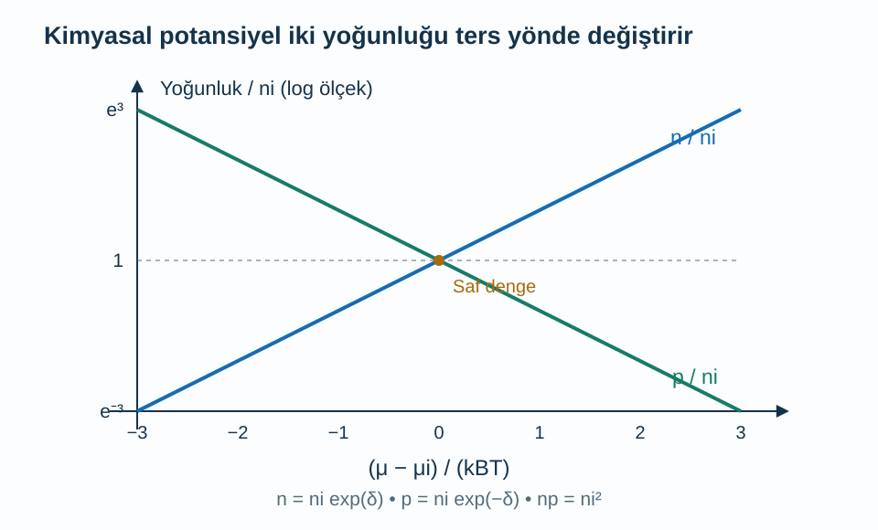

Bir yarı iletkenin iletkenliği yalnız elektronların ne kadar kolay hareket ettiğine bağlı değildir. Hareket edebilecek elektron ve delik sayısı da belirleyicidir. Kristale çok küçük miktarda uygun yabancı atom eklemek, bütün katıyı büyük bir net yükle doldurmadan bu sayıları değiştirebilir. Elektronik aygıtların önemli bir bölümü bu kontrollü değişim üzerine kurulur.

Önce [enerji bantları](/blog/kristaller-ve-enerji-bantlari/), [durum yoğunluğu](/blog/durum-yogunlugu-ve-fermi-yuzeyi/), [etkin kütle ve delikler](/blog/etkin-kutle-ve-delikler/) ve [iletkenlik](/blog/elektriksel-iletkenlik-ve-drude-modeli/) yazılarına dayanacağız. Bu yazıda homojen, termal dengede, üç boyutlu bir yarı iletken ele alıyoruz. Bant kenarlarını parabolik kabul edeceğiz. Kullanacağımız basit üstel doluluk formülleri, taşıyıcıların dejenere olmadığı, yani Fermi–Dirac doluluğunun seyrek kuyrukla yaklaştırılabildiği koşullarda geçerlidir.

## 1. Önce enerji referanslarını yerleştirelim

İletim bandının en düşük enerjisi $E_c$, valans bandının en yüksek enerjisi $E_v$ olsun. Aralarındaki pozitif fark $E_g=E_c-E_v$ **bant aralığıdır**. Elektron sayısını belirleyen ortak kimyasal potansiyele $\mu$ diyeceğiz. Termal dengede kullanılan Fermi düzeyi ifadesi burada bu kimyasal potansiyeli anlatır.

Mutlak sıfıra yakın saf bir bant yarı iletkeninde valans bandı dolu, iletim bandı boş olabilir. Termal uyarılma bir elektronu iletim bandına çıkardığında valans bandında bir delik bırakır. Saf malzemede başka yük kaynakları yoksa bu olaylar çiftler halinde taşıyıcı üretir. İletim elektronlarının yoğunluğunu $n$, deliklerin yoğunluğunu $p$ ile gösteririz. Bunlar hacim başına sayılardır; toplam elektron sayısıyla veya toplam atom sayısıyla aynı değildir.

Bir delik, atomun çekirdeğinin yerinden çıkması değildir. Valans bandındaki eksik elektron doluluğudur. Katkı atomunun iyonlaşmasıyla ortaya çıkan sabit iyon yükünü de hareketli delikle karıştırmamalıyız. İlerleyen yük dengesi denkleminde bu farklı yükler ayrı terimlerle bulunacak.

## 2. Kullanılabilir durum ile doluluk birleşince

İletim bandı durum yoğunluğuna $g_c(E)$ diyelim. Birim hacimdeki elektron sayısı, durum yoğunluğunu dolulukla çarparak bulunur:

$$
\begin{aligned}
n&=\int_{E_c}^{\infty}g_c(E)f(E)\,dE\\
f(E)&=\frac1{e^{(E-\mu)/(k_BT)}+1}.
\end{aligned}
$$

$k_B$ Boltzmann sabiti, $T$ mutlak sıcaklıktır. İletim bandı kenarı kimyasal potansiyelin birkaç $k_BT$ üzerindeyse üstel terim $1$'den çok büyüktür. Paydadaki $+1$ ihmal edilerek $f(E)\simeq e^{-(E-\mu)/(k_BT)}$ yazılır. Buna Boltzmann yaklaşımı diyoruz; elektronların fermiyon olma özelliğini kaldırmıyoruz, yalnız doluluğun küçük olduğu sınırını kullanıyoruz.

$E-\mu=(E-E_c)+(E_c-\mu)$ ayrımını yapalım. İkinci parça integrasyon değişkenine bağlı olmadığı için dışarı çıkar:

$$
\begin{aligned}
n&=N_c e^{-(E_c-\mu)/(k_BT)}\\
N_c&=\int_{E_c}^{\infty}g_c(E)e^{-(E-E_c)/(k_BT)}\,dE.
\end{aligned}
$$

$N_c$ **etkin durum yoğunluğudur**. Bütün iletim bandının toplam kapasitesi değildir; sıcaklığın belirlediği enerji aralığındaki durumların üstel ağırlıklı toplamıdır. İzotropik parabolik bant, iki spin durumu ve tek vadi için integral:

$$
N_c=2\left(\frac{m_n^*k_BT}{2\pi\hbar^2}\right)^{3/2}
$$

sonucunu verir. $m_n^*$ elektron için durum yoğunluğu etkin kütlesi, $\hbar$ indirgenmiş Planck sabitidir. Birden fazla vadi veya yön bağımlı kütle olduğunda bu sade ifade uygun biçimde değiştirilir.

## 3. Delik sayısında işaret neden ters?

Valans bandında delik olma olasılığı elektronun bulunmama olasılığıdır: $1-f(E)$. Kimyasal potansiyel valans kenarından yeterince yukarıdaysa bu olasılık yaklaşık $e^{(E-\mu)/(k_BT)}$ olur. $E-\mu=(E-E_v)+(E_v-\mu)$ ayrımıyla aynı integral düşüncesi:

$$
p=N_v e^{-(\mu-E_v)/(k_BT)}
$$

verir. $N_v$ valans bandının etkin durum yoğunluğudur. Basit izotropik modelde $N_c$ ifadesindeki elektron kütlesi yerine pozitif delik durum yoğunluğu kütlesi $m_p^*$ konur. Kimyasal potansiyel yukarı çıktığında iletim elektronlarının üstel baskısı azalır, deliklerin baskısı artar: $n$ büyürken $p$ küçülür.

İki yoğunluğu çarpalım. Üstlerin toplamında kimyasal potansiyel iptal olur:

$$
\begin{aligned}
np&=N_cN_v e^{-[(E_c-\mu)+(\mu-E_v)]/(k_BT)}\\
&=N_cN_v e^{-E_g/(k_BT)}\\
&\equiv n_i^2.
\end{aligned}
$$

$n_i$ **öz taşıyıcı yoğunluğudur**. Saf malzemede nötrlük $n=p$ gerektirdiği için $n=p=n_i$ olur. $np=n_i^2$ bağıntısı, termal dengede ve dejenere olmayan yaklaşımda geçerlidir. Işıkla sürekli taşıyıcı üretilen veya gerilim altında denge dışında tutulan malzemeye otomatik olarak uygulanmaz. [MIT'nin yarı iletkenlere giriş notları](https://ocw.mit.edu/courses/6-012-microelectronic-devices-and-circuits-fall-2009/a37c73e7fcff4bcb5c5f1177e12d0891_MIT6_012F09_lec01.pdf) taşıyıcı yoğunlukları ve katkılamayı bu denge çerçevesinde kurar.

## 4. Donör ve akseptör ne değiştirir?

**Donör**, uygun koşullarda bir elektronunu iletim bandına verebilen katkıdır. Elektronu bağlıyken nötr olan donör, elektron ayrıldığında pozitif iyon halinde kalır. **Akseptör**, valans bandından bir elektron kabul edebilir; negatif iyon haline gelirken valans bandında hareketli bir delik bırakır. Bu dil, katkının ana kristaldeki bağ yapısı ve izinli enerji düzeyleriyle ilgilidir; her yabancı atom otomatik olarak yararlı donör veya akseptör değildir.

Sığ donör düzeyi $E_D$, iletim kenarının biraz altında; sığ akseptör düzeyi $E_A$, valans kenarının biraz üstünde bulunabilir. Burada alt indisli $D$ ve $A$ enerji düzeylerinin türünü belirtir. Gerekli iyonlaşma enerjileri bant aralığından küçük olabilir. Böylece valans bandından iletim bandına bütün aralığı aşarak çift üretmekten daha kolay bir taşıyıcı kaynağı oluşur.

Şekildeki enerji uzaklıkları şematiktir. Gerçek iyonlaşma oranı sıcaklığa, katkı türüne ve kimyasal potansiyele bağlıdır. Katkı sayısını doğrudan serbest taşıyıcı sayısına eşitlemeden önce tam iyonlaşma yaklaşımının uygunluğunu değerlendirmek gerekir.

## 5. Yük nötrlüğünü dikkatle yazmak

İyonlaşmış donör yoğunluğu $N_D^+$, iyonlaşmış akseptör yoğunluğu $N_A^-$ olsun. Pozitif yükler delikler ve donör iyonları; negatif yükler iletim elektronları ve akseptör iyonlarıdır. Homojen nötr bölgede:

$$
p+N_D^+=n+N_A^-.
$$

Tam iyonlaşma varsayarsak toplam katkı yoğunlukları $N_D$ ve $N_A$ için $N_D^+=N_D$, $N_A^-=N_A$ yazarız. Net donör fazlasını $\Delta=N_D-N_A$ diye tanımlayınca $n-p=\Delta$ olur. Bu eşitliği $p=n_i^2/n$ ile birleştirirsek:

$$
\begin{aligned}
n-\frac{n_i^2}{n}&=\Delta\\
n^2-\Delta n-n_i^2&=0.
\end{aligned}
$$

Pozitif kökü seçmek zorundayız; yoğunluk negatif olamaz:

$$
\begin{aligned}
n&=\frac{\Delta+\sqrt{\Delta^2+4n_i^2}}2\\
p&=\frac{n_i^2}{n}.
\end{aligned}
$$

$\Delta\gg n_i$ ise $n\simeq\Delta$ ve $p\simeq n_i^2/\Delta$ olur. Net akseptör fazlası varsa aynı işlemi $p$ için kurmak daha uygundur. Nötrlük “elektron ve delik sayısı eşit” demek değildir; sabit katkı iyonlarının yükleri de toplamın içindedir.

## 6. Sayısal örnek: n tipi malzeme

$T=300\,\mathrm K$ için örnek bir malzemenin öz yoğunluğunu $n_i=1{,}0\times10^{10}\,\mathrm{cm^{-3}}$ alalım. Bu yazıdaki sayılar yuvarlatılmış model girdileridir. Donör yoğunluğu $N_D=1{,}0\times10^{16}\,\mathrm{cm^{-3}}$, akseptör yoğunluğu sıfır olsun. Tam iyonlaşmayı kabul ediyoruz. Donör sayısı öz yoğunluktan milyon kat büyük olduğu için:

$$
\begin{aligned}
n&\simeq10^{16}\,\mathrm{cm^{-3}}\\
p&=\frac{(10^{10})^2}{10^{16}}\\
&=10^4\,\mathrm{cm^{-3}}.
\end{aligned}
$$

Elektronlar **çoğunluk taşıyıcısı**, delikler **azınlık taşıyıcısıdır**. Delik sayısı sıfır değildir. Yoğunluk çarpımı hâlâ $10^{20}\,\mathrm{cm^{-6}}$'dır. İletkenlik hesabı için elektron hareketliliğini $\mu_e=1350\,\mathrm{cm^2/(V\,s)}$ model değeri seçelim. Delik katkısını ihmal ederek:

$$
\begin{aligned}
\sigma&\simeq en\mu_e\\
&=(1{,}60218\times10^{-19})(10^{16})(1350)\\
&\simeq2{,}163\,\mathrm{S/cm}.
\end{aligned}
$$

Bütün uzunlukları santimetreyle kullandığımız için sonuç santimetre başınadır. Metre başına çevirmek için $100$ ile çarparız: $216{,}3\,\mathrm{S/m}$. Katkı yoğunluğunu artırdığımızda hareketliliğin sabit kalacağını garanti edemeyiz; safsızlık saçılması da değişebilir. Bu hesap, verilen yoğunluk ve hareketliliğin birlikte sonucudur.

## 7. Sayısal örnek: Dengeleme ve Fermi düzeyi

Aynı sıcaklık ve $n_i$ ile bu kez $N_D=1{,}0\times10^{16}$, $N_A=1{,}0\times10^{15}\,\mathrm{cm^{-3}}$ seçelim. İki katkı türü de tam iyonlaşmış olsun. Net fark $\Delta=9{,}0\times10^{15}\,\mathrm{cm^{-3}}$ olur. Böylece:

$$
\begin{aligned}
n&\simeq9{,}0\times10^{15}\,\mathrm{cm^{-3}}\\
p&\simeq\frac{10^{20}}{9{,}0\times10^{15}}\\
&=1{,}111\times10^4\,\mathrm{cm^{-3}}.
\end{aligned}
$$

Akseptörler donörlerin etkisini kısmen **dengeler**. Taşıyıcı yoğunluğu net farkla belirlenirken iyonlaşmış saçıcı sayısı iki katkının toplamından etkilenebilir. Bu yüzden aynı net elektron yoğunluğuna sahip iki örneğin hareketlilikleri mutlaka aynı olmaz.

Saf malzemenin kimyasal potansiyeline $\mu_i$ diyelim. Elektron yoğunluğu formülünü saf durumdakiyle oranlarsak $N_c$ ve $E_c$ iptal olur:

$$
\begin{aligned}
\frac n{n_i}&=e^{(\mu-\mu_i)/(k_BT)}\\
\mu-\mu_i&=k_BT\ln\left(\frac n{n_i}\right).
\end{aligned}
$$

Logaritmanın içi boyutsuz bir yoğunluk oranıdır. $k_BT\simeq0{,}025852\,\mathrm{eV}$ ve $n/n_i=9{,}0\times10^5$ kullanınca:

$$
\begin{aligned}
\mu-\mu_i&=0{,}025852\ln(9{,}0\times10^5)\,\mathrm{eV}\\
&\simeq0{,}3544\,\mathrm{eV}.
\end{aligned}
$$

Kimyasal potansiyel iletim bandına doğru yükselmiştir. Ancak bu sonucu kullandığımız yaklaşım açısından kontrol etmeliyiz: bulunan $\mu$, iletim bandına fazla yaklaşır veya içine girerse Boltzmann ifadesi yerine tam Fermi–Dirac integrali gerekir. Sadece formülü hesaplamak geçerlilik koşulunu ortadan kaldırmaz.

Şekilde iki eğrinin kesişimi saf duruma karşılık gelir. Yatay eksen kimyasal potansiyelin saf değerden farkını termal enerjiye böler; bu nedenle boyutsuzdur. Eğriler aynı yönde yükselmez, çünkü termal denge yoğunluk çarpımını sabit tutar.

## 8. Etkin durum yoğunluğunun sıcaklık kuvveti

$N_c$ ifadesindeki $T^{3/2}$ kuvvetini yalnız hazır formül olarak bırakmayalım. Bant kenarından ölçülen enerjiye $\epsilon=E-E_c\ge0$ dersek parabolik üç boyutlu bandın yoğunluğu $g_c(E)=B\sqrt\epsilon$ biçimindedir. $B$ kütle ve Planck sabitini içeren, sıcaklıktan bağımsız katsayıdır. Etkin durum yoğunluğu:

$$
N_c=B\int_0^\infty\sqrt\epsilon\,
 e^{-\epsilon/(k_BT)}\,d\epsilon
$$

olur. $y=\epsilon/(k_BT)$ değişkenini seçince $\sqrt\epsilon=(k_BT)^{1/2}\sqrt y$ ve $d\epsilon=k_BT\,dy$ çıkar. İki sıcaklık çarpanını birleştirerek:

$$
N_c=B(k_BT)^{3/2}\int_0^\infty\sqrt y\,e^{-y}\,dy
$$

buluruz. Son integral boyutsuz sabit bir sayıdır; değeri $\sqrt\pi/2$'dir. Sıcaklığa bağlı kuvvet böylece integralin ayrıntılı değerini bilmeden bile görünür. Sıcaklık yükseldiğinde yalnız tek bir durumun doluluğu değişmez, termal olarak erişilebilir durumların enerji aralığı da genişler.

Öte yandan öz yoğunlukta $n_i=\sqrt{N_cN_v}e^{-E_g/(2k_BT)}$ üstel faktörü bulunur. Sabit bant aralıklı basit modelde bu üstel değişim, belirli sıcaklık aralıklarında kuvvet biçimindeki ön çarpandan daha etkili olabilir. Bu nedenle sıcaklığı biraz artırmak taşıyıcı sayısını büyük ölçüde değiştirebilir. Gerçek malzemenin bant aralığı da sıcaklığa bağlıysa onun değişimini ayrıca hesaba katmak gerekir; sabit $E_g$ bir ilk yaklaşımdır.

## 9. Sıcaklık değişince üç farklı davranış

Düşük sıcaklıkta sığ katkılar bile bütünüyle iyonlaşmayabilir. Taşıyıcıların bağlı katkı düzeylerinde kalması **donma bölgesi** diye adlandırılır. Burada $n\simeq N_D-N_A$ yaklaşımı başarısız olur; iyonlaşmış katkı oranını doluluk istatistiğiyle ayrıca hesaplamak gerekir. Nötrlük denklemimiz geçerliliğini korur, fakat $N_D^+$ ve $N_A^-$ artık toplam katkı sayılarına eşit değildir.

Orta bir sıcaklık aralığında katkılar büyük ölçüde iyonlaşmış ve öz üretim hâlâ küçük olabilir. Bu **katkı kontrollü bölgede** çoğunluk yoğunluğu net katkı miktarına yakındır. Daha yüksek sıcaklıkta ise bantlar arası termal çift üretimi artar. $n_i$, katkı yoğunluğu ölçeğini aştığında elektron ve delik yoğunlukları birbirine yaklaşır; malzeme öz davranışa yönelir. Bu geçişlerin sıcaklıkları her malzeme için aynı değildir.

Saf kimyasal potansiyelin tam bant ortasında olması da zorunlu değildir. $n=p$ koşulunu iki üstel ifadeye uygulayınca $\mu_i=(E_c+E_v)/2+(k_BT/2)\ln(N_v/N_c)$ çıkar. Etkin durum yoğunlukları eşitse ikinci terim sıfırdır. Eşit değillerse doluluk dengesi orta noktayı kaydırır. [MIT'nin kütle etkisi ders kaynağı](https://ocw.mit.edu/courses/3-23-electrical-optical-and-magnetic-properties-of-materials-fall-2007/resources/clean13/) bu denge ilişkisini katkı düzeyleriyle birlikte ele alır.

Katkılama böylece iki ayrı hesabı birleştirir: hangi elektronik durumların bulunabildiği ve toplam yükün nasıl dengelendiği. Bir sonraki uzaysal adımda farklı katkı bölgeleri yan yana geldiğinde yerel nötrlük bozulabilir; burada kurduğumuz taşıyıcı dengesi o durumu anlamanın başlangıcıdır.
