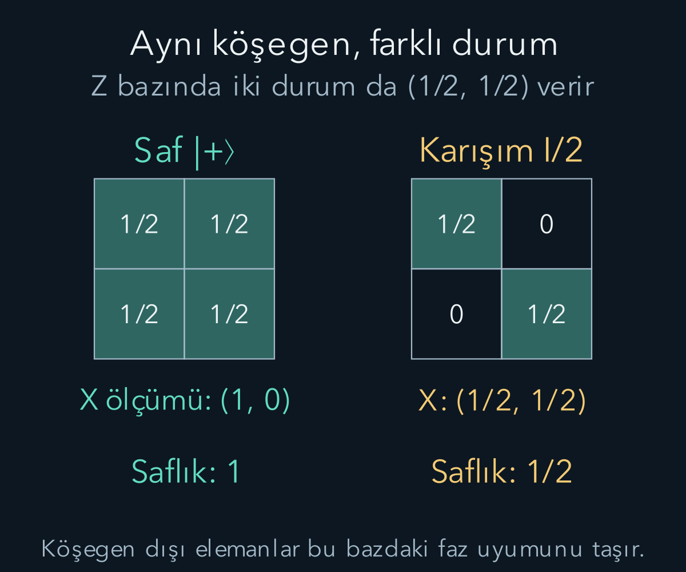
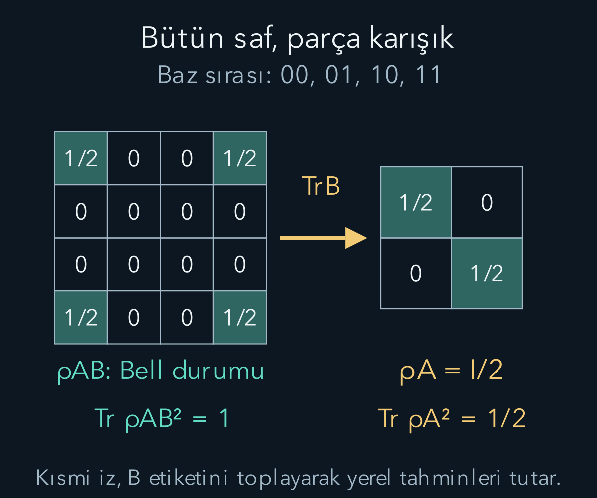

import ArticleVideo from '@/components/ArticleVideo.astro'
import kavram from './media/01-kavram.mp4?url'
import kavramPoster from './media/01-kavram.jpg?url'

Bir laboratuvar bazen aynı saf durumu tekrar tekrar hazırlamaz. Hazırlamaların bir bölümünde bir durum, kalanında başka bir durum seçilebilir. Ayrıca [dolanık bir bütünün](/blog/tensor-carpimi-ve-dolaniklik/) yalnız bir parçasını incelerken o parçaya tek bir saf ket atamak yeterli olmayabilir. **Yoğunluk matrisi**, bu iki durumu aynı ölçüm hesabında ele almamızı sağlar.

[Ket-bra ve Born kuralı](/blog/kuantum-durumu-superpozisyon-ve-born-kurali/), [gözlenebilirler](/blog/kuantum-gozlenebilirleri-ve-beklenen-deger/) ve tensör çarpımı ön bilgilerimizdir. Bu yazıda sonlu boyutlu sistemlerde çalışıyoruz. ‘Karışık’ sözcüğü düzensiz görünen bir grafik veya kirli bir aygıt anlamına gelmez; durumun belirli matematiksel özelliğini ifade eder.

## 1. Saf durumdan yoğunluk matrisine

Normalleştirilmiş saf ket $|\psi\rangle$ için:

$$
\rho=|\psi\rangle\langle\psi|
$$

tanımlarız. $\rho$ Yunan rho harfidir. Ket ile bra bu sırada çarpıldığı için sonuç bir işleç veya seçilmiş bazda matristir. İki bileşenli $|\psi\rangle=(\alpha,\beta)^T$ için:

$$
\rho=\begin{pmatrix}|\alpha|^2&\alpha\beta^*\\
\beta\alpha^*&|\beta|^2\end{pmatrix}.
$$

Köşegen elemanlar bu bazdaki sonuç olasılıklarını taşır. Köşegen dışı elemanlar, bileşenler arasındaki faz ilişkisine dair bilgi içerir. Bununla birlikte köşegen veya köşegen dışı olma baz seçimine bağlıdır. Herhangi bir yoğunluk matrisinin yalnız bir bazda köşegen olması, onun her bakımdan klasik veya saf olduğu anlamına gelmez.

Global faz burada doğrudan yok olur: ket $e^{i\chi}$, bra $e^{-i\chi}$ kazanır ve çarpımları birdir. Aynı saf durumu temsil eden global fazlı ketler aynı $\rho$'yu verir. Yoğunluk matrisi saf durum bilgisini bu fiziksel eşdeğerliği otomatik olarak koruyarak yazar.

## 2. Klasik hazırlama karışımı

Bir deneyde $|\psi_j\rangle$ durumu $p_j$ olasılığıyla hazırlansın; $p_j\ge0$ ve $\sum_jp_j=1$ olsun. Durumun yoğunluk matrisi:

$$
\rho=\sum_jp_j|\psi_j\rangle\langle\psi_j|
$$

olur. Burada ketleri genliklerle toplamıyoruz; farklı klasik hazırlık seçeneklerinin dış çarpımlarını olasılıklarla topluyoruz. Bu işlem, aynı ketlerin koherent süperpozisyonundan farklıdır. Hazırlık kaydını tutuyorsak her alt topluluğa ayrıca koşullama yapabiliriz; kayıt kullanılmıyorsa toplam $\rho$ yerel ölçüm istatistiklerini verir.

Örneğin durumların yarısında $|0\rangle$, yarısında $|1\rangle$ hazırlarsak $\rho_{\mathrm{karışım}}=\frac12\begin{pmatrix}1&0\\0&1\end{pmatrix}=I/2$ olur. Buna karşılık $|+\rangle=(|0\rangle+|1\rangle)/\sqrt2$ saf durumunda $\rho_+=\frac12\begin{pmatrix}1&1\\1&1\end{pmatrix}$ çıkar. İki matrisin köşegenleri aynı, köşegen dışları farklıdır.

$z$ ölçümünde iki hazırlık da yarı yarıya sonuç verir. $x$ ölçümünde saf artı durumunun artı olasılığı bir, karışımınki yarımdır. Aynı tek baz dağılımının farklı kuantum durumları temsil edebildiğini önceki yazıda gördük; şimdi fark doğrudan matris elemanlarında görünür.

## 3. Geçerli yoğunluk matrisinin koşulları

Yoğunluk matrisi Hermit olmalı, izi bir olmalı ve pozitif yarı belirli olmalıdır. Hermitlik $\rho^\dagger=\rho$ demektir. **İz**, köşegen elemanların toplamıdır ve $\operatorname{Tr}\rho$ diye yazılır. Pozitif yarı belirlilik, her $|v\rangle$ için $\langle v|\rho|v\rangle\ge0$ olmasıdır; özdeğerlerin negatif olmamasına eşdeğerdir.

Hazırlık toplamından bu koşulları görebiliriz. Her dış çarpım Hermittir. Normalize ket için dış çarpımın izi bir olduğundan toplam iz $\sum_jp_j=1$ olur. Pozitiflik ise $\langle v|\rho|v\rangle=\sum_jp_j|\langle\psi_j|v\rangle|^2\ge0$ ifadesinden gelir. Böylece Born kuralında negatif olasılık üretilemez.

Tersine, bu üç koşulu sağlayan sonlu boyutlu bir matris spektral ayrışımla özvektör dış çarpımlarının pozitif ağırlıklı toplamı olarak yazılabilir. Özdeğerler bir olasılık dağılımı oluşturur. Bu yüzden koşullar yalnız gerekli değil, bu çerçevede yeterlidir. Her iz-bir Hermit matrisin geçerli olduğunu sanmamalıyız; pozitiflik ayrıca kontrol edilmelidir.

## 4. Negatif özdeğer neden kabul edilemez?

$M=\begin{pmatrix}1/2&4/5\\4/5&1/2\end{pmatrix}$ matrisini düşünelim. Hermittir ve izi birdir. Fakat $|+\rangle$ ve $|-\rangle$ özvektörlerinde özdeğerleri $1/2+4/5=1{,}3$ ve $1/2-4/5=-0{,}3$ olur. İkinci özvektörde ölçüm olasılığı hesaplasaydık negatif değer çıkardı.

Bu nedenle yalnız köşegenlerin sıfırla bir arasında olması yeterli değildir. Köşegen dışı elemanlar da pozitiflikle sınırlanır. İkiye iki durumda $\rho=\begin{pmatrix}a&c\\c^*&1-a\end{pmatrix}$ için $0\le a\le1$ yanında $|c|^2\le a(1-a)$ gerekir. Bu determinantın negatif olmaması koşuludur.

$a=1/2$ olduğunda $|c|\le1/2$ olur. Saf artı durum $c=1/2$ ile sınırı sağlar; tamamen karışık durum $c=0$'dır. Geçersiz örnekte $c=4/5$ bu sınırı aştığı için sorun çıktı. Böyle bir kontrol, deney verisinden veya sayısal hesaplardan elde edilen matrisin fiziksel olup olmadığını anlamak için yararlıdır.

## 5. İz ile beklenen değer hesabı

Yoğunluk matrisiyle gözlenebilir ortalaması:

$$
\boxed{\langle A\rangle=\operatorname{Tr}(\rho A)}
$$

olur. Saf durumda $\operatorname{Tr}(|\psi\rangle\langle\psi|A)=\langle\psi|A|\psi\rangle$ bulunur. Karışımda doğrusallıkla $\sum_jp_j\langle\psi_j|A|\psi_j\rangle$ çıkar. Bu, klasik hazırlık seçeneklerinin ortalamalarını olasılıklarıyla toplamakla aynıdır.

Bir izdüşüm sonucu $P_a$ için olasılık $p(a)=\operatorname{Tr}(\rho P_a)$ olur. Toplam izdüşümler $I$ verdiği için olasılıklar toplamı $\operatorname{Tr}\rho=1$'dir. Bu gösterim hem saf hem karışık durumlarda tek bir Born kuralı kullanmamızı sağlar. Varyans da $\operatorname{Tr}(\rho A^2)-[\operatorname{Tr}(\rho A)]^2$ biçimindedir.

Örneğin $\rho=\operatorname{diag}(3/4,1/4)$ ve $S_z=(\hbar/2)\operatorname{diag}(1,-1)$ için çarpımın köşegeni $3\hbar/8,-\hbar/8$ olur. İz $\hbar/4$ verir. $S_z^2=(\hbar^2/4)I$ olduğundan ikinci moment $\hbar^2/4$, varyans $3\hbar^2/16$ çıkar. Matris hesabı önceki olasılık hesabını aynen tekrarlar.

Aynı hesabı ölçüm yönünü değiştirerek görünür kılalım. $\theta$, $xz$ düzleminde $z$ ekseninden $x$ yönüne ölçülen fiziksel açı olsun. Önceki spin ölçümü işleçlerinden bu yöndeki artı sonuç izdüşümü:

$$
\Pi_+(\theta)=\frac{I+\cos\theta\,\sigma_z+\sin\theta\,\sigma_x}{2}
=\frac12\begin{pmatrix}1+\cos\theta&\sin\theta\\\sin\theta&1-\cos\theta\end{pmatrix}
$$

olur; $\sigma_x$ ve $\sigma_z$ Pauli matrisleridir. Bu matrisin izi bir, karesi kendisidir; dolayısıyla tek boyutlu bir izdüşümdür. Saf artı durumunun bütün matris elemanları $1/2$ olduğundan çarpımın izi $[1+\cos\theta+\sin\theta+\sin\theta+1-\cos\theta]/4=(1+\sin\theta)/2$ çıkar. Karışım için ise $\operatorname{Tr}[(I/2)\Pi_+]=\operatorname{Tr}\Pi_+/2=1/2$ kalır. $\theta=0$ başlangıcında iki durum da yarı yarıya, $\theta=\pi/2$ sonunda saf durum kesin artı sonuç verir. Durumları zamanla değiştirmedik; aynı hazırlıkların hangi yönde ölçüldüğünü değiştirdik.

<ArticleVideo src={kavram} poster={kavramPoster} title="Karışım ile saf süperpozisyonu ayırmak" caption="Ölçüm yönü z ekseninden x eksenine dönerken saf artı durumunun artı sonuç olasılığı (1+sinθ)/2 ile artar. Eşit karışımın iki olasılığı bütün yönlerde yarı yarıya kalır. θ, z ekseninden ölçülen açıdır." />

## 6. Saflığı sayıyla kontrol etmek

Saf dış çarpım için $\rho^2=|\psi\rangle\langle\psi|\psi\rangle\langle\psi|=\rho$ olur. Dolayısıyla $\operatorname{Tr}(\rho^2)=1$'dir. Geçerli yoğunluk matrisinin özdeğerleri $\lambda_j$ ise bu büyüklük $\sum_j\lambda_j^2$ olur. Pozitif ve toplamı bir olan özdeğerlerde sonuç en fazla birdir; bire ancak tek özdeğer bir, diğerleri sıfırken ulaşılır.

$\operatorname{Tr}(\rho^2)$ büyüklüğüne **saflık** denir. İki boyutta tamamen karışık $I/2$ için kare $I/4$, iz $1/2$ olur. Genel $d$ boyutta en küçük saflık $1/d$'dir ve $I/d$ durumunda gerçekleşir. Düşük saflık, ölçüm aletinin hatalı olduğunu değil, durumun saf bir ketle temsil edilemediğini söyler.

$\rho=\operatorname{diag}(3/4,1/4)$ için saflık $9/16+1/16=5/8$ olur. Bu durum ne saf ne tamamen karışıktır. Saflık, belirli bir bazdaki tek bir olasılığın büyüklüğünden değil, bütün yoğunluk matrisinden hesaplanır; baz değişiminde aynı kalır.

## 7. Aynı matrisin farklı hazırlama öyküleri

$I/2$ matrisini yarı yarıya sıfır ve bir hazırlayarak elde ettik. Fakat yarı yarıya artı ve eksi hazırlasaydık da $[|+\rangle\langle+|+|-\rangle\langle-|]/2=I/2$ olurdu; köşegen dışı katkılar birbirini götürür. Aynı yoğunluk matrisi birden çok farklı topluluk ayrışımıyla yazılabilir.

Bu nedenle yalnız sistem üzerinde yapılan ölçümlerden, bu iki hazırlama öyküsünden hangisinin kullanıldığını ayırt edemeyiz. Hazırlayan kişinin elindeki ek kayıt farklı olabilir; o kayıt da erişilebilir fiziksel sisteme dahil edilirse başka bir ortak problem oluşur. Yoğunluk matrisi, belirtilen sistemdeki bütün ölçüm istatistiklerini özetler; evrenin bütün geçmişini kodladığını iddia etmez.

Karışımı ‘sistem gerçekte mutlaka bu iki belirli saf durumdan birindedir’ diye tek bir ayrışıma bağlamak bu yüzden doğru değildir. Laboratuvar gerçekten bir klasik seçim yapmışsa o deneyin kaydı böyle bir öykü sağlar. Fakat aynı matrisin matematiksel görünümü tek başına ayrıcalıklı bir gizli saf durum listesi seçmez.

## 8. Dolanık bütünün tek parçası

Ortak yoğunluk matrisi $\rho_{AB}$'den yalnız A ölçümlerini veren matrise **indirgenmiş yoğunluk matrisi** deriz. B üzerinden **kısmi iz** alarak $\rho_A=\operatorname{Tr}_B\rho_{AB}$ yazarız. Baz sırası 00,01,10,11 olduğunda eleman kuralı:

$$
(\rho_A)_{aa'}=\sum_{b=0}^1(\rho_{AB})_{ab,a'b}
$$

biçimindedir. B etiketini aynı değerle eşleştirip topluyoruz; A'nın iki etiketi kalıyor. Bu, ortak olasılıklardan marjinal alma işleminin faz bilgisi taşıyan matris karşılığıdır. Kısmi iz sıradan bütün matris izinden farklıdır; bir sayı değil daha küçük bir matris üretir.

Bell durumu $|\Phi^+\rangle=(|00\rangle+|11\rangle)/\sqrt2$ için:

$$
\rho_{AB}=\frac12\begin{pmatrix}1&0&0&1\\0&0&0&0\\0&0&0&0\\1&0&0&1\end{pmatrix}.
$$

A'nın 00 elemanı ortak 00,00 ile 01,01 elemanlarının toplamıdır ve $1/2$ olur. A'nın 11 elemanı 10,10 ile 11,11 toplamından yine $1/2$ çıkar. A'nın köşegen dışı elemanları 00,10 ile 01,11 gibi elemanları toplar; ikisi de sıfırdır. Sonuç $\rho_A=I/2$'dir.

## 9. Bütün safken parça karışık olabilir

Bell bütününde $\operatorname{Tr}(\rho_{AB}^2)=1$ iken A'nın saflığı $1/2$'dir. Bu çelişki değildir. Ortak durumdaki korelasyon bilgisi yalnız A'ya ait bir ketle temsil edilemez. A'nın karışıklığını, bütünün hangi saf durumda olduğunu bilmediğimiz için ortaya çıkan klasik bir bilgisizlik diye anlatamayız; bütünün saf Bell durumu tam olarak verilmiştir.

Çarpım saf durumunda ise $\rho_{AB}=\rho_A\otimes\rho_B$ ve her iki parça saftır. Ayrıca her iki parçanın karışık olması, bütünün mutlaka dolanık olduğunu göstermez. Örneğin $I/2\otimes I/2$ tamamen bağımsız karışık hazırlıktır. Yerel saflık tek başına genel karışık bütünün dolanıklığını belirleyen bir ölçüt değildir.

Bell durumuyla yarı yarıya 00/11 karışımı aynı yerel $I/2$ matrislerini verir. Fakat ortak $X\otimes X$ ortalaması Bell'de bir, klasik karışımda sıfırdır. Kısmi iz yerel tahminler için yeterli bilgiyi tutar; bütün ortak korelasyonları tutmaz. Kaybedilen bilgi, ‘yerel sistem eksik ölçüldü’ diye zorunlu olarak geri getirilebilen sıradan bir tablo satırı değildir.

## 10. Evrim ve seçici ölçüm

Kapalı sistemde üniter evrim $\rho(t)=U(t)\rho(0)U(t)^\dagger$ biçimindedir. Bu dönüşüm özdeğerleri ve saflığı korur. Dolayısıyla kapalı tek sistemin saf başlangıcı, yalnız üniter evrimle kendi başına karışık hâle gelmez. Daha büyük saf bir bütünün parçası ise etkileşim sırasında çevreyle dolanarak indirgenmiş saflığını kaybedebilir.

İdeal izdüşüm ölçümünde $a$ sonucu seçilirse yeni matris $\rho_a=P_a\rho P_a/p(a)$ olur. Sonuç seçilmezse $\rho'=\sum_aP_a\rho P_a$ kullanılır. Bu iki işlem farklıdır. Birincisi belirli kayıtla koşullanmış alt topluluğu, ikincisi bütün sonuçların kaydı kullanılmadan birleştirilmiş betimlemesini verir.

Sonuçları okumamak ölçümün fiziksel etkileşimini geri almaz. Buna karşılık hangi yol bilgisini çevreye bırakmadan koherent biçimde ters çevirmek başka bir üniter işlem olabilir. Yoğunluk matrisi dili, bu iki deneyin farkını yalnız günlük ‘bakmak’ sözcüğüne bağlamadan yazmamızı sağlar.

## 11. Çevreyle etkileşim ve dekoherans

Başlangıçta sistem $(|0\rangle+|1\rangle)/\sqrt2$, çevre $|e\rangle$ durumunda olsun. Etkileşim, ortak durumu $(|0\rangle|e_0\rangle+|1\rangle|e_1\rangle)/\sqrt2$ biçimine götürsün. Çevre durumları normalize olsun. Sistem için kısmi iz alınca:

$$
\rho_S=\frac12\begin{pmatrix}1&\gamma\\\gamma^*&1\end{pmatrix},
\qquad \gamma=\langle e_1|e_0\rangle
$$

elde edilir. Çevre kayıtları aynıysa $|\gamma|=1$ olabilir ve faz ilişkisi korunur. Kayıtlar birbirinden ayırt edilebilir, yaklaşık dik hâle gelirse $\gamma\approx0$ olur; seçilen bazdaki köşegen dışı katkılar bastırılır. Bu süreç **dekoherans**, yani eşevreliliğin yerel betimlemede kaybıdır.

Çevre iç çarpımının hangi sırayla geldiği, ortak dış çarpımı açarak anlaşılır. Örneğin köşegen dışı terim $|0\rangle\langle1|\otimes|e_0\rangle\langle e_1|/2$'dir. Çevre üzerinden iz alınca $\operatorname{Tr}(|e_0\rangle\langle e_1|)=\langle e_1|e_0\rangle=\gamma$ kalır; ters terim bunun karmaşık eşleniğini verir. Köşegenlerde çevre normları bir olduğu için nüfuslar değişmez.

Saflık hesabında bütün matrisi kareleyip yalnız köşegeni toplamak yeterlidir:

$$
\rho_S^2=\frac14
\begin{pmatrix}
1+|\gamma|^2&2\gamma\\
2\gamma^*&1+|\gamma|^2
\end{pmatrix}.
$$

Cauchy–Schwarz, normalize çevre durumları için $|\gamma|\le1$ verir. Bu yüzden saflık fiziksel aralık olan $1/2$ ile $1$ arasında kalır. Örneğin $\gamma=i/2$ için saflık $5/8$'dir: yalnız gerçek kısmın sıfır olması tam dekoherans değildir; mutlak değerin sıfıra yaklaşması gerekir.

Bu örnekte yerel saflık $(1+|\gamma|^2)/2$ olur. Birden yarıma doğru azalabilirken bütün sistem-çevre durumu saf kalır. Kayıp, daha büyük ortak durumdaki ilişkilere dağılmıştır. Dekoherans çevre ve etkileşimin seçtiği bazla ilgilidir; her bazdaki bütün köşegen dışı elemanlar aynı anda sıfırlanır gibi bir iddia değildir.

## 12. Yerel beklentilerin kısmi izle uyuşması

Kısmi izin asıl görevi, A üzerinde yapılan her ölçümün ortak durumla aynı sonucunu vermektir. Bu özellik $\operatorname{Tr}[\rho_{AB}(M\otimes I)]=\operatorname{Tr}(\rho_A M)$ bağıntısıyla ifade edilir. Solda bütün sistemin matrisiyle, sağda yalnız A'nın indirgenmiş matrisiyle hesap yaptık. B üzerinde ölçüm yapmıyorsak birim işleç kullanılır; B'nin bütün olası baz değerleri bu nedenle toplanır.

Bell örneğinde $\rho_A=I/2$ olduğundan her yöndeki spin bileşeninin ortalaması sıfırdır. Pauli matrislerinin izleri sıfır olduğu için $\operatorname{Tr}[(I/2)\sigma_j]=0$ çıkar. Daha da güçlü olarak her bir normalleştirilmiş tek-boyutlu izdüşüm için olasılık $\operatorname{Tr}[(I/2)P]=1/2$ olur. Böylece yerel rastgelelik yalnız z veya x yönüne özgü değildir; bütün keskin iki sonuçlu spin yönlerinde aynıdır.

B tarafında z ölçümü yapılıp sonuç seçilmezse ortak Bell matrisi 00 ve 11 dış çarpımlarının yarı yarıya karışımına dönüşür. Ortak köşegen dışı Bell elemanları kaybolur, fakat A'nın kısmi izi yine $I/2$ kalır. Dolayısıyla A kendi kayıtlarından B'nin bu ölçümü yapıp yapmadığını ayırt edemez. Ortak korelasyonları karşılaştırmak için iki tarafın kayıtlarına birlikte erişmek gerekir.

B sonucu seçip hangi alt topluluğun tutulduğunu A'ya bildirirse A'nın koşullu durumu değişebilir. Burada eksik olan iletişim, seçim kaydıdır; bu kayıt sıradan bir kanaldan ulaşmalıdır. Koşullu bir matrisin değişmesini tek başına ışık üstü mesaj kabul etmek, seçilmemiş yerel dağılımla seçilmiş alt topluluğu karıştırır. Yoğunluk matrisi dili bu ayrımı açıkça hesaplamamıza yardımcı olur.

İz hesabında kullanılan $\operatorname{Tr}(AB)=\operatorname{Tr}(BA)$ özelliği sonlu matrislerde satır-sütun toplamlarının yeniden düzenlenmesinden gelir. Bu, $AB=BA$ demek değildir. İzler eşit olabilirken matrisler farklı olabilir; komütatör örneklerinde bunu gördük. Ölçüm ortalamalarını sadeleştirirken iz içindeki döngüsel değişimi, işleçleri her yerde serbestçe yer değiştirme izni sanmamalıyız.

## 13. Açıklamanın kapsamı

Dekoherans, neden yerel girişim etkilerinin çoğu çevresel durumda bastırıldığını hesaplamaya yarar. Ancak tek bir deneyde neden belirli tek sonuç görüldüğüne ilişkin bütün yorum sorunlarını tek başına çözdüğünü söylemiyoruz. Ortak üniter evrim, indirgenmiş durum ve seçici koşullama farklı matematiksel adımlardır; aralarındaki yorum tartışmasını gizlemek gerekmez.

Yoğunluk matrisi formalizmi bu tartışmalardan bağımsız biçimde ölçüm olasılıklarını tutarlı hesaplar. Saf durum, klasik hazırlık karışımı ve dolanık bütünün parçası aynı ölçüm kuralıyla ele alınır. Buna rağmen aynı matrise ulaşan hazırlama süreçlerinin fiziksel öykülerini birbirine karıştırmayız.

Bir sonraki yazıda yerel durumların tek başına göstermediği ortak korelasyonları nicel olarak sınayacağız. Bell eşitsizliği, belirli yerellik ve ayar bağımsızlığı varsayımlarıyla hangi korelasyonların mümkün olduğunu sınırlayacak. Kuantum hesabıyla bu sınırın nasıl aşıldığını, yerel mesaj gönderememe sonucunu koruyarak göstereceğiz.

## Kaynakça

Aşağıdaki açık kaynaklar 11 Ekim 2026 tarihinde yeniden doğrudan kontrol edildi. Metin, hesap örnekleri ve şekiller bu yazı için özgün olarak hazırlandı.

- [MIT OpenCourseWare — Entanglement, Density Matrices, and Decoherence](https://ocw.mit.edu/courses/8-06-quantum-physics-iii-spring-2016/fc8347d83390a876ee665fbbfd9b2d7f_MIT8_06S16_chap3.pdf): Yoğunluk matrisi koşulları, indirgenmiş durumlar ve çevreyle etkileşim.
- [MIT OpenCourseWare — Multiparticle States and Tensor Products](https://ocw.mit.edu/courses/8-05-quantum-physics-ii-fall-2013/resources/lecture-notes-8/): Bileşik sistem ve yerel ölçüm yapısı.
