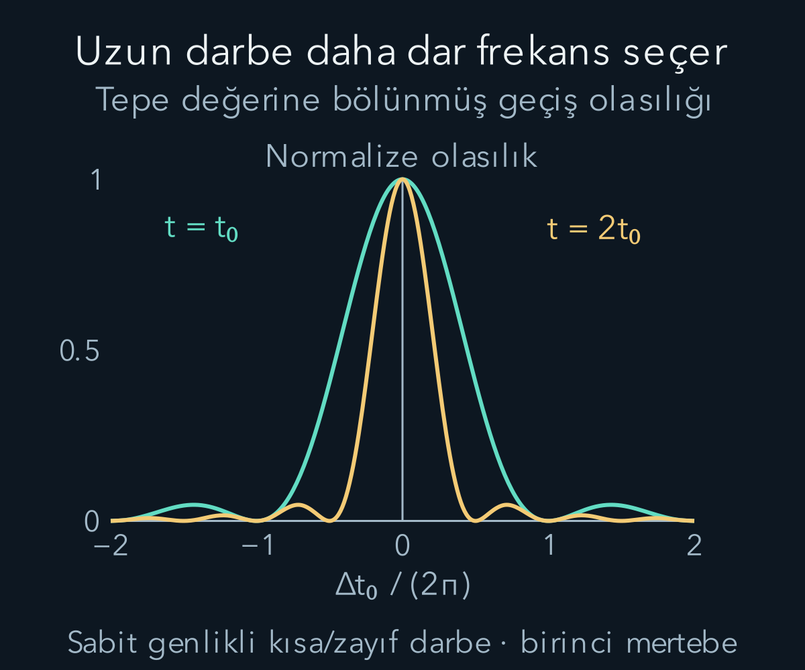
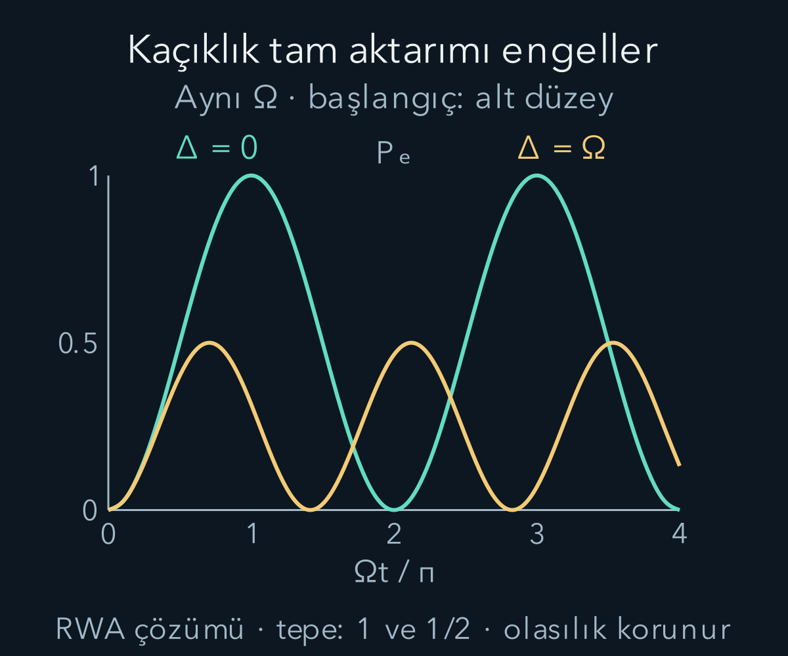

import ArticleVideo from '@/components/ArticleVideo.astro'
import kavram from './media/01-kavram.mp4?url'
import kavramPoster from './media/01-kavram.jpg?url'

Dışarıdan uygulanan bir alan, atomun başlangıçta bulunduğu enerji durumundan başka bir duruma geçme olasılığını değiştirebilir. Buradaki “geçiş”, dalga fonksiyonunun bir katsayısının değişmesidir. Her anda ölçüm yapıp atomun iki basamak arasında atladığını izlemekle aynı deney değildir. Önce ölçüm yapılmadan geçen süreyi Schrödinger denklemiyle hesaplayacak, sonunda hangi enerji sonucunun ne sıklıkta çıkacağını bulacağız.

[Hamiltonyen ve zaman evrimi](/blog/hamiltonyen-ve-kuantum-zaman-evrimi/) yazısında sabit Hamiltonyenin enerji katsayılarının büyüklükleri değişmiyordu. [Zamandan bağımsız pertürbasyon](/blog/zamandan-bagimsiz-perturbasyon-teorisi/) ise yeni, sabit bir Hamiltonyenin enerji düzeylerini buluyordu. Burada dış etki zamanla değişiyor. [WKB yaklaşımındaki](/blog/wkb-yaklasimi/) konumsal yavaşlık koşuluyla karıştırmadan, hem etkinin gücünü hem uygulama süresini inceleyeceğiz. Karmaşık genlik, matris çarpımı ve üstel fonksiyonun türevi kullanacağımız araçlardır.

## 1. Sabit parçanın bildiğimiz hareketini ayırmak

Hamiltonyeni $H(t)=H_0+V(t)$ biçiminde yazalım. $H_0$ sabit, çözümünü bildiğimiz kısım; $V(t)$ dış etkiden doğan enerji operatörüdür. $H_0|n\rangle=E_n|n\rangle$ ve $\langle m|n\rangle=\delta_{mn}$ olsun. $E_n$ enerji, $|n\rangle$ ortonormal baz durumudur. $\delta_{mn}$ indisler aynıysa bir, farklıysa sıfırdır.

Genel durumu:

$$
|\psi(t)\rangle=\sum_n c_n(t)e^{-iE_nt/\hbar}|n\rangle
$$

şeklinde açalım. $t$ zaman, $i^2=-1$ sanal birim, $\hbar$ indirgenmiş Planck sabitidir. $|\psi(t)\rangle$ tam durum, $c_n$ ise karmaşık olasılık genliğidir. Üstel çarpan, dış etki olmasa zaten oluşacak fazdır. Bilmediğimiz yeni hareketi $c_n(t)$ katsayısına bıraktık. Bu bir yaklaşık çözüm değil, sabit bazda her durum için yapabileceğimiz yeniden yazmadır.

Türevi alıp $i\hbar$ ile çarptığımızda her terimden $(i\hbar\dot c_n+E_nc_n)e^{-iE_nt/\hbar}$ gelir. Sağdaki $H_0$ aynı $E_nc_n$ katkısını verir; iki taraftan silinir. Kalan eşitliği soldan $\langle m|$ ile çarpıp ortak fazı ayırırsak:

$$
\boxed{i\hbar\dot c_m=\sum_n V_{mn}(t)e^{i\omega_{mn}t}c_n(t).}
$$

Burada iki kısaltma tanımladık:

$$
\begin{aligned}
V_{mn}&=\langle m|V|n\rangle,\\
\omega_{mn}&=\frac{E_m-E_n}{\hbar}.
\end{aligned}
$$

Nokta zamana göre türevdir. $V_{mn}$ enerji birimindedir; $\omega_{mn}$ açısal frekanstır. Formüldeki üstel çarpan enerji farkının oluşturduğu göreli fazı taşır. Hamiltonyen Hermit, yani eşlenik transpozuna eşit olduğunda bu tam bağlı denklemler normu korur: $\sum_n|c_n|^2=1$.

## 2. Birinci mertebe: başlangıç katsayısını sabit tutmak

$t=0$ anında $|i\rangle$ durumunda başlayalım. Katsayılar $c_i(0)=1$, diğerleri sıfırdır. Etki yeterince zayıf veya yeterince kısa ise sağ tarafta yaklaşık $c_i(t)\approx1$ ve $c_{n\ne i}(t)\approx0$ kullanabiliriz. $f\ne i$ hedefi için:

$$
\begin{aligned}
\dot c_f^{(1)}(t)&=-\frac{i}{\hbar}V_{fi}(t)e^{i\omega_{fi}t},\\
c_f^{(1)}(t)&=-\frac{i}{\hbar}\int_0^tV_{fi}(s)e^{i\omega_{fi}s}\,ds.
\end{aligned}
$$

Üstteki $(1)$ genliğin etkiye göre birinci mertebesini belirtir. Olasılık $P_{i\to f}\approx|c_f^{(1)}|^2$ olduğundan, başta sıfır olan geçiş olasılığının ilk katkısı etki gücünün karesiyle gelir. Genlikleri toplamakla olasılıkları toplamanın farkı burada yeniden önem kazanır: integral farklı zamanlarda biriken karmaşık katkıları önce toplar, kare en sonda alınır.

Bu ilk hesapta $c_i=1$ bırakıp ayrıca $c_f^{(1)}$ eklersek yaklaşık durumun norm karesi $1+|c_f^{(1)}|^2$ olur. Tam fiziksel durumun normu elbette bir kalır. Eksik olan, başlangıç genliğinde aynı olasılık mertebesinde beliren düzeltmedir. Örneğin $\Omega$ bağlaşımın açısal frekans ölçeği olmak üzere, tam rezonans çözümünde birazdan $c_g=\cos(\Omega t/2)$ bulacağız; küçük zamanda $c_g\approx1-\Omega^2t^2/8$ olduğundan $|c_g|^2\approx1-\Omega^2t^2/4$ olur. Böylece öteki düzeye giden olasılığın nereden eksildiği görünür. Birinci mertebe geçiş hesabını kesin olarak normalize edilmiş bütün durum sanmamak gerekir.

Bu yaklaşım tüm zamanlar için geçerli değildir. Hesaplanan toplam geçiş olasılığı küçük kalmalıdır. Küçük bir dış etki uzun süre uygulanırsa başlangıç durumundaki nüfus belirgin azalabilir. O zaman sağ tarafta $c_i=1$ demeyi sürdürmek, kaybedilen genliği hesaba katmamak olur. Ayrıca $V_{ii}$ köşegen elemanı büyük bir faz biriktiriyorsa, geçiş küçük olsa bile bu fazı baştan ayırmak gerekir. Aşağıdaki iki düzeyli örnekte köşegen dış etkiyi sıfır seçerek bu ek soruyu kaldırıyoruz.

Geçişin varlığı yalnız frekansa bağlı değildir. Matris elemanı sıfırsa bu mertebede geçiş de sıfırdır. Örneğin yansıma simetrili bir kuyuda aynı pariteli iki gerçek enerji fonksiyonunu $\phi_g(x)$ ve $\phi_e(x)$ ile gösterelim. Dış etki konumla orantılıysa bağlantı integrali $\int\phi_e(x)x\phi_g(x)dx$ içerir. Aynı pariteli iki fonksiyonun çarpımı çifttir; $x$ ile çarpınca tek fonksiyon olur ve simetrik aralıktaki integral sıfırlanır. Bu, [parite yazısındaki](/blog/kuantumda-simetri-ve-parite/) tek-çift fonksiyon kuralının bir geçiş seçme kuralına dönüşmesidir. Rezonansa ayarlamak, sıfır olan bağlantıyı tek başına açmaz.

## 3. Sinüslü alan iki frekans katkısı getirir

İki duruma odaklanalım: alt düzey $|g\rangle$, üst düzey $|e\rangle$. Enerji farkı $E_e-E_g=\hbar\omega_0>0$ olsun. Uygulanan alanın bu iki durumu bağlayan matris elemanını:

$$
V_{eg}(t)=V_{ge}(t)=\hbar\Omega\cos(\omega t)
$$

seçelim. $\omega$ alanın açısal frekansı, $\Omega>0$ bağlaşımın açısal frekans ölçeğidir. Bu örnekte dış alanın başlangıç fazını sıfır, bağlantı katsayısını gerçek seçiyoruz. Başka bir darbe fazı, hazırlanan süperpozisyonun göreli fazını değiştirebilir. V(t) matrisinin köşegen elemanlarını bu modelde sıfır kabul ediyoruz. Başka düzeyler ve bozunma şimdilik modele dahil değil. Bu tanımda kosinüsün önündeki katsayı $\hbar\Omega$ olduğu için rezonans nüfusunun açısal frekansı $\Omega$ çıkacak. Bağlaşımı $\hbar\Omega/2$ diye tanımlayan bir kaynakla karşılaştırırken sembolleri değil Hamiltonyenin gerçek matris elemanlarını eşleştirmeliyiz.

$\cos\omega t=(e^{i\omega t}+e^{-i\omega t})/2$ eşitliğiyle hedef genliğinin integralinde:

$$
\begin{aligned}
e^{i\omega_0s}\cos\omega s
&=\tfrac12e^{i(\omega_0-\omega)s}\\
&\quad+\tfrac12e^{i(\omega_0+\omega)s}.
\end{aligned}
$$

bulunur. Alan enerji farkına yakın ayarlandığında ilk katkı yavaş, ikincisi çok hızlı faz döndürür. **Rezonans**, $\omega\approx\omega_0$ koşuludur. Farkı $\Delta=\omega_0-\omega$ ile adlandıralım; buna frekans kaçıklığı veya detuning denir.

Hızlı terimin zaman integrali yaklaşık $1/(\omega_0+\omega)$ ölçeğinde sınırlı kalırken, rezonanstaki yavaş terim bir süre boyunca aynı yönde birikir. Bu nedenle $\Omega\ll\omega_0$, $|\Delta|\ll\omega_0$ ve hızlı dönemden uzun ilgi sürelerinde hızlı terimi ihmal etmek anlamlı olabilir. Buna **dönen dalga yaklaşımı**, kısaca RWA denir. Yalnız baz değiştirmek yaklaşık işlem değildir; hızlı terimi atmak yaklaşık işlemdir. Çok güçlü sürmede, çok kısa darbelerde veya çok uzun sürede biriken küçük frekans kaymalarında ayrıca doğruluk kontrolü gerekir.

## 4. Rezonans eğrisini integralden çıkarmak

RWA ve birinci mertebe birlikte kullanılırsa:

$$
\begin{aligned}
c_e^{(1)}(t)&=-\frac{i\Omega}{2}\int_0^t e^{i\Delta s}ds\\
&=-i\Omega e^{i\Delta t/2}\frac{\sin(\Delta t/2)}{\Delta}.
\end{aligned}
$$

Son adımda $e^{iu}-1=2ie^{iu/2}\sin(u/2)$ kullanıldı. Mutlak karesi:

$$
P^{(1)}_{g\to e}(t)=\frac{\Omega^2t^2}{4}
\operatorname{sinc}^2\!\left(\frac{\Delta t}{2}\right),
$$

Burada kullanılan fonksiyonun tanımı:

$$
\operatorname{sinc}(u)=\frac{\sin u}{u},\quad\operatorname{sinc}(0)=1.
$$

Buradaki sinc tanımında içeriye ayrıca $\pi$ konmuyor. Tam rezonanstaki limit $P^{(1)}=\Omega^2t^2/4$ olur. Burada $\Delta$ ile bölmeyi doğrudan $\Delta=0$ koyarak yapmadık; $\sin u/u\to1$ limitini kullandık. Bu sonuç $\Omega t\ll1$ iken anlamlıdır; uzun sürede birden büyük çıkması doğanın olasılık kuralını bozduğunu değil, yaklaşımın bittiğini gösterir.

Sabit süreli dikdörtgen darbenin ilk sıfırları $\Delta=\pm2\pi/t$ noktalarındadır. Daha uzun darbe daha dar frekans seçiciliği sağlar. Bu, integralde ters fazlı katkıların daha hassas biçimde birbirini götürmesidir. Darbenin biçimi değişirse yan tepelerin biçimi de değişir. Burada her deneyin evrensel tayf çizgisini değil, seçtiğimiz sabit genlikli sonlu darbenin cevabını hesaplıyoruz.

## 5. Nüfus azalmaya başlayınca iki denklem de gerekli

RWA altında artık küçük geçiş varsayımını kaldırabiliriz. İki katsayıyı birlikte evriltelim:

$$
\begin{aligned}
i\dot c_g&=\frac\Omega2e^{-i\Delta t}c_e,\\
i\dot c_e&=\frac\Omega2e^{i\Delta t}c_g.
\end{aligned}
$$

$\Delta=0$ iken ilk denklemin türevini alıp ikincisini kullanalım: $\ddot c_g=-(\Omega^2/4)c_g$. Başlangıç $c_g(0)=1$, $\dot c_g(0)=0$ olduğundan $c_g=\cos(\Omega t/2)$ bulunur. İlk denkleme geri koyarsak $c_e=-i\sin(\Omega t/2)$ çıkar. Böylece:

$$
\begin{aligned}
P_g&=\cos^2(\Omega t/2),\\
P_e&=\sin^2(\Omega t/2).
\end{aligned}
$$

Toplam her an birdir. Küçük zamanda $\sin u\approx u$ olduğu için tam RWA sonucu birinci mertebenin $\Omega^2t^2/4$ ifadesine geri döner. Örneğin $\Omega t=0{,}2$ için ilk yaklaşım $0{,}01$, Rabi sonucu yaklaşık $0{,}009967$ verir; fark küçüktür. $\Omega t=\pi$ içinse ilk yaklaşım $\pi^2/4\approx2{,}467$ gibi olasılık olamayacak bir sayı verirken Rabi sonucu birdir. Aynı alanın kısa süreli ve uzun süreli etkisini ayırmak bu yüzden zorunludur.

Bu **Rabi salınımı**dır. Dış alan sürekli uygulanırken durum yalnız yukarı taşınmaz; genlik tekrar alt düzeye dönebilir. Şu anki model kapalı iki düzeyli sistemin eşevreli hareketini anlatır. Kendiliğinden ışınım veya çevrenin etkisi eklendiğinde aynı kusursuz salınımın sonsuza kadar sürmesi beklenmez.

İlk tam aktarım $\Omega t=\pi$ anındadır: $t_\pi=\pi/\Omega$. Bu süreli uygulamaya $\pi$ darbesi denir. Yarı sürede $\pi/2$ darbesi, bildiğimiz serbest enerji fazları çıkarılmış etkileşim temsilinde $(|g\rangle-i|e\rangle)/\sqrt2$ süperpozisyonunu hazırlar. Tam Schrödinger durumunda bu fazları geri koymalıyız: ortak $e^{-iE_gt/\hbar}$ fazı dışında durum $(|g\rangle-i e^{-i\omega_0t}|e\rangle)/\sqrt2$ olur. Ölçüm olasılıkları aynı kalırken başka bazdaki girişim hesabında göreli fazı korumak gerekir. Eşit nüfusların tek başına karışık durum anlamına gelmediğine dikkat edelim; burada göreli fazı belirli saf bir durum vardır.

## 6. Rezonans dışındaki tam RWA çözümü

Fazları $c_g=b_ge^{-i\Delta t/2}$ ve $c_e=b_ee^{i\Delta t/2}$ olarak ayıralım. Türevde fazların katkısını da tutunca:

$$
i\frac{d}{dt}\begin{pmatrix}b_g\\b_e\end{pmatrix}
=\frac12\underbrace{\begin{pmatrix}-\Delta&\Omega\\\Omega&\Delta\end{pmatrix}}_{M}
\begin{pmatrix}b_g\\b_e\end{pmatrix}.
$$

$b_g,b_e$ zamanla değişen yeni katsayılar, $M$ frekans birimli matristir. $I$ iki boyutlu birim matris olacak; bir sütunu değiştirmeden bırakır. Çarpımını açıkça yapınca köşegen dışındaki $-\Delta\Omega+\Omega\Delta$ terimleri silinir; iki köşegen de $\Delta^2+\Omega^2$ olur. Dolayısıyla $M^2=\Omega_R^2I$, $\Omega_R=\sqrt{\Omega^2+\Delta^2}$.

Üstelin çift kuvvetleri $I$ ile, tek kuvvetleri $M$ ile toplandığından evrim matrisi:

$$
\begin{aligned}
U&=I\cos(\Omega_Rt/2)\\
&\quad-i\frac{M}{\Omega_R}\sin(\Omega_Rt/2).
\end{aligned}
$$

olur. Başlangıç sütunu $(1,0)^T$ ($T$ transpoz işareti) ile çarpınca $b_e=-i(\Omega/\Omega_R)\sin(\Omega_Rt/2)$ çıkar. Ek fazın mutlak değeri bir olduğundan:

$$
\boxed{P_e(t)=\frac{\Omega^2}{\Omega_R^2}
\sin^2\!\left(\frac{\Omega_Rt}{2}\right).}
$$

Kaçıklık arttıkça salınımın açısal frekansı büyür, ancak ulaşabildiği en büyük olasılık küçülür. “Daha hızlı salınıyor, daha iyi aktarım yapıyor” çıkarımı doğru değildir. Tam aktarım bu sabit genlikli modelde yalnız tam rezonanstadır.

<ArticleVideo src={kavram} poster={kavramPoster} title="Rezonans ve kaçıklıkta Rabi salınımı" caption="Yatay eksen Ωt/π. Yeşil eğri Δ=0, altın eğri Δ=Ω için üst düzey olasılığıdır. Hareketli noktalar aynı anda iki farklı deneyin tahminini gösterir; tek atomun kesintisiz izlenen enerji kaydı değildir. Rezonans dışındaki tepe 1/2'de kalır." />

## 7. Birimlerle somut darbe süresi

$\Omega/(2\pi)=1\,\mathrm{MHz}$ seçelim. MHz, saniyede bir milyon çevrimdir; $\Omega$ ise radyan/saniye olduğundan $\Omega=2\pi\times10^6\,\mathrm{s^{-1}}$ kullanmalıyız. Rezonansta:

$$
t_\pi=\frac\pi{2\pi\times10^6}\,\mathrm s
=0{,}5\,\mu\mathrm s.
$$

$\mu\mathrm s$ mikrosaniyedir. $0{,}25\,\mu\mathrm s$ sonunda iki sonuç eşit olasılıklıdır; $1\,\mu\mathrm s$ sonunda üst düzey olasılığı yeniden sıfırdır. Her süreyi denemek için aynı başlangıcı yeniden hazırlayan birçok deney gerekir. Aynı atomu sürekli enerji ölçümüne tabi tutmak farklı bir dinamik oluşturabilir.

$\Delta=\Omega$ seçilirse en yüksek olasılık $1/2$, ilk tepe süresi $\pi/(\sqrt2\Omega)\approx0{,}3536\,\mu\mathrm s$ olur. Rezonanstaki $0{,}5\,\mu\mathrm s$ darbesini aynen uygulamak bu durumda tam aktarım yapmaz. Ayrıca bu sayısal örneği gerçek bir geçişe uygularken $\omega_0$'ın $\Omega$'dan çok daha büyük olduğunu ve başka düzeylerin önemli ölçüde uyarılmadığını kontrol etmeliyiz.

## 8. Alan kapanınca salınım neden durur?

Darbenin sonunda $V(t)$ sıfırlanırsa artık katsayı denkleminin sağ tarafı sıfırdır: $\dot c_g=\dot c_e=0$. $H_0$'ın serbest fazları dönmeyi sürdürür, fakat enerji bazındaki olasılıklar sabit kalır. Dolayısıyla $\pi$ darbesiyle hazırlanmış üst düzey, bu ideal modelde kendiliğinden alt düzeye inmez. Gerçek bir atomun ışıma yoluyla bozunmasını açıklamak için burada dışarıda bıraktığımız alan ve çevre etkilerini eklemeliyiz.

Aynı şekilde $\pi/2$ darbesinden sonra eşit olasılıkların sabit kalması göreli fazın yok olması demek değildir. Daha sonra uygulanan ikinci bir darbe, bekleme sırasında biriken faza duyarlı olabilir. “Yarım üst, yarım alt” diye yalnız iki olasılık söylemek, sonraki girişimi tahmin etmeye yetmez. Durum vektöründe tuttuğumuz karmaşık katsayılar bu eksik bilgiyi taşır.

## 9. Yaklaşımların sınırını birlikte okumak

İki farklı sadeleştirme yaptık. Birinci mertebe pertürbasyon, başlangıç nüfusunun neredeyse tükenmediği kısa/zayıf etkiyi hesapladı. RWA ise hızlı ters dönen terimi ihmal etti. RWA denklemlerini tam çözmek, küçük geçiş varsayımı olmadan yüzde yüze varan nüfus aktarımını açıklayabilir. Bu iki doğruluk sorusunu aynı başlık altında gizlememeliyiz.

Enerji alışverişinin kaynağı zamanla değişen dış alandır. $H_0$ enerjisi tek başına korunmak zorunda değildir; sistem ve sürücünün birlikte enerji dengesi ayrı bir açıklamadır. Burada alanı verilen klasik bir sürücü olarak modelledik, foton sayısını izleyen kuantize alan hesabı yapmadık. Çıkardığımız sonuç, seçtiğimiz modelin katsayılarının nasıl değiştiğini ve sonunda ölçüm olasılıklarının nasıl oluştuğunu gösteriyor.

## Kaynaklar

Genel katsayı denklemi ve birinci mertebe yöntemi [MIT OCW — Time Dependent Perturbation Theory](https://ocw.mit.edu/courses/8-06-quantum-physics-iii-spring-2018/89ef6d5958ee59bae9a91345c3d8c8e4_MIT8_06S18ch4.pdf), iki düzeyli sürme ve hızlı terim koşulları [MIT OCW 5.61 — Lecture 36](https://ocw.mit.edu/courses/5-61-physical-chemistry-fall-2017/23f23a23487b97c09aaf468f478987c9_MIT5_61F17_lec36.pdf) ile karşılaştırıldı. Matris üsteli, seçilen MHz örneği ve çizimler bu yazı için yeniden hesaplandı. Kaynaklar 13 Ekim 2026 tarihinde doğrudan açıldı.
