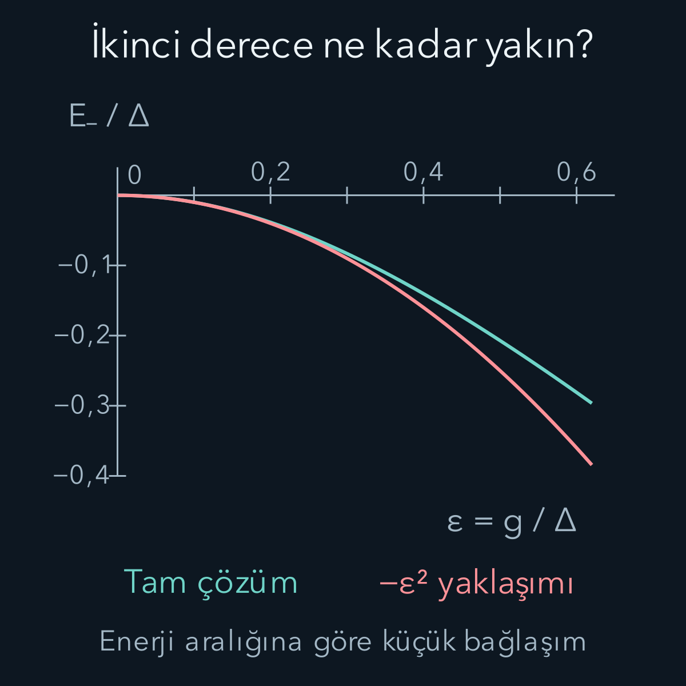
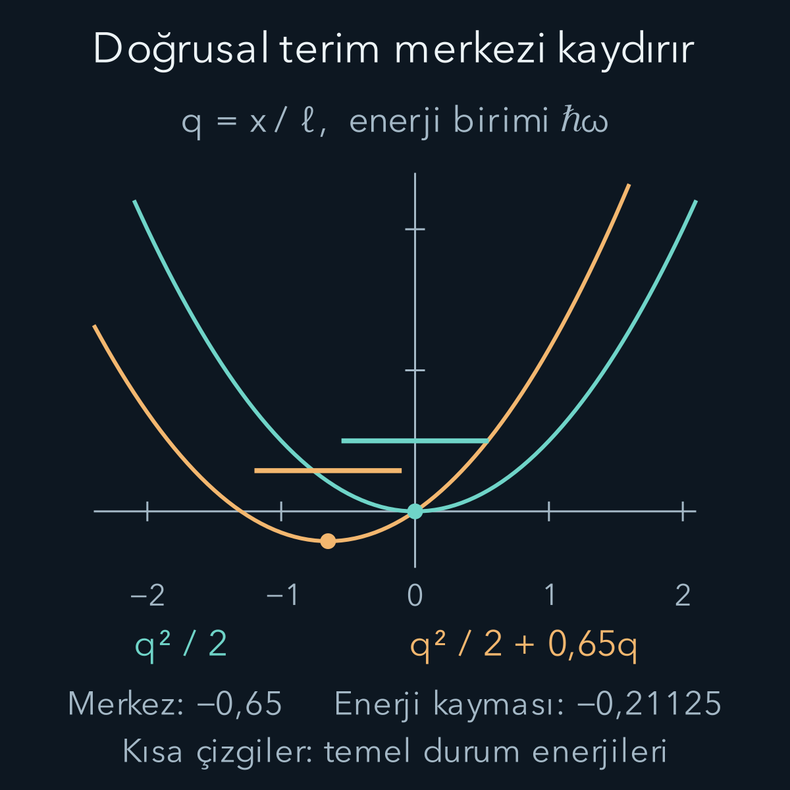

import ArticleVideo from '@/components/ArticleVideo.astro'
import kavram from './media/01-kavram.mp4?url'
import kavramPoster from './media/01-kavram.jpg?url'

Kuyuyu, harmonik osilatörü ve hidrojenin basit modelini çözebildik. Gerçek bir sisteme ek alan, zayıf etkileşim veya küçük bir potansiyel değişimi eklendiğinde aynı denklemi baştan tam çözmek her zaman mümkün olmaz. **Pertürbasyon teorisi**, bildiğimiz çözümün çevresinde kontrollü bir yaklaşık hesap kurmayı amaçlar. Önce bilinen çözümü yazar, sonra değişimin birinci ve ikinci dereceden katkılarını ayırırız.

[Özdeş parçacıklar yazısında](/blog/ozdes-parcaciklar-bozonlar-ve-fermiyonlar/) hangi ortak durumlara izin verildiğini öğrendik. Şimdi izin verilen uzay içinde enerji problemini yaklaşık çözmeye geçiyoruz. Hesap için [özdeğer ve köşegenleştirme](/blog/ozdegerler-ozvektorler-ve-kosegenlestirme/), [Taylor yaklaşımı](/blog/sonsuz-seriler-ve-taylor-yaklasimi/), [Hamiltonyen](/blog/hamiltonyen-ve-kuantum-zaman-evrimi/) ve [harmonik osilatör](/blog/kuantum-harmonik-osilatoru/) önbilgileri kullanılacak. Burada Hamiltonyen zamandan bağımsızdır; değişen parametreleri karşılaştırmamız kendiliğinden bir zaman evrimi deneyi tanımlamaz.

## 1. Çözülen kısım ile eklenen kısmı ayırmak

Hamiltonyeni şöyle yazalım:

$$
H(\lambda)=H_0+\lambda W.
$$

$H_0$ özdurumlarını bildiğimiz Hermitsel işleç, $W$ eklenen Hermitsel enerji işleci, $\lambda$ ise boyutsuz bir kontrol veya hesap parametresidir. Fiziksel değişim $\lambda W$'dir. Bazı problemlerde $\lambda$ gerçekten değiştirilen bir alanın ölçeklenmiş değeri, bazılarında yalnız katkıları derecelerine göre ayırma aracıdır. Sonunda $\lambda=1$ koymak, eklediğimiz terimin otomatik olarak küçük olduğu anlamına gelmez.

Bilinen özdeğer denklemi:

$$
H_0|n^{(0)}\rangle=E_n^{(0)}|n^{(0)}\rangle
$$

olsun. $n$ durumu ayıran etiket, üstteki parantez içi sıfır ise pertürbasyonsuz niceliği gösterir; üs alma işlemi değildir. Bilinen özdurumların ortonormal ve ele aldığımız uzayda tam bir baz oluşturduğunu varsayıyoruz. Ortonormal olmak, her durumun normunun bir, farklı durumların iç çarpımının sıfır olmasıdır. Tamlık ise uygun her durumu bu durumların birleşimiyle yazabilmemizdir.

Bu yazıda seçtiğimiz $E_n^{(0)}$ enerjisine ait bağımsız başka bir durum yoktur. Buna **dejenere olmayan** enerji denir. Ayrıca seviye diğerlerinden sonlu bir enerji aralığıyla ayrılmış olmalıdır. Ayrık bağlı durumlara odaklanıyoruz; süreklilik eşiğine yaklaşan bir durum için aynı toplam formüllerini sorgusuz kullanamayız.

## 2. Enerji kadar durum da değişir

Aradığımız çözümü parametrenin kuvvetlerine göre açalım:

$$
\begin{aligned}
E_n(\lambda)&=E_n^{(0)}+\lambda E_n^{(1)}\\
&\quad+\lambda^2E_n^{(2)}+\cdots.
\end{aligned}
$$

$$
\begin{aligned}
|n(\lambda)\rangle&=|n^{(0)}\rangle+\lambda|n^{(1)}\rangle\\
&\quad+\lambda^2|n^{(2)}\rangle+\cdots.
\end{aligned}
$$

$E_n^{(1)}$ birinci derece enerji katsayısıdır; gerçek birinci derece katkı $\lambda E_n^{(1)}$ olur. Durum katsayıları da benzer biçimde tanımlanır. Bu açılımlar çözümün seçilen dalı boyunca düzgün değişebildiğini varsayar; her problemde her parametre değerine kadar yakınsak olduklarına dair söz vermiyoruz.

Durumun normu ve genel fazı için bir seçim yapmamız gerekir. Hesabı kolaylaştırmak üzere $\langle n^{(0)}|n(\lambda)\rangle=1$ seçelim. Buna ara normalizasyon denir. Buradan $\langle n^{(0)}|n^{(1)}\rangle=0$ ve daha yüksek düzeltmeler için benzeri çıkar. Tam normu bu aşamada tam bir yapmıyoruz; ölçüm olasılığı hesaplamadan önce durumu yeniden normalize edeceğiz.

Bu seçim fiziksel serbestliği kullanır: Bir özvektör sıfır olmayan bir sayıyla çarpıldığında aynı özdeğere ait kalır. Başlangıç durumu üzerindeki izdüşüm sıfır olmadığı sürece seçtiğimiz katsayıyı bire getirebiliriz. Başlangıçtan çok uzağa gidersek bu koordinat seçimi de kullanışsız olabilir.

Bu derece ayırmayı sıradan bir çarpımla ilişkilendirebiliriz. İki parantezin her birinde sabit ve doğrusal terim varsa çarpımın doğrusal kısmı, bir parantezin sabit terimiyle diğerinin doğrusal terimini iki farklı sırada eşleştirerek gelir. İki doğrusal terimin çarpımı ise ikinci derecededir. Burada da aynı muhasebeyi yapıyoruz; yalnız katsayıların bazıları sayı, bazıları işleç, bazıları durum vektörüdür. İşleçler durumların solunda kalmalıdır. Böylece bir terimin hangi dereceye ait olduğunu, görünüşünün karmaşıklığından değil taşıdığı parametre kuvvetinden anlarız.

## 3. Birinci derecedeki denklemi çıkarmak

Açılımları $H|n\rangle=E_n|n\rangle$ içine koyup aynı $\lambda$ kuvvetlerini eşitleyelim. Sıfırıncı derece bilinen özdeğer denklemidir. Birinci derecede sol taraftan $H_0|n^{(1)}\rangle+W|n^{(0)}\rangle$, sağ taraftan $E_n^{(0)}|n^{(1)}\rangle+E_n^{(1)}|n^{(0)}\rangle$ gelir. Böylece:

$$
\begin{aligned}
&(H_0-E_n^{(0)}I)|n^{(1)}\rangle\\
&\qquad=(E_n^{(1)}I-W)|n^{(0)}\rangle.
\end{aligned}
$$

$I$ birim işleçtir. Şimdi soldan $\langle n^{(0)}|$ uygulayalım. Hermitsellik sayesinde $\langle n^{(0)}|H_0=E_n^{(0)}\langle n^{(0)}|$ olduğundan sol taraf sıfır olur. Sağdaki norm birdir. Sonuç:

$$
\boxed{E_n^{(1)}=\langle n^{(0)}|W|n^{(0)}\rangle.}
$$

İlk enerji düzeltmesi, eklenen enerji teriminin eski durumdaki beklenen değeridir. Eski durumun değişimini hiç hesaplamadan ilk enerji kaymasını bulabilmemiz bu izdüşümün sonucudur. Beklenen değer gerçek çıkar; çünkü W Hermitseldir.

Örneğin ek terim yalnız sabit bir enerji $W=C I$ ise bütün durumlarda $E_n^{(1)}=C$ bulunur. Farklı özdurumları birbirine bağlayan matris elemanları sıfırdır. Dolayısıyla durum değişmez; bütün enerjiler tam olarak $\lambda C$ kadar kayar. Enerji farkları korunur. Bu basit sınama, “büyük mutlak enerji düzeltmesi mutlaka büyük durum değişimi demektir” düşüncesinin neden doğru olmadığını gösterir.

Konuma bağlı bir ek potansiyelde aynı formül integral olur: $E_n^{(1)}=\int\psi_n^{(0)*}(x)W(x)\psi_n^{(0)}(x)\,dx$. Örneğin W yalnız küçük bir bölgede sabit V değeri alıyorsa ilk düzeltme, V ile eski durumun o bölgede bulunma olasılığının çarpımıdır. Bölgeye çok az olasılık ağırlığı düşüyorsa katkı küçük olabilir. Burada kullandığımız olasılık yeni değil eski durumunkidir; yeni durumun değişimini aynı ifadeye yeniden yerleştirmek, derece hesabını takip etmeden bazı katkıları iki kez saymamıza neden olabilir.

Soldan bir bra uygulamak, soyut görünen denklemi belirli bir yöndeki bileşene indirmektir. İki boyutta bir vektör denklemindeki yatay bileşenleri karşılaştırmak gibi, burada da başlangıç özdurumu yönünü seçiyoruz. Bu yönü seçince bilinmeyen durum düzeltmesini içeren parçanın kaybolması tesadüf değildir: başlangıç durumuna etki eden eski Hamiltonyen zaten bildiğimiz enerji sayısıyla çarpmaktır. İlk enerji katsayısını kolayca ayırabilmemizin cebirsel nedeni budur. Bir sonraki adımda başka yönleri seçince enerji katsayısı yerine durumun yeni bileşenleri ortaya çıkacak.

## 4. Duruma hangi bileşenler karışır?

Aynı birinci derece denklemi bu kez $k\ne n$ olan $\langle k^{(0)}|$ ile çarpalım. Sağdaki $E_n^{(1)}$ terimi ortogonallikten sıfırlanır:

$$
\begin{aligned}
&(E_k^{(0)}-E_n^{(0)})\langle k^{(0)}|n^{(1)}\rangle\\
&\qquad=-\langle k^{(0)}|W|n^{(0)}\rangle.
\end{aligned}
$$

$W_{kn}=\langle k^{(0)}|W|n^{(0)}\rangle$ kısaltmasını kullanalım. İşareti paydaya geçirirsek:

$$
\boxed{|n^{(1)}\rangle=
\sum_{k\ne n}\frac{W_{kn}}{E_n^{(0)}-E_k^{(0)}}|k^{(0)}\rangle.}
$$

Paydaki matris elemanı iki eski durumun ne kadar bağlandığını, payda aralarındaki enerji aralığını anlatır. Pay da payda da enerji birimindedir; katsayı boyutsuz çıkar. Yakın enerjiler aynı bağlaşım altında daha güçlü karışabilir.

Buradaki $|k^{(0)}\rangle$ katkısı, parçacığın o enerjiye gerçek bir sıçrama yaptığını söylemez. Yeni durağan özdurumu eski özbazda açıyoruz. Ölçümün hangi Hamiltonyene göre yapıldığı belirtilmeden bu katsayıları “zaman içindeki geçişler” olarak yorumlayamayız.

## 5. İkinci enerji düzeltmesi

İkinci derecedeki denklem:

$$
\begin{aligned}
&(H_0-E_n^{(0)}I)|n^{(2)}\rangle\\
&\qquad=(E_n^{(1)}I-W)|n^{(1)}\rangle\\
&\qquad\quad+E_n^{(2)}|n^{(0)}\rangle
\end{aligned}
$$

olur. Soldan yine başlangıç özdurumuyla çarptığımızda $H_0-E_n^{(0)}I$ katkısı sıfırlanır. Ara normalizasyon nedeniyle $E_n^{(1)}\langle n^{(0)}|n^{(1)}\rangle=0$ olur. Böylece $E_n^{(2)}=\langle n^{(0)}|W|n^{(1)}\rangle$ elde edilir. Önceki toplamı yerine koyarsak:

$$
\boxed{E_n^{(2)}=\sum_{k\ne n}
\frac{|W_{kn}|^2}{E_n^{(0)}-E_k^{(0)}}.}
$$

Mutlak kare, $W_{nk}=W_{kn}^*$ Hermitsellik bağıntısından gelir. Pay enerji karesi, payda enerji olduğu için sonuç doğru enerji birimindedir. Temel durumda bütün diğer enerjiler daha yüksekse paydalar negatiftir; ikinci derece katkı sıfır veya negatiftir. Uyarılmış durumda aşağıdaki ve yukarıdaki seviyeler farklı işaretli katkılar verebilir.

## 6. Küçüklüğü doğru ölçekle karşılaştırmak

Durum düzeltmesinin küçük kalması için ilgili oranlar

$$
\left|\frac{\lambda W_{kn}}{E_n^{(0)}-E_k^{(0)}}\right|\ll1
$$

olmalıdır. Çok sayıda katkı varsa yalnız her birinin küçük olmasına bakmak yetmez; karelerinin toplamı, yani $\lambda^2\langle n^{(1)}|n^{(1)}\rangle$ da kontrol edilmelidir. Bu, yaklaşım için yararlı bir kontrol ölçüsüdür; tek başına sonsuz serinin yakınsaklığını kanıtlamaz.

“Ek enerji, asıl enerjiye göre küçük” demek yetersizdir. Bütün enerjilere aynı sabiti ekleyerek sıfır noktasını değiştirebiliriz; fizik aynı kalır. Enerji aralıkları ise bu değişimden etkilenmez. Yakın iki seviye arasında çok küçük görünen bir matris elemanı bile büyük durum değişimine neden olabilir.

Birinci derece durumun norm karesi $1+\lambda^2\|n^{(1)}\|^2$ olur. Normalize yaklaşık durum için onu bu sayının kareköküne böleriz. Başlangıç katsayısında ikinci dereceden $-\lambda^2\|n^{(1)}\|^2/2$ değişimi böyle doğar. Ancak yalnız bu normalizasyonu eklemek bütün ikinci derece durum düzeltmesini hesapladığımız anlamına gelmez; diğer yönlerdeki ikinci derece bileşenler hâlâ eksiktir.

Paydanın sıfır olması ise yalnız aritmetik bir aksaklık değildir. Aynı enerjiye ait iki eski durum varsa başlangıç Hamiltonyeni onların hangi birleşimini seçmemiz gerektiğini söylemez. Ek terim bu altuzayın içinde çok küçük olsa bile yeni özvektörleri sonlu bir açıyla seçebilir. Böyle bir durumda sıfıra bölmeyi küçük bir sayı ekleyerek düzeltmeyiz; önce eş enerjili altuzayın içinde eklenen işlecin doğru özbazını bulmak gerekir. Burada türettiğimiz formülün dejenere olmayan seviyelerle sınırlandırılmasının nedeni budur.

Pratik bir doğruluk kontrolü, bulunan normalize yaklaşık vektörü başlangıç özdeğer denklemine geri koymaktır. $|r\rangle=(H-E_{\mathrm{yak}}I)|\psi_{\mathrm{yak}}\rangle$ farkına kalan veya artık vektör diyelim; tam özçözümde sıfırdır. Normunun ilgili enerji ölçeğine göre küçülmesi, hesabın kendi içinde tutarlı olduğuna ilişkin doğrudan kanıt sağlar. Fakat yakındaki başka özdeğerlere çok küçük aralıklar varsa küçük kalan tek başına özvektörün tam olarak istediğimiz dalda olduğunu garanti etmez. Durum örtüşmesi ve enerji aralıkları da kontrol edilir.

Bir hesap yaparken önce ilgilendiğimiz eski seviyeyi ve ona bağlanabilen diğer seviyeleri belirleriz. Simetri nedeniyle bir matris elemanı sıfırsa o kanal ilk durumda karışım üretmez. Kalan matris elemanlarını aralıklarla karşılaştırır, istenen doğruluğa göre kaç derece gerektiğine karar veririz. Son olarak sonucu bir limitte, tam çözülen benzer bir modelde veya özdeğer denklemindeki artıkla sınarız. Bu sıra, ilk bulduğumuz küçük sayıyı güvenilirlik kanıtı sanmamızı önler.

Örneğin aynı bağlaşımı iki kat daha dar bir aralığa sahip sisteme uygularsak ilk karışım genliği iki katına çıkar. Önde gelen karışım olasılığı ise genliğin karesi olduğu için dört katına çıkar. Bu karşılaştırma henüz enerji sıfırını, toplam bağlanma enerjisini veya deney cihazının büyük görünmesini kullanmadı; yalnız gerçekten birbirine bağlanan iki durumun göreli ölçeğine baktı. Yaklaşık hesabın fiziksel anlamı burada yatar.

## 7. Tam çözülen iki düzeyli sınama

Eski bazda şu Hamiltonyeni seçelim:

$$
H=\begin{pmatrix}0&g\\g&\Delta\end{pmatrix},\qquad \Delta>0.
$$

$g$ gerçek bağlaşım enerjisi, $\Delta$ eski iki seviyenin enerji farkıdır. Bu örnekte $g=\lambda v$ yazılabilir; v sabit bir enerji ölçeğidir. Alt durum için ilk enerji düzeltmesi sıfır, ikinci katkı $-g^2/\Delta$ olur. İlk durum yaklaşımı $|0\rangle-(g/\Delta)|1\rangle$'dır; burada 0 ve 1 eski baz etiketleridir.

Tam özdeğer için determinantı sıfırlayalım:

$$
\det(H-EI)=(-E)(\Delta-E)-g^2=0,
$$

$$
E^2-\Delta E-g^2=0.
$$

İkinci derece denklem formülüyle:

$$
E_\pm=\frac{\Delta\pm\sqrt{\Delta^2+4g^2}}2.
$$

Boyutsuz $\epsilon=g/\Delta$ tanımıyla alt enerji:

$$
\begin{aligned}
\frac{E_-}{\Delta}&=\frac{1-\sqrt{1+4\epsilon^2}}2\\
&=-\epsilon^2+\epsilon^4-2\epsilon^6+\cdots.
\end{aligned}
$$

İlk terim türettiğimiz ikinci derece sonucuyla aynıdır. $\Delta=1\,\mathrm{eV}$, $g=0{,}10\,\mathrm{eV}$ için yaklaşık enerji $-0{,}010000\,\mathrm{eV}$, tam enerji $-0{,}00990195\,\mathrm{eV}$ olur. Fark yaklaşık $0{,}00009805\,\mathrm{eV}$'dur. Mutlak hata küçük olsa da enerji kaymasının kendisine göre yaklaşık yüzde birlik hatadır; hangi ölçekte hata verdiğimizi belirtmeliyiz.

$g/\Delta=0{,}5$ olursa tam enerji $-0{,}207107\Delta$, ikinci derece sonuç $-0{,}25\Delta$ çıkar. Enerji kaymasına göre hata artık yaklaşık yüzde 20,7'dir. Formüle değer koyabilmek yaklaşımın yeterli olduğunu göstermez. Bu örnekte kökün Taylor serisi $|\epsilon|<1/2$ için yakınsaktır; yaklaşımın istenen doğruluğu sağlaması genellikle bundan daha güçlü bir küçüklük gerektirir.

Hatanın ölçeklenmesi de yöntemi sınar. Küçük $\epsilon$ bölgesinde atılan ilk enerji terimi $+\Delta\epsilon^4$'tür. Bağlaşımı yarıya indirirsek ikinci derece kayma yaklaşık dörtte bire, kalan enerji hatası yaklaşık on altıda bire iner. Örneğin $\epsilon=0{,}05$ için tam enerji $-0{,}00249378\Delta$, ikinci derece sonuç $-0{,}00250000\Delta$ olur. Mutlak hata yaklaşık $0{,}00000622\Delta$'dır; önceki örneğe oranı yaklaşık on altıda birdir. Bu davranış, yalnız bir noktada doğru sayı bulmaktan daha anlamlı bir kontrol sağlar.

Grafikteki iki eğrinin büyük bağlaşımda ayrılması da aynı amaçla gösteriliyor. Dışarıdaki noktalar bir yöntemi başarısız diye etiketlemek için değil, kullanılan kısa serinin hangi bölgede güvenilir olduğunu görünür kılmak içindir. İstenen enerji duyarlılığı örneğin $10^{-5}\Delta$ ise $\epsilon=0{,}1$ yeterli olmazken $0{,}05$ bu örnekte yeterli olabilir. “Küçük” sözcüğü bu yüzden hedeflenen hata payıyla birlikte anlam kazanır.

## 8. Birinci enerji düzeltmesi sıfırsa hiçbir şey olmadı mı?

Hayır. İki düzeyli örnekte $W_{00}=0$ olduğundan ilk enerji düzeltmesi sıfırdı ama durum ilk derecede değişti. Tam alt özdurumu $\cos\alpha|0\rangle-\sin\alpha|1\rangle$ yazabiliriz. $g\ge0$ için $\tan(2\alpha)=2g/\Delta$ ve $0\le\alpha<\pi/4$ seçilir. Küçük g'de $\alpha\simeq g/\Delta$ çıkar; ilk durum düzeltmesiyle uyuşur.

Eski üst baz sonucunun tam olasılığı:

$$
\begin{aligned}
P_1&=\sin^2\alpha\\
&=\frac12\left(1-\frac1{\sqrt{1+4\epsilon^2}}\right)
\end{aligned}
$$

olur. $\epsilon=0{,}1$ için yaklaşık yüzde $0{,}971$'dir; ilk genlikten elde edilen önde gelen olasılık yüzde birdir. Bu olasılık yeni enerji özdurumunu eski bazda ölçersek anlam taşır; yeni Hamiltonyenin enerji ölçümünde alt enerji kesindir.

<ArticleVideo src={kavram} poster={kavramPoster} title="Pertürbasyonun doğruluk sınırı" caption="ε = g/Δ artırılırken iki düzeyli modelin tam alt enerjisi ile ikinci derece tahmini izleniyor. Altta aynı yeni özdurumun eski |1⟩ baz bileşeninin olasılığı gösteriliyor. Parametre taraması ayrı durağan problemleri karşılaştırır; gerçek zaman evrimi değildir." />

## 9. Potansiyeli kaydıran küçük doğrusal terim

Bir başka sınama için $H_0=p^2/(2m)+m\omega^2x^2/2$ harmonik osilatörüne $fx$ ekleyelim. $m$ kütle, $\omega$ açısal frekans, f kuvvet biriminde sabit katsayıdır; eklenen kuvvet $-f$ yönündedir. Eski özdurumlarda parite nedeniyle $\langle x\rangle=0$ olduğundan ilk enerji katkısı sıfırdır.

$\ell=\sqrt{\hbar/(m\omega)}$ uzunluk ölçeği ve $x=\ell(a+a^\dagger)/\sqrt2$ bağıntısıyla yalnız komşu seviyeler bağlanır. $a$ alçaltıcı, $a^\dagger$ yükseltici işleçtir. n seviyesinden alt komşuya matris elemanının karesi $f^2\ell^2n/2$, üst komşuya $f^2\ell^2(n+1)/2$ olur. Enerji paydaları sırasıyla $+\hbar\omega$ ve $-\hbar\omega$'dır:

$$
\begin{aligned}
\delta E_n^{(2)}&=\frac{f^2\ell^2n}{2\hbar\omega}
-\frac{f^2\ell^2(n+1)}{2\hbar\omega}\\
&=-\frac{f^2}{2m\omega^2}.
\end{aligned}
$$

Temel durumda n=0 alt komşu katkısı zaten yoktur. Sonuç n'den bağımsızdır. Şimdi potansiyelde kareyi tamamlayarak kontrol edelim:

$$
\begin{aligned}
&\frac12m\omega^2x^2+fx\\
&\quad=\frac12m\omega^2\left(x+\frac f{m\omega^2}\right)^2\\
&\qquad-\frac{f^2}{2m\omega^2}.
\end{aligned}
$$

Kuyunun merkezi $-f/(m\omega^2)$ kadar kayar; eğriliği değişmez. Bütün enerjiler tam olarak bulduğumuz sabit kadar aşağı iner. Bu özel problemde enerji için ikinci derecede tam sonuca ulaştık. Buna rağmen yeni dalga fonksiyonunun eski bazdaki açılımı yalnız iki terimden oluşmaz; büyük yer değiştirmede ilk durum yaklaşımı başarısız olabilir.

Şekilde uzunluk $\ell$, enerji $\hbar\omega$ biriminde gösteriliyor. $f\ell/(\hbar\omega)=0{,}65$ seçildiğinde merkezin boyutsuz konumu $-0{,}65$, enerji kayması $-0{,}65^2/2=-0{,}21125$ olur. Kısa yatay çizgiler potansiyel minimumlarını değil, sıfır noktası enerjisini de içeren temel durum seviyelerini gösterir; her minimumdan yukarı uzaklık $1/2$ enerji birimidir.

Pertürbasyon hesabında bu iki ayrı soruyu korumalıyız: Enerjiyi hangi doğrulukla biliyoruz, durumu hangi doğrulukla biliyoruz? Simetri bir katsayıyı sıfırlayabilir, özel cebir enerjiyi erken derecede tam verebilir veya küçük bir enerji aralığı durum karışımını büyütebilir. Yaklaşımın güvenilirliği, bulduğumuz formülün yanında kullandığımız ölçek ve varsayımlarla belirlenir.

## Kaynaklar

Enerji ve durum açılımları, ara normalizasyon, dejenere olmayan düzeltmeler ve geçerlilik tartışması [MIT OCW, Quantum Physics III, Chapter 1: Perturbation Theory](https://ocw.mit.edu/courses/8-06-quantum-physics-iii-spring-2018/a0889c5ca8a479c3e56c544d646fb770_MIT8_06S18ch1.pdf) ile doğrulandı. Buradaki iki düzeyli modelin sayıları, özvektör olasılığı, doğrusal osilatör sınaması ve görseller bağımsız hesaplanarak özgün biçimde düzenlendi.

Kaynağa erişim ve formül kontrolü: **12 Ekim 2026**.
